[日本語](tutorial-advanced.md) | **English**

# Tutorial (advanced): faster work and maps ready to publish

For those who have finished the [basic tutorial](tutorial.en.md). This tutorial explains faster ways to work,
song analysis (tempo and structure), the checks before publishing a map, how to measure the difficulty (★), how to watch your replays, and how to respond to ranking review notes.

> The screenshots show the English UI (v2.2.0-oz). The numbers (①, ②, …) in the screenshots match the tables in the text.

## Contents

1. [Working faster](#1-working-faster)
2. [Displays that help placement](#2-displays-that-help-placement)
3. [Making the most of the NLE](#3-making-the-most-of-the-nle)
4. [Making several difficulties efficiently](#4-making-several-difficulties-efficiently)
5. [Songs with tempo changes, and fixing beat offsets](#5-songs-with-tempo-changes-and-fixing-beat-offsets)
6. [Analyzing the song (tempo and structure)](#6-analyzing-the-song-tempo-and-structure)
7. [Advanced lighting](#7-advanced-lighting)
8. [More about the INFO nodes](#8-more-about-the-info-nodes)
9. [Checks before publishing](#9-checks-before-publishing)
10. [Watching your replays (REPLAY)](#10-watching-your-replays-replay)
11. [Responding to review notes](#11-responding-to-review-notes)
12. [Customizing the settings](#12-customizing-the-settings)
13. [Troubleshooting](#13-troubleshooting)

---

## 1. Working faster

### Moving in time

| Action | What it does |
|---|---|
| **← / →**, wheel | Move forward / back by the snap (1/2 beat, etc.) |
| **Shift + Ctrl + ← / →** | Move smoothly by 4 beats |
| **Ctrl + ← / →** | Jump to the start / end of the song |
| **.** (period) | Bring the view back to the playhead (the current beat) |

"**.**" is handy when the current beat has gone off screen while you moved the view in Camera-lock mode.
In the 3D view it moves the view to the current beat while keeping the camera angle.
In the NLE it scrolls so that the current beat is in the center.

### Changing the snap quickly

Press the **"," (comma) key** to open a circular menu (pie menu) for choosing the snap (how far each step moves).
You can switch to a finer snap only while placing 1/4-beat patterns, without moving the mouse to the toolbar.

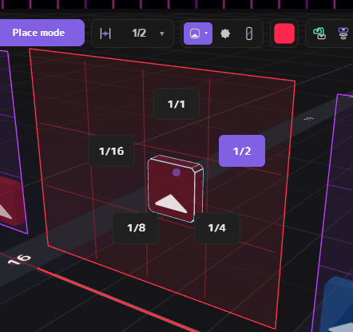

Hold the key, move the mouse toward the item you want, and release the key to choose it.

In the same way, the **W key** opens a pie menu to choose select / note / bomb / wall.

### Editing selected notes without leaving Place mode

Even in Place mode, **point at the selected notes** and press the following keys to edit all selected notes at once.
This saves switching to Camera-lock mode.

| Action | What it does |
|---|---|
| **F** | Swap the color (red ⇄ blue) |
| **Alt + wheel** | Rotate the cut direction |
| **D** | Make them dot notes (no direction) |

When the mouse is not over the selected notes, these change the color / direction of the note you are about to place (the brush), as before.

**Alt + wheel** rotates only through the 8 arrow directions, without the dot.
So when you rotate several selected notes together, their relative directions (for example, left-right symmetry) are kept.
Use the **D key** to make dot notes. Pressing D for the brush switches between the dot and the last arrow direction.

### Fine-tuning the shape of arcs and chains

With an arc or chain selected, combine the wheel with these keys to change its shape.

| Target | Action | What changes |
|---|---|---|
| Arc | **Alt + wheel** | How much the head curves |
| Arc | **Ctrl + Alt + wheel** | How much the tail curves |
| Chain | **Shift + wheel** | Number of slices (links) |
| Chain | **Ctrl + Alt + wheel** | Squish (how far the links are pulled toward the head) |

### Marking sections of the song with markers

**Ctrl + E** places a marker at the mouse position (or at the current beat if the mouse is not over the timeline).
If you put markers at the start of choruses and breaks, you can jump to the previous / next marker with **Ctrl + [ / Ctrl + ]**.

In the top row of the NLE (the marker band), you can drag markers to move them and double-click a name to rename it.
Right-click a marker to also:

- **▶ Set as song preview start**: make the marker position the start of the part played on the song select screen
- Rename / delete it

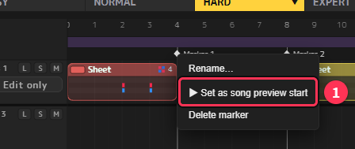

You can also right-click a clip in the NLE → "**Cut at markers**" to split the clip at every marker inside it ([chapter 3](#3-making-the-most-of-the-nle)).

### Customizing shortcuts

You can change the key assignments in the **Shortcuts** tab of **Preferences**.

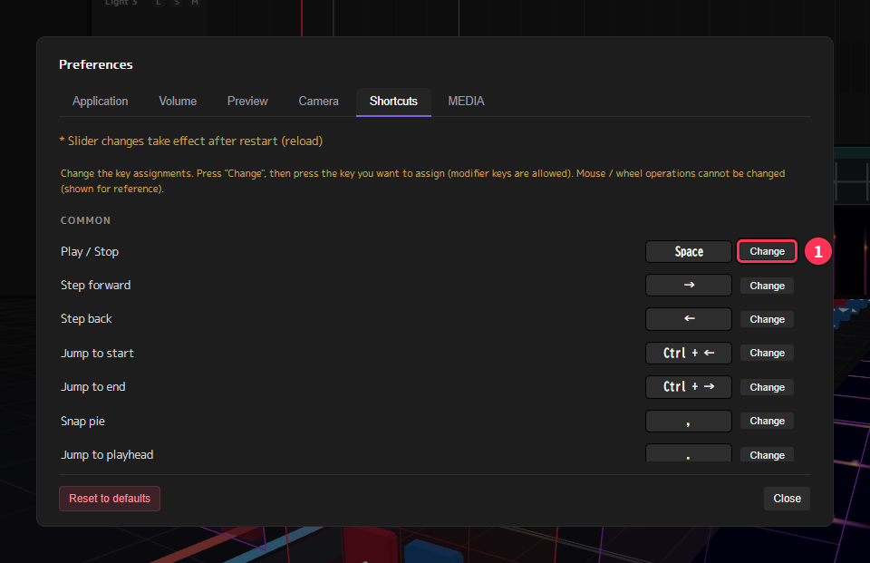

1. Press the **Change** button of the action you want to change
2. Press the new key (combinations with Ctrl, Alt and Shift are possible). Press Esc to cancel

- If the key is already used by another action, its frame turns red to let you know
- Changed actions get a **Default** button so you can reset them one by one. **Reset all to default** resets them all at once
- Only keyboard actions can be changed (mouse and wheel actions cannot)
- The floating shortcut lists on the screen show the keys you assigned
- The assignments are saved with your preferences, so they are kept after restarting the app

<!-- chapter-nav -->
> **Go to chapter:** [1. Working faster](#1-working-faster) ｜ [2. Displays that help placement](#2-displays-that-help-placement) ｜ [3. Making the most of the NLE](#3-making-the-most-of-the-nle) ｜ [4. Making several difficulties efficiently](#4-making-several-difficulties-efficiently) ｜ [5. Songs with tempo changes, and fixing beat offsets](#5-songs-with-tempo-changes-and-fixing-beat-offsets) ｜ [6. Analyzing the song (tempo and structure)](#6-analyzing-the-song-tempo-and-structure) ｜ [7. Advanced lighting](#7-advanced-lighting) ｜ [8. More about the INFO nodes](#8-more-about-the-info-nodes) ｜ [9. Checks before publishing](#9-checks-before-publishing) ｜ [10. Watching your replays (REPLAY)](#10-watching-your-replays-replay) ｜ [11. Responding to review notes](#11-responding-to-review-notes) ｜ [12. Customizing the settings](#12-customizing-the-settings) ｜ [13. Troubleshooting](#13-troubleshooting) ｜ [▲ Contents](#contents)
<!-- /chapter-nav -->

---

## 2. Displays that help placement

These displays help you decide "which way the next swing goes" and "whether the speed is comfortable to play" while placing notes.

### Previous notes display

Outside the placement frame (the red frame in Place mode, the yellow frame in Camera-lock mode), **to its left and right**, there are helper grids
that show the **last red and blue notes you placed**, with their position and direction, semi-transparently.

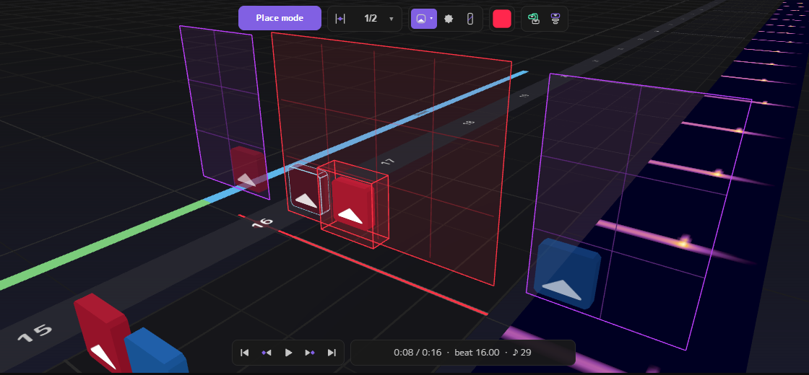

In the image, the left purple frame shows the previous red note (up), and the right purple frame shows the previous blue note.
The note inside the red frame in the middle was placed facing up, the same as the previous red note, so it has the red frame of the "Same-direction warning" described next.

Use it to choose a direction that swings back naturally from the previous note. For example, if the previous blue note was down, the next blue note is naturally up.

- Toggle it with the **H key** (or **Previous notes display** in Preferences)
- When the previous red and blue notes are on the same cell, both are drawn smaller and split diagonally (red = top left, blue = bottom right)

### Same-direction warning

When you place a note whose **cut direction is within 45° of the previous or next note of the same color**, you are told in three ways.
Swinging the same way twice in a row means you cannot swing back, and the flow after it breaks.

- The note gets a **red frame**
- The **SAME DIR** lamp at the top of the screen lights up
- A short warning sound plays

The red frame is on the middle note in the image above, and the lamp is ② in the image in "JD / RT display" below.

Which note gets the red frame:

- When it matches the direction of the previous note, **the note you just placed**
- When it matches the direction of the next note, **the next note** (for example, when you re-placed a note in the middle)

**Click the lamp to jump to the first note with a red frame.**
The red frames and the lamp disappear automatically when you fix the direction or delete the note.

It is not checked in these cases (they are usually intended):

- Dot notes
- Notes less than 1/5 beat apart (treated as one swing, like sliders)
- A bomb between them (treated as a bomb reset)

A chain is treated as one swing from its head to its tail, in the head's direction.

When you rotate selected notes with Alt + wheel or swap their color with F, nothing sounds while you rotate;
they are checked together **when you deselect them**.

If you don't need the warning, turn off **Same-direction warning** in Preferences.

> This warning is a rough guide while placing and is not as strict as the map check in [chapter 9](#9-checks-before-publishing).
> Use the map check before publishing as well.

### JD / RT display

To the right of the BPM field in the header, three values related to how notes appear are shown.

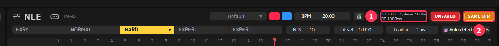

| Display | Meaning |
|---|---|
| **JD** (m) | The distance from where notes appear to where they disappear |
| **player** (m) | The distance from where notes appear to the player position (half of JD) |
| **RT** (ms) | The time from when notes appear until they reach the player position (reaction time) |

They are calculated from BPM, NJS and offset with the same formula as Beat Saber.
This field is display only. To change the values, adjust **NJS** or **Offset** in the header.

- The shorter the RT, the more suddenly notes seem to appear. The longer it is, the earlier you can see them and the easier they are to read, but more notes are on screen at once
- NJS and offset are per difficulty, so the values change when you switch difficulties
- The calculation uses the base BPM of Info.dat (changing the BPM partway with tempo parts does not change this display)

### Spectrogram (frequency display)

When you load a song, the strength of each frequency is shown as a colored band (weak → strong: black → purple → red → orange → white).

- **NLE**: below the waveform in the Music row
- **3D view**: outside the space where you place notes

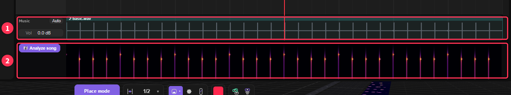

The song in the image is a click track made for the explanation, so vertical lines appear on every beat. In a real song, the whole band gets brighter where the song builds up.

Thick parts like the chorus look bright and quiet parts look dark, so you can grasp the structure of the song at a glance.
It helps you decide where to make the notes dense and where to give the player a rest.

The spectrogram in the NLE follows the Music placement (start position, splits and trims), showing the sound as it is actually played.
When you move or cut the Music clip, it moves together with the waveform (nothing is drawn where there is no sound).

Press the purple **🎼 Analyze song** at the left of the spectrogram in the NLE to show the structure of the song (sections such as intro, verse and chorus) as a band ([chapter 6](#6-analyzing-the-song-tempo-and-structure)).

<!-- chapter-nav -->
> **Go to chapter:** [1. Working faster](#1-working-faster) ｜ [2. Displays that help placement](#2-displays-that-help-placement) ｜ [3. Making the most of the NLE](#3-making-the-most-of-the-nle) ｜ [4. Making several difficulties efficiently](#4-making-several-difficulties-efficiently) ｜ [5. Songs with tempo changes, and fixing beat offsets](#5-songs-with-tempo-changes-and-fixing-beat-offsets) ｜ [6. Analyzing the song (tempo and structure)](#6-analyzing-the-song-tempo-and-structure) ｜ [7. Advanced lighting](#7-advanced-lighting) ｜ [8. More about the INFO nodes](#8-more-about-the-info-nodes) ｜ [9. Checks before publishing](#9-checks-before-publishing) ｜ [10. Watching your replays (REPLAY)](#10-watching-your-replays-replay) ｜ [11. Responding to review notes](#11-responding-to-review-notes) ｜ [12. Customizing the settings](#12-customizing-the-settings) ｜ [13. Troubleshooting](#13-troubleshooting) ｜ [▲ Contents](#contents)
<!-- /chapter-nav -->

---

## 3. Making the most of the NLE

The NLE is a timeline where you arrange the map in **clips** (colored bands).
For songs that reuse the same patterns, such as repeated choruses, copying and arranging clips makes the work much faster.

### Parts of the NLE

From top to bottom, these rows are shown.

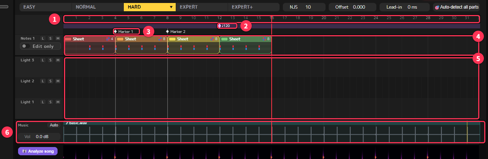

| No. | Row | What you can do |
|---|---|---|
| ① | Number scale (ruler) | Click or drag to move the playback position |
| ② | Tempo part band (purple) | Change the BPM partway through the song ([chapter 5](#5-songs-with-tempo-changes-and-fixing-beat-offsets)). In the image there is a ◆ at beat 12 |
| ③ | Marker band | Move and rename markers ([chapter 1](#marking-sections-of-the-song-with-markers)) |
| ④ | Notes lanes | Clips (colored bands) of notes, bombs, walls, arcs and chains |
| ⑤ | Light lanes | Clips of lights |
| ⑥ | Music | The waveform of the song, with the spectrogram below it. You can change the song volume at its left end ([chapter 5](#song-volume-volume-adjustment)). For **🎼 Analyze song** at the left of the spectrogram, see [chapter 6](#6-analyzing-the-song-tempo-and-structure) |

The **L / S / M** buttons at the left end of each lane are lock, solo and mute (see "Adding lanes, lock, solo and mute" below).
Note lanes also have an **Edit only** strip (switch) below them (see "[Edit only](#edit-only)" below).

A new project starts with one notes lane and three light lanes (as in the image).
You can add lanes by right-clicking, and a lane is also added at the top automatically when you put a clip where there is no free space (see "[Adding lanes, lock, solo and mute](#adding-lanes-lock-solo-and-mute)" below).

**Clips are separate for each difficulty.** When you switch difficulties, the clips of that difficulty are shown instead.
How to copy content to another difficulty is explained in [chapter 4](#4-making-several-difficulties-efficiently).

### Selecting and moving clips

| Action | What it does |
|---|---|
| **Left-click** a clip | Select it |
| **Shift + left-click** | Add to the selection (click again to remove) |
| **Left-drag** from an empty spot | Select all clips inside the box |
| **A** | Clear the selection |
| **Drag** a clip | Move it (selected clips move together) |
| **Drag the left / right edge** of a clip | Change its length |
| **X / Delete** | Delete |

Clips cannot overlap within the same lane.

### Splitting and joining

| Action | What it does |
|---|---|
| Select a clip, point at the beat where you want to split, and press **C** | Split it there |
| **R** | Split mode on / off. While on, clicking a clip splits it at that position |
| Right-click → "**Cut at markers**" | Split at every marker inside the clip |
| Select two or more and press **Ctrl + G** | Join them into one clip |

- The clip after the split gets "'" added to its name and a different color
- **Ctrl + G** joins note clips with note clips and light clips with light clips, even if they are on different lanes or far apart.
  Notes where the clips overlapped in time stay overlapped, so check them with the map check in [chapter 9](#9-checks-before-publishing)

If you put markers at the sections of the song (such as the start of each chorus) and then use "Cut at markers", the clips are split to match the structure of the song.

### Copy and paste

1. Select clips and press **Ctrl + C** (**Ctrl + X** to cut)
2. Press **Ctrl + V** and the clips to be pasted follow the mouse
3. **Click** where you want to paste them (Esc or right-click to cancel)

If you copy several clips, they are pasted keeping their arrangement.

- **Ctrl + Shift + V** is "Paste linked". The pasted clips are linked to the copied ones, so editing the copied clip also changes the pasted one (see "[Linked clips](#linked-clips)" below)
- You can also switch to another difficulty before pasting. Then a dialog asks whether to **Link** to the copied clips or **Don't link (normal paste)**

### The right-click menu of a clip

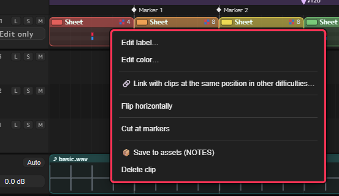

| Item | What it does |
|---|---|
| Edit label… | Rename the clip ("Chorus 1", etc.) |
| Edit color… | Change the color of the clip (you can also click the small color square at the top left of the clip) |
| 🔗 Link with clips at the same position in other difficulties… | See "[Linking across difficulties](#linking-across-difficulties)" below |
| **Flip horizontally** | Mirror the content left-right and swap red and blue |
| Cut at markers | See "Splitting and joining" above |
| **📦 Save to assets** | See "Assets" below |
| Delete clip | Delete the clip |

When two or more clips are selected, the menu also has **🔗 Link**, and linked clips have items such as **Unlink** (see "Linked clips" below).

Right-click an empty spot to get **Create empty clip** (16 beats) and **Create marker** (and **🔗 Paste linked** if you have copied clips).

> **Example: making the second chorus**
> Ctrl + C the clip of the first chorus → Ctrl + V at the second chorus → right-click → "Flip horizontally".
> Just swapping the left and right of the same pattern gives the second chorus some variation.

### Adding lanes, lock, solo and mute

A new project starts with one notes lane and three light lanes.
You can change the number of notes lanes for new projects with "**Note lanes**" in Preferences ([chapter 12](#application)).

Right-click an empty spot at the left end of the lanes to **add or remove a lane at the top**, for notes and for lights.

- Up to 10 lanes
- You can remove a lane only when the top lane is empty (including in the other difficulties)
- The number of lanes is shared by all difficulties
- Adding or removing a lane can be undone with **one Ctrl + Z** (the clip positions in all difficulties are restored too)

**When there is no free space, a lane is added at the top**

In the following cases, if the lanes where the clip would go are full, one lane is added at the top and the clip goes there (the existing clips move down one lane).

- When you place notes and so on in the 3D view (when there is neither a clip to put them in at that beat nor room to create a one-bar clip)
- When you drag a map or an asset clip from MEDIA into the NLE
- When you paste clips in the NLE (the clips that will go into the added lane show "＋" before their names while you move them)

If there are already 10 lanes, no lane is added and a message at the bottom of the screen tells you. An added lane is undone with Ctrl + Z together with the operation.

**Vertical scroll bars**

When there are too many lanes to show at once, vertical scroll bars appear for the notes lanes and the light lanes, at the **right end** and at the **left end** of the NLE (the thin strip to the left of the lane names).
The left and right scroll bars always point to the same position, so you can use either.

- Drag the thumb, or click an empty part of the scroll bar, to move there
- Turn the wheel over a scroll bar to move about one lane at a time

Point at a lane and press one of these keys (or click the buttons at the left end of the lane) to change its state.

| Key | State | What it does |
|---|---|---|
| **L** | Lock | The content is dimmed and cannot be selected or edited in the 3D view |
| **M** | Mute | The content is not shown in the 3D view |
| **S** | Solo | Only that lane is shown in the 3D view |
| **E** | Edit only | Note lanes only. Notes you place in the 3D view go only into that lane, and other lanes cannot be edited (see "[Edit only](#edit-only)" below) |

Mute and solo **only change what is shown**. The export always includes the content of every lane.
Locking the note lanes while making lights prevents you from moving notes by accident.
Lane states are saved with the project.

### Edit only

Makes only one note lane editable.
When you build up patterns in separate lanes, it prevents you from moving notes in another lane by accident, or placing notes in a different lane than you meant.
A new project has only one notes lane, so to use separate lanes, [add lanes](#adding-lanes-lock-solo-and-mute) first.

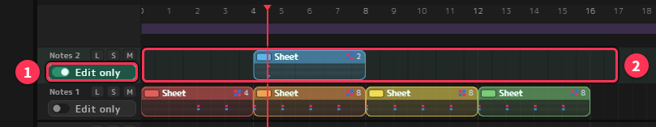

| No. | Name | Description |
|---|---|---|
| ① | Edit only switch | The strip at the left end of a note lane, below the name and L / S / M. Click anywhere on the strip to switch it. It turns green when on; click again to turn it off |
| ② | Edit only lane | Everything you place in the 3D view goes into this lane |

The image shows a notes lane added at the top (Notes 2), set to Edit only, with notes placed around beat 4.
Notes 1 below has the clips of the notes placed earlier.

- You can also point at a note lane in the NLE and press **E** to turn it on or off (**Ctrl + E** adds a marker, which is a different action)
- Only one lane can be Edit only at a time. Turning it on for another lane turns it off for the previous one
- While it is on, everything you place or paste in the 3D view (notes, bombs, walls, arcs and chains) goes into that lane.
  If that lane has no clip where you place it, a one-bar clip is created for it
- Notes in other lanes are dimmed as if locked, and cannot be selected or moved
- Lanes are shared by all difficulties, so the same lane stays Edit only when you switch difficulties
- Light lanes don't have it (it has no effect in LIGHTING mode)

**When you click a note in another lane**

Clicking a note in another lane in the 3D view changes nothing by itself; a band (①) appears at the top of the view.

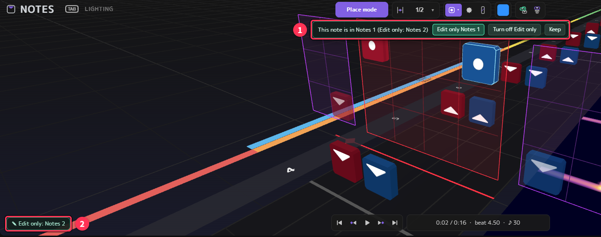

| Button | What it does |
|---|---|
| **Edit only Notes 1** | Make the lane of the clicked note Edit only |
| **Turn off Edit only** | Stop Edit only (you can place notes in any lane again) |
| **Keep** | Close the band |

- While Edit only is on, the bottom left of the 3D view shows "✎ Edit only: Notes 2" (②)
- When you select by dragging a box, notes in other lanes are left out of the selection without the band (the number left out is shown briefly in the indicator at the bottom left)
- Turning on Edit only for a locked lane unlocks it
- If the Edit only lane is locked or muted, or hidden by another lane's solo, nothing is placed when you try; a message at the bottom of the screen tells you why
- Which lane is Edit only is saved with the project (just switching it doesn't mark the project as unsaved, and it is not part of Ctrl + Z)

### Linked clips

When you **link** clips that should have the same content, editing one place changes all of the linked clips.
Use it for repeated choruses, or for patterns you want to keep the same across difficulties.

- Of the linked clips, only the **parent** can be edited. The others are **children** and always have the same content as the parent
- Edits to the parent, such as placing, deleting or moving notes or flipping it horizontally, go into the children as well
- The name and color are the same for all linked clips (changing them on any clip changes all of them)
- You can also link with clips in other difficulties (see "[Linking across difficulties](#linking-across-difficulties)" below)
- Note clips can be linked with note clips, and light clips with light clips (notes and lights can't be mixed)

#### Linking

1. Select the two clips you want to link (click → **Shift + click**)
2. Press **K** (or right-click → "**🔗 Link (K)**")
3. In the dialog, choose which one is the parent and press **Link**

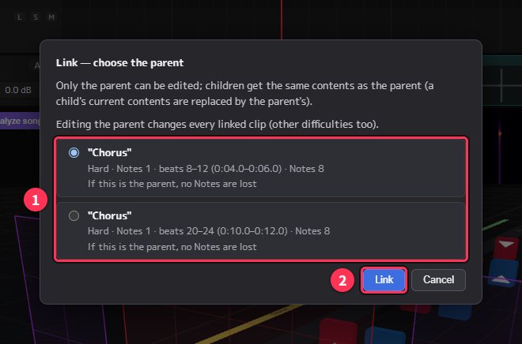

| No. | Name | Description |
|---|---|---|
| ① | Parent candidates | The clip name, plus difficulty, lane, beat range (song time) and the number of notes. The earlier clip is selected at first |
| ② | Link | Link the clips with the selected one as the parent |

- The current content of the clip that becomes the child is replaced by the parent's. If the two have different content, red text such as "If this is the parent: Notes lost: Hard 8" appears under the candidate
- Two clips can be linked even if their positions from the start of the bar differ (for example, beat 8 and beat 21); the dialog mentions it
- Only two clips can be newly linked at a time. To add more, select them together with a linked clip (parent or child) and press K; they join that link as children
- Selecting clips of two separate links and pressing K lets you choose a parent and merge them into one link (all clips of the other link, parent and children, become children of the chosen parent)

**Paste linked**

Select a clip, press **Ctrl + C** → **Ctrl + Shift + V**, and **click** where you want to paste it; the pasted clip is linked to the copied one
(right-clicking an empty spot → "**🔗 Paste linked**" does the same).

- If the copied clip is not linked yet, the copied clip becomes the parent and the pasted one its child
- If the copied clip is a child, the pasted clip becomes a child of its parent
- Clips cut with **Ctrl + X** can't be pasted linked, because the original no longer exists

> **Example: fixing every chorus in one place**
> Select the clip of the first chorus and press Ctrl + C → Ctrl + Shift + V at the second and third choruses.
> When you later edit the first chorus (the parent), the same edits go into the second and third.
> If you want to change only the second one, unlink that clip first and then edit it.

#### Telling parents and children apart

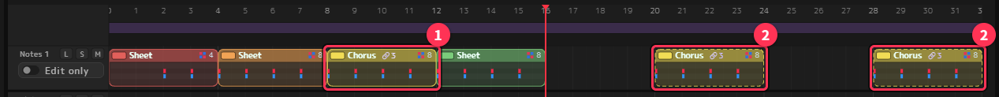

| No. | Name | Description |
|---|---|---|
| ① | Parent | 🔗 and the number of linked clips appear to the right of the name. If there are children in other difficulties too, something like "also in other diffs: 1" follows |
| ② | Children | Drawn with a dashed border. Same content as the parent; they can't be edited here |

The image shows the "Chorus" at beat 8 as the parent, with children at beats 20 and 28 (🔗3 = three clips are linked).

#### Children can't be edited

The notes and lights inside a child can't be selected or moved in the 3D view (they are dimmed like a locked lane).
If you click a note of a child, or try to place a note inside a child, nothing changes by itself; a band (①) appears at the top of the view.

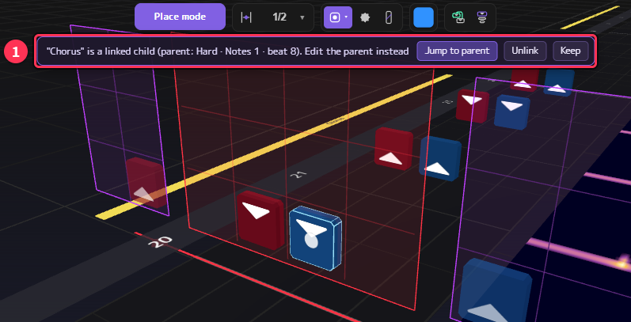

| Button | What it does |
|---|---|
| **Jump to parent** | Select the parent clip and move the playback position to its start (if the parent is in another difficulty, switch to it) |
| **Unlink** | Unlink this clip and make it a normal clip (its content stays) |
| **Keep** | Close the band |

- In the NLE, you also can't **flip** a child horizontally or **trim its left edge** (the same band appears). You can drag its right edge to change its length
- The part of a child that is longer than the parent is drawn with diagonal lines and has no content
- When you edit a parent that has children in other difficulties, a band tells you that the clip "is also linked to other difficulties (Expert). Editing the parent changes every linked clip" (once per link)

#### The right-click menu of linked clips

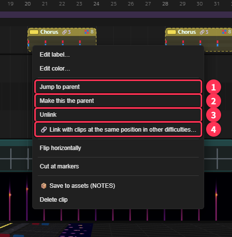

| No. | Item | What it does |
|---|---|---|
| ① | Jump to parent | Shown only for children. Same as the band above |
| ② | Make this the parent | Shown only for children. Makes this clip the new parent (the previous parent becomes a child) |
| ③ | Unlink | Unlink this clip. If several linked clips are selected, unlinks them all (shown as "Unlink (2)") |
| ④ | 🔗 Link with clips at the same position in other difficulties… | See "Linking across difficulties" below |

#### Unlinking and deleting clips

- An unlinked clip becomes a normal clip with a copy of the parent's content at that moment
- When only one clip is left in a link, the link is removed automatically
- **If you delete the parent or unlink it and two or more clips remain, a dialog asks you to choose the next parent** (they all have the same content; see the image below)
- While clips are linked, they can't be **split** (C, split mode, Cut at markers) or **joined** (Ctrl + G).
  When you try to split, a band appears; press [Unlink] and then split
- A difficulty that has clips linked with other difficulties can't be emptied with "Delete all notes" and the like in the difficulty menu (unlink them first)

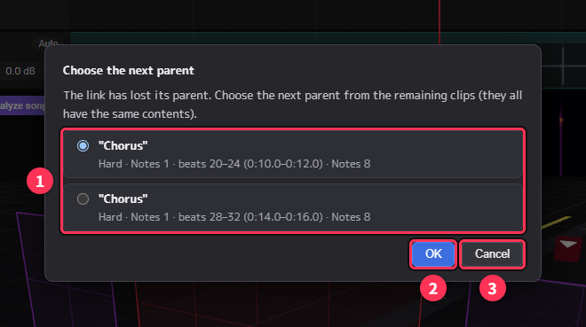

| No. | Name | Description |
|---|---|---|
| ① | Next parent candidates | The remaining clips. The top candidate is selected at first |
| ② | OK | Make the selected clip the next parent (Enter does the same) |
| ③ | Cancel | Undo the whole operation that brought up the dialog (Esc does the same) |

The image shows the parent (Chorus) at beat 8 selected and deleted with Delete. Two children remain, so the dialog asks for the next parent.

Press **Cancel**, and the operation that brought up the dialog (deleting or cutting the parent clip, unlinking, or a Send / Receive between difficulties that removed a parent in the destination) is cancelled as a whole, and everything returns exactly to how it was before (clips and links in other difficulties too).

- The cancelled operation does not come back with redo (Shift + Ctrl + Z) either
- If dialogs appear one after another for two links, pressing Cancel in either one cancels the whole operation

#### Linking across difficulties

Links can span difficulties. For example, if an Expert+ clip is the parent and the same clip in Expert is its child,
editing Expert+ also changes Expert. There are three ways to make such links.

| Method | Description |
|---|---|
| **Send / Receive** in the difficulty menu | If you copy with "**Link to the parent difficulty**" (on by default) left on in the confirmation dialog, each clip in the destination becomes a child of the same clip in the source ([chapter 4](#opening-the-send--receive-menu)) |
| **Pasting** into another difficulty | Pasting clips copied in another difficulty with Ctrl + V shows a dialog to choose **Link** or **Don't link (normal paste)**. Link makes them children of the copied clips. Ctrl + Shift + V links without the dialog |
| Right-click → "**🔗 Link with clips at the same position in other difficulties…**" | Lists the clips in other difficulties with the same beat, lane and length. The clips in the checked difficulties become children of this clip (or of its parent, if it is linked) |

- If the source or copied clip is a child, the new clips are linked to its parent
- When linking or unlinking changes other difficulties too, **one Ctrl + Z** undoes it in all difficulties

### The Music clip

Right-click the Music row to create **clips as long as the song** (notes and lights, notes only, or lights only) in one go.
You can also make the whole song in one clip and split it later with "Cut at markers".

You can also select the Music and split it with C, or delete part of it with X / Delete (for example, to cut off the fade-out at the end).
Split Music clips can be joined again by selecting two or more and pressing Ctrl + G.

### Assets (saving patterns to reuse)

Right-click a clip → "**📦 Save to assets**" to save its content as a reusable part.

- Saved assets appear in the **MEDIA** list. Drag one onto a lane in the NLE to place it there as a clip (if there is no free space, a lane is added at the top)
- You can use them in other projects and other songs
- Right-click an asset in MEDIA to rename it
- Assets are saved as `.nlmclip` files in the `asset` folder of the app

Saving rhythm patterns and light effects you use often as assets is handy when you start a new song.

### MEDIA library (record song folders, then list and search them)

When you register Beat Saber's CustomLevels (the folder that holds your downloaded songs) or a music folder in MEDIA,
you can list and search the songs in it, and drag their maps and audio into the NLE as material.
For example, you can borrow patterns from your earlier maps, or find maps of similar difficulty and compare their NJS and NPS.

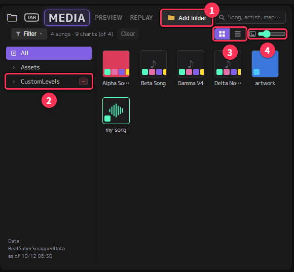

| No. | Name | Description |
|---|---|---|
| ① | Add folder | Choose a folder to add to the library |
| ② | Catalog | The list of registered folders. Only the songs in the chosen folder are listed (**All** shows everything; **Assets** are the [assets](#assets-saving-patterns-to-reuse) above) |
| ③ | View switch | Switch between the grid (cover images) and the detail view (a table with one row per difficulty) |
| ④ | Size | The size of the cover images in the grid, or the text size in the detail view (**Ctrl + wheel** over the list also works) |

#### Adding folders

Use ① **Add folder** (or **Add folder to MEDIA…** in the File menu) and choose a folder.
If you choose a folder that holds many song folders, such as CustomLevels, all the songs in it are loaded.

- In the desktop version (exe), the chosen folder is **recorded** and loaded automatically the next time you start the app
- The first load takes a while, depending on the number of songs (the progress appears as "Loading 12/85" where the count is shown, and as "12/85" in the catalog).
  From the second time on, only the songs that changed are read again, so it is faster
- When you add or delete songs, right-click the folder in the catalog → "**🔄 Reload**"
- Double-click a folder name in the catalog to change the name shown there (the folder itself is not renamed)
- **−** at the right of a folder removes it from the library (and from the record; the files in the folder are not deleted)
- If a folder cannot be found (for example, an external drive is unplugged), it is shown dimmed. The record is kept; click it to look again
- NLM only reads the library folders and never writes to them
- Drag the border between MEDIA and the NLE, or between the catalog and the list, to change their widths (double-click the catalog border to reset its width)

> In the **browser version** (started with `serve.py`), added folders are not recorded and disappear when you reload.
> The detail view also shows only what is written in Info.dat; NPS, length, upload date, play records and so on are available only in the desktop version.

#### Detail view (one row per difficulty)

Switch to the detail view with ③ to see a table with one row per difficulty. The screenshot shows a widened MEDIA, sorted by ★ from high to low.

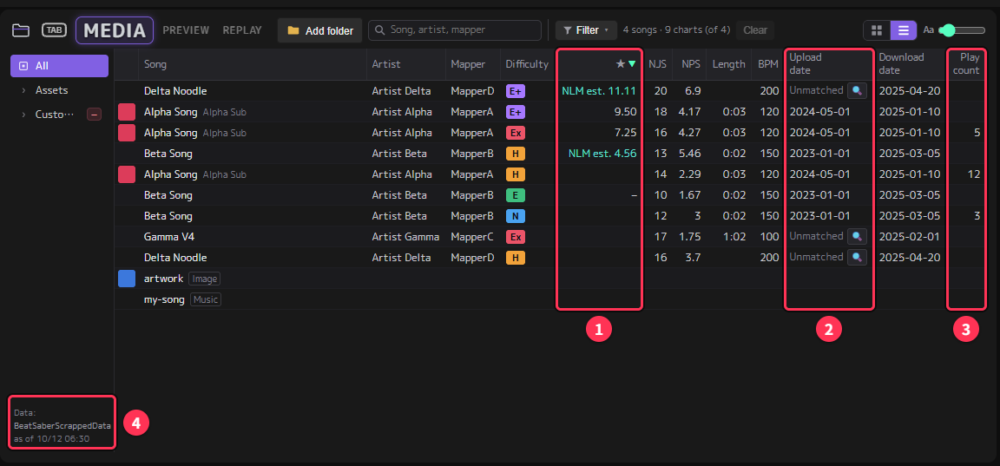

| No. | Column / place | Description |
|---|---|---|
| ① | ★ | The BeatLeader ★. For difficulties without one, an approximation calculated by NLM appears in a different color, such as "**NLM est. 4.56**" ([below](#calculating--nlm-estimate)). The ▼ in the heading means the list is sorted by this column |
| ② | Upload date | The day the song was uploaded to BeatSaver (from the [song data](#data-from-the-internet-song-data-and-beatsaver)). Songs that are not in the song data show "**Unmatched 🔍**" |
| ③ | Play count | How many times you played that difficulty in Beat Saber (from the [play records](#game-play-records)) |
| ④ | Data source | While the song data is in use, its name and date appear here (hover for details) |

The columns shown at first are: cover, song (with subtitle), artist, mapper, difficulty (with the mode name if not Standard), ★, NJS, NPS, length, BPM, upload date, download date and play count.

- **NPS** is calculated the same way as on BeatSaver (the number of color notes ÷ the seconds from the first to the last color note)
- **Length** is the length of the audio
- **Download date** is the date that mods record in the song folder (if there is none, it is estimated from the folder dates)
- Click a row to select it, **Ctrl + click** to add rows, and **Shift + click** to select a range
- Items that are not songs (music files, images, asset clips) show only their name and kind
- The view, columns, sort order and filter conditions are kept for the next start

#### Sorting and columns

- Click a heading to sort by that column. Click it again to reverse the order (▲ smallest first, ▼ largest first)
- Rows without a value always go to the bottom, in either order
- The sort order is also used for the order of the cards in the grid
- Right-click a heading to open a menu where you show or hide columns. **Reset columns** returns to the initial columns

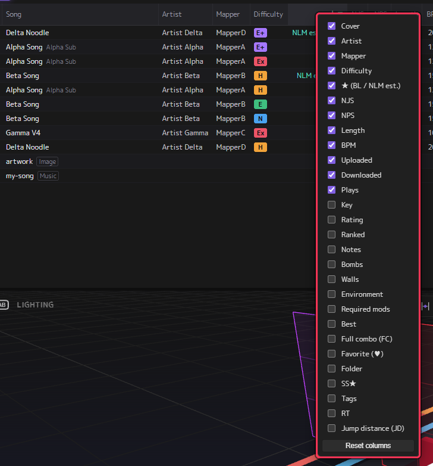

The columns hidden at first are: key (BeatSaver), rating, ranked status, notes, bombs, walls, environment, required mods, best score, full combo,
favorite, folder, SS★ (ScoreSaber ★), tags, reaction time (RT) and jump distance (JD)
(RT and JD are calculated from NJS, offset and BPM with the same formula as in [chapter 2](#jd--rt-display)).

#### Search and filter

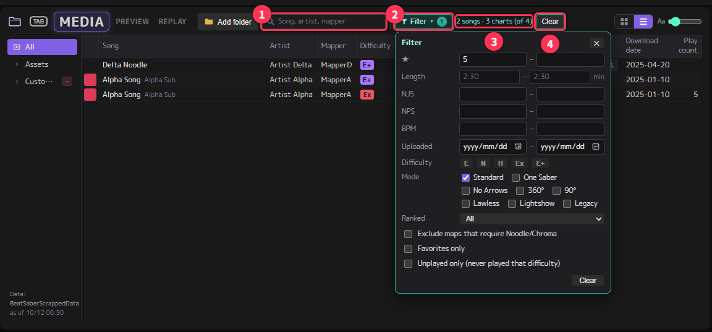

| No. | Name | Description |
|---|---|---|
| ① | Search box | Search by song, artist or mapper. The list is filtered as you type (Esc or × clears it) |
| ② | Filter ▾ | Opens the panel of conditions. The number in the circle is the number of active conditions |
| ③ | Count | The number of songs and difficulties that match. "of 4" is the number of songs in the range chosen in the catalog |
| ④ | Clear | Clears the search and all conditions |

| Condition | Content |
|---|---|
| ★, Length, NJS, NPS, BPM, Uploaded | Lower and upper limits (empty means no limit). Length is in minutes ("2:30" means 2 minutes 30 seconds). ★ uses the BeatLeader ★, or the NLM-estimated ★ when there is none |
| Difficulty | Choose from E, N, H, Ex and E+ (all when none is chosen) |
| Mode | Standard, One Saber, No Arrows, 360°, 90° and so on (only Standard at first) |
| Ranked | All / BL ranked (difficulties ranked on BeatLeader) / Unranked |
| Exclude maps that require Noodle/Chroma | Excludes maps that cannot be played without Noodle or Chroma (mods). Maps that only suggest them are not excluded |
| Favorites only | Only songs you marked as favorites in Beat Saber (from the [play records](#game-play-records)) |
| Unplayed only | Only rows whose difficulty you have never played (from the play records) |

- The conditions are checked for each difficulty (row). The grid shows the songs that have at least one matching difficulty
- With a range condition, rows without that value (such as maps without ★) are left out
- The initial mode setting (only Standard) is not counted in the number in the circle

#### Putting maps into the NLE

A song (a card in the grid or a row in the detail view) is used as follows, depending on where you drag it. It goes into the difficulty you have open.

| Drop on | What goes in |
|---|---|
| A Notes lane of the NLE | The notes of that difficulty (including bombs, walls, arcs and chains), as one clip at the beat where you drop it |
| A Light lane of the NLE | The lights of that difficulty, as a clip |
| The Music row of the NLE | The audio of the song, at the beat where you drop it |
| The INFO screen | Song info and cover image nodes (plus a song preview node if the song has a preview range) |

- Dragging a row of the detail view puts in **the difficulty of that row** (for example, you can put an Expert map into Hard).
  Even when several rows are selected, only the row you grabbed goes in
- A card in the grid puts in the map with the same name as the difficulty you have open. While you filter, it is chosen from the matching difficulties
  (if there is no difficulty with the same name, the hardest matching one. The message at the bottom of the screen tells you which one went in)
- When you drop on a Notes or Light lane and the lanes are full where it would go, a lane is added at the top for it ([adding lanes](#adding-lanes-lock-solo-and-mute))
- When you drop on a Notes lane, the NJS and offset of the current difficulty also become those of the map you put in
- Right-click a song → "**📥 Load song data**" loads the audio, BPM, song info, cover image and the maps of all Standard difficulties at once
  (if a song is already loaded, the audio and BPM stay as they are)
- Right-click a song → "**📁 Open folder location**" opens the song folder in Explorer (only for folders added in the desktop version)

> Songs with **v4 maps** (Info.dat in the newer format) can also be put into the NLE (dragging or Load song data).
> NLM still exports in the v3 format, so **NJS events** (which v3 doesn't have) and **light boxes** (which NLM can't read) are lost on export
> (NLM tells you when loading and when exporting). The map check uses the NJS events, and skips the lighting checks for difficulties that had light boxes.

#### Messages after loading song data

"📥 Load song data" converts other people's maps (v2, v3 and v4 formats) into NLM's form as it loads them.
Maps with many lights take a few seconds, and meanwhile the progress is shown, such as "Loading audio…" and "Loading map… Expert (2/3)".

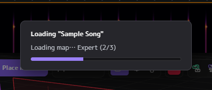

When the map has things NLM can't handle, or NLM changed how something is loaded, a message appears at the bottom of the screen after loading.

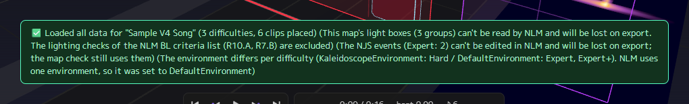

| Message | Meaning |
|---|---|
| The BPM changes differ between difficulties, so the beats of … were converted to the shared tempo | NLM uses one tempo for all difficulties. It uses the tempo shared by the most difficulties and converts the beats of the others so that their timing stays the same. The beats of converted difficulties differ from the original map's beats (review notes can still be loaded with the original beats; [chapter 11](#retimed-difficulties)) |
| The environment differs per difficulty (…). NLM uses one environment, so it was set to … | NLM uses the environment shared by the most difficulties |
| Not loaded: the difficulties other than Standard — OneSaber 2 … | NLM only makes Standard maps |
| This map's light boxes (N groups) can't be read by NLM and will be lost on export… | Light boxes (the newer lighting system introduced in v3) can't be shown or edited in NLM. The lighting checks (R10.A, R7.B) of the NLM BL criteria list become manual checks |
| The NJS events (…) can't be edited in NLM and will be lost on export… | NJS events of a v4 map. They can't be written in the exported v3 format, but the NLM BL criteria list still uses them |
| Converting the tempo in AudioData.dat to NLM's tempo is off by up to … ms | The error when converting a v4 map's tempo to NLM's BPM. If it is large, check with the metronome ([chapter 5](#5-songs-with-tempo-changes-and-fixing-beat-offsets)) |
| Not loaded: N object(s) of the v4 chart whose data index doesn't match | Data in the map file that points to nothing. It has to be fixed in the original map |

- The environment (stage) of the loaded map is carried over to the export (if a song is already loaded, the current environment stays)
- If the environment is not available in the 3D preview, **⚠** appears next to the environment name at the top of the screen and the preview shows Default (the export keeps the original environment)

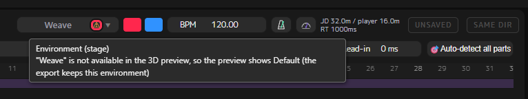

- When exporting, NLM also tells you if things from the original map that NLM can't handle (light boxes, NJS events) were not exported
- When all difficulties together have 150,000 lights or more, "This project has N lights in total" appears once when loading (and when opening the project) ([chapter 13](#a-message-says-there-are-many-lights))

#### Data from the internet (song data and BeatSaver)

The upload date, rating, ranked status, ★ (BeatLeader and ScoreSaber) and tags come from the internet.

- **Song data**: [BeatSaberScrappedData](https://github.com/kinsi55/BeatSaberScrappedData) published by Kinsi
  (public BeatSaver, BeatLeader and ScoreSaber data compiled into one file, also used by some Beat Saber mods) is downloaded from jsDelivr **at most once a day**.
  Nothing is sent from your PC when it is downloaded
- Songs are matched by an identifier (hash) made from the map files. If your copy differs from the current version on BeatSaver (an older version before an update, for example),
  the ★ and ranked status are not shown (they belong to another version)
- While the song data is in use, its name and date appear below the catalog (④ in the detail view screenshot)
- Turn off "Download the song data" in the **MEDIA** tab of Preferences to stop downloading it and hide it from the list ([chapter 12](#media))

Songs that are not in the song data (songs uploaded very recently, for example) show "**Unmatched 🔍**" in the upload date column.
Press 🔍 to see a confirmation; only when you press **Send** is the identifier (hash) of that one song sent to BeatSaver (api.beatsaver.com) to look it up.

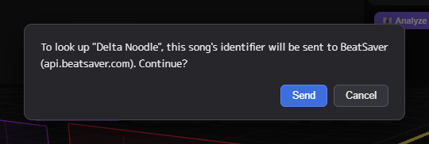

- If the song is found, its values are filled in and 🔍 disappears (hover over values taken directly from BeatSaver to see "From BeatSaver")
- Songs that are not on BeatSaver either (your own maps that you have not uploaded, for example) show "Not found on BeatSaver either", and 🔍 stays
- To keep the load on BeatSaver's servers low, there is no way to look up many songs at once. Songs are looked up one at a time, when you press 🔍.
  When BeatSaver is busy, you are asked to wait a number of seconds
- 🔍 appears only while the song data is in use

#### Game play records

In the desktop version, NLM reads the play records (`PlayerData.dat`) that Beat Saber keeps on your PC,
and shows the play count, best score, full combo and favorites in the list (best score, full combo and favorite are hidden columns at first).

- NLM only reads the play records; it never changes them and never sends them to the internet
- They are usually found automatically. If not, choose the file with **Choose file…** in the **MEDIA** tab of Preferences ([chapter 12](#media))
- They are read again when the library is loaded and on "Reload", if the file has been updated

#### Calculating ★ (NLM estimate)

Maps that are not ranked on BeatLeader have no ★.
If you have installed the add-on plugin (nlm-rating) used by "Estimate difficulty" in [chapter 9](#the-first-time-install-the-plugin),
NLM can calculate an approximate ★ and show it in the ★ column.

Right-click a row in the detail view and choose one of the following.

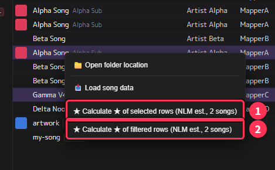

| No. | Item | Songs to calculate |
|---|---|---|
| ① | ★ Calculate ★ of selected rows (NLM est.) | The songs of the selected rows (select several with **Ctrl / Shift + click**) |
| ② | ★ Calculate ★ of filtered rows (NLM est.) | The songs of the rows now in the list (narrowed by the search and filter) |

- Only songs that have a difficulty without an official ★ are calculated (songs already calculated by NLM, and songs outside the folders added in the desktop version, are skipped).
  The number in the parentheses is the number of songs to calculate
- The calculation is done per song, for all its difficulties at once. Each song takes one to a few seconds
- While it runs, "Calculating ★ 3/12" appears at the top of MEDIA; press **Stop** to stop it. With more than 30 songs, you are asked before it starts
- The results appear in the ★ column in a different color, such as "**NLM est. 7.12**". They are also used for sorting and filtering by ★
- The results are recorded and still shown after you restart the app (after you update the plugin, the results of the old version are no longer used and can be calculated again)
- Difficulties with fewer than 20 notes cannot be calculated ("–"). Hover over the cell to see why a calculation failed
- The number of songs calculated at the same time can be changed in the **MEDIA** tab of Preferences ([chapter 12](#media))
- If the plugin is not installed, NLM tells you how to install it (with **Install from GitHub** in the "Estimate difficulty" panel)

> **The NLM-estimated ★ is not the official BeatLeader ★.** It is an approximation that NLM calculates with the plugin, and it can differ from the value on the BeatLeader site.
> It is labeled "NLM est." and shown in a different color so that you don't mistake it for the official ★.

<!-- chapter-nav -->
> **Go to chapter:** [1. Working faster](#1-working-faster) ｜ [2. Displays that help placement](#2-displays-that-help-placement) ｜ [3. Making the most of the NLE](#3-making-the-most-of-the-nle) ｜ [4. Making several difficulties efficiently](#4-making-several-difficulties-efficiently) ｜ [5. Songs with tempo changes, and fixing beat offsets](#5-songs-with-tempo-changes-and-fixing-beat-offsets) ｜ [6. Analyzing the song (tempo and structure)](#6-analyzing-the-song-tempo-and-structure) ｜ [7. Advanced lighting](#7-advanced-lighting) ｜ [8. More about the INFO nodes](#8-more-about-the-info-nodes) ｜ [9. Checks before publishing](#9-checks-before-publishing) ｜ [10. Watching your replays (REPLAY)](#10-watching-your-replays-replay) ｜ [11. Responding to review notes](#11-responding-to-review-notes) ｜ [12. Customizing the settings](#12-customizing-the-settings) ｜ [13. Troubleshooting](#13-troubleshooting) ｜ [▲ Contents](#contents)
<!-- /chapter-nav -->

---

## 4. Making several difficulties efficiently

When you make several difficulties, it is faster to finish one difficulty first, copy its content to another difficulty and then adjust it.

### Opening the send / receive menu

Among the difficulty buttons at the top of the screen (EASY to EXPERT+), **click the button of the difficulty that is already selected** to open a menu.

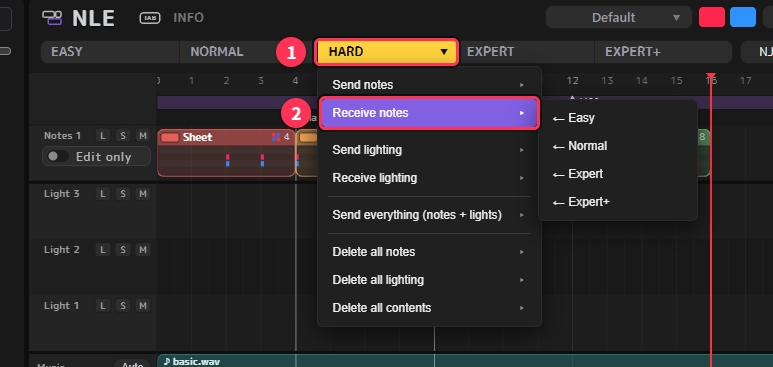

| Item | What it does |
|---|---|
| **Send notes** → destination | Copy the notes and the note clips of this difficulty to the chosen difficulty |
| **Receive notes** ← source | Copy the notes and the note clips of the chosen difficulty to this difficulty |
| Send lighting / Receive lighting | The same for lights and light clips |
| Send everything (notes + lights) | Copy both notes and lights (and the clips of both) |
| Delete all notes / Delete all lighting / Delete all contents | Delete the content of this difficulty |

- "Notes" also include bombs, walls, arcs and chains
- Only the chosen kind is copied. For example, "Send lighting" doesn't touch the notes and note clips of the destination (also when the destination has never been opened)
- Copying **replaces the content and clips of the same kind in the destination** (it does not add to them). The arrangement of those clips in the NLE becomes the same as in the source
- Only the content is copied. NJS and offset keep each difficulty's own values
- Every Send and Receive can be undone with **one Ctrl + Z** (see "Can it be undone?" below)
- The delete items ask for confirmation first. Only the content is deleted; the clip frames in the NLE stay (can be undone with Ctrl + Z)

### The confirmation before copying (link to the parent difficulty)

When you choose the destination or source of Send / Receive, a confirmation dialog appears before copying. If the destination has content, it says something like "⚠ The current Notes in Expert will be replaced".

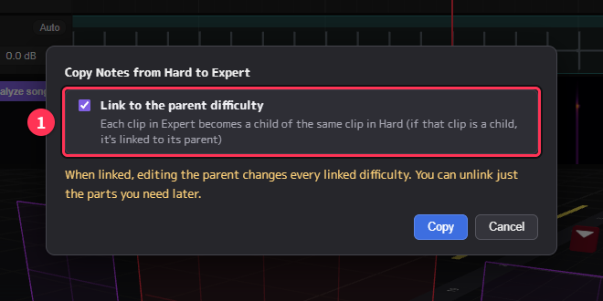

If you press **Copy** with **Link to the parent difficulty** (①, on by default) left on, each clip in the destination becomes a **child** of the same clip in the source
([Linked clips](#linked-clips)).

- After that, editing the source (the parent) also changes the destination. The destination clips can't be edited there
- Empty clips also become children in the destination when linked (notes you later place in the parent go into the destination too)
- To change only some parts in the destination, unlink just those clips and then edit them
- If you plan to rework the whole destination, uncheck ① before pressing **Copy** (it becomes a normal copy)

> **Can it be undone?**
> For both Send and Receive, whether ① is on or off, **one Ctrl + Z** undoes the copy in all difficulties, including the destination and the source (the links added to it).
> The same applies when you send to a difficulty that is not on screen (if the destination had no content yet, it becomes empty again).

### Example: making Expert from Expert+

1. Finish Expert+
2. Switch to Expert with the **4 key** (or the EXPERT button)
3. Click the EXPERT button again → "**Receive notes**" → "**← Expert+**"
4. In the confirmation dialog, uncheck "**Link to the parent difficulty**" and press **Copy** (because you will rework most clips in Expert)
5. Thin out the notes and make the hard parts easier for Expert (if it goes wrong, Ctrl + Z returns to before receiving)
6. Set Expert's **NJS and offset** in the header (while watching JD / RT in [chapter 2](#jd--rt-display))
7. Continue the same way to the lower difficulties: Expert to Hard, Hard to Normal, …

> If, on the other hand, many parts (such as the intro) should stay the same between difficulties, you can copy with the link on and unlink only the clips you change.

Finally, use "Estimate difficulty" in [chapter 9](#9-checks-before-publishing) to check that higher difficulties have higher ★.

### Copy the lights at the end

Lights often don't need to differ between difficulties, so finish them in one difficulty and then
copy them to the others with "**Send lighting**" to save effort.
Only the lights are copied, so the notes of the destination stay as they are.

If you send them with "**Link to the parent difficulty**" left on in the confirmation dialog, the lights in the destination become children of the source lights.
When you later edit the source lights, the other difficulties change automatically, so you don't need to send them again.
(If you sent them with the link off, send them again whenever you change the lights. Editing only the notes doesn't require copying the lights again.)

Lights made with [auto lighting](#auto-lighting-making-lights-from-the-notes) (chapter 7) are added to every difficulty from the start, so no sending is needed.

### Emptying difficulties you won't publish

Every difficulty with content (notes or lights) is exported.
If you don't want to publish an unfinished difficulty, open it and empty it with "**Delete all contents**".
If you might continue it later, keep it first as a separate project with "Save As…" before emptying it.
If it has clips linked with other difficulties, it can't be emptied; unlink them first ([Linked clips](#unlinking-and-deleting-clips)).

<!-- chapter-nav -->
> **Go to chapter:** [1. Working faster](#1-working-faster) ｜ [2. Displays that help placement](#2-displays-that-help-placement) ｜ [3. Making the most of the NLE](#3-making-the-most-of-the-nle) ｜ [4. Making several difficulties efficiently](#4-making-several-difficulties-efficiently) ｜ [5. Songs with tempo changes, and fixing beat offsets](#5-songs-with-tempo-changes-and-fixing-beat-offsets) ｜ [6. Analyzing the song (tempo and structure)](#6-analyzing-the-song-tempo-and-structure) ｜ [7. Advanced lighting](#7-advanced-lighting) ｜ [8. More about the INFO nodes](#8-more-about-the-info-nodes) ｜ [9. Checks before publishing](#9-checks-before-publishing) ｜ [10. Watching your replays (REPLAY)](#10-watching-your-replays-replay) ｜ [11. Responding to review notes](#11-responding-to-review-notes) ｜ [12. Customizing the settings](#12-customizing-the-settings) ｜ [13. Troubleshooting](#13-troubleshooting) ｜ [▲ Contents](#contents)
<!-- /chapter-nav -->

---

## 5. Songs with tempo changes, and fixing beat offsets

### First, find out how it is off

Turn on the metronome to the right of the BPM, play, and compare the clicks with the song. How to fix it depends on how it is off.

| How it is off | Cause | Fix |
|---|---|---|
| Off by the same amount from start to end | The start of the song is not aligned | **Lead-in** (see "How lead-in works" below) |
| In sync at first, then drifts more and more | The BPM is wrong | Pick another Detect BPM candidate, or type the number |
| In sync up to a point, then suddenly off | The tempo changes partway through the song | **Tempo parts** |

If the top of the **Detect BPM** candidates says "⚠ The song tempo may not be constant",
the tempo may differ between the first and second half of the song. Use tempo parts.

**Analyze song** ([chapter 6](#6-analyzing-the-song-tempo-and-structure)) also gives you a good starting point for the BPM and the lead-in.
Its confirmation dialog also tells you where the beats shift once partway through the song, or where the tempo wavers.

### Using tempo parts

Tempo parts change the BPM partway through the song.
They are shown with ◆ and the BPM on the **purple band** (the tempo part band) right below the number scale of the NLE.
Each tempo part sets the BPM of the section from its ◆ to the next ◆.

**Adding a tempo part**

- **Right-click** an empty spot on the band → "**+ Add tempo part here**": adds one at the mouse position
- **Right-click** an empty spot on the band → "**+ Specify in seconds…**": enter the seconds from the start of the song to add one exactly there
- You can also **double-click** an empty spot on the band

Right after adding, it takes over the BPM at that position, so adding alone does not change how the song lines up.

**Setting the BPM**

- **Right-click** a ◆ → "**🎯 Auto-detect**": analyzes the audio of that section and sets the BPM
- **Right-click** a ◆ → "**Enter BPM…**", or **double-click** the ◆: type the number
- "**🎯 Auto-detect all parts**" in the header: auto-detects all tempo parts at once
- To delete one, right-click the ◆ → "**Delete tempo part**"

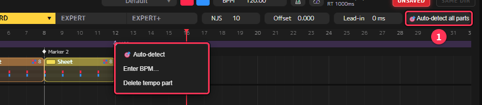

**Example workflow**

1. Turn on the metronome, play, and find where it starts to drift
2. Add a tempo part there
3. Set the BPM with "🎯 Auto-detect"
4. Listen with the metronome again, and type the value if it still doesn't fit
5. Repeat 1–4 until the end of the song

Tempo parts are exported as Beat Saber BPM changes (bpmEvents), so the tempo also changes in the game.

> The JD / RT display in the header ([chapter 2](#jd--rt-display)) is calculated with the base BPM (the value in the BPM field of the header).
> Changing the BPM partway with tempo parts does not change this display.

### How lead-in works

**Lead-in** (ms) in the header adds silence to the start of the song.
The whole song moves later by that amount, so you can put the first beat of the song exactly on a beat line.

For example, in a song at BPM 120 (1 beat = 500 ms) whose first beat is 300 ms from the start,
adding 200 ms of silence puts the first beat at 500 ms (on the line of beat 1).

- You can only add silence (you cannot cut the start of the song)
- The silence is written into the audio of song.egg itself when exporting, so ffmpeg is needed for the conversion ([chapter 13](#a-message-says-ffmpeg-was-not-found))
- The song preview section (the part played on the song select screen) is corrected automatically for the added silence when exporting
- When the time to the first note is short ("Hot start" in the map check), adding silence also gives you room

### Song volume (volume adjustment)

You can change the volume of the song at the left end of the **Music** row at the bottom of the NLE.

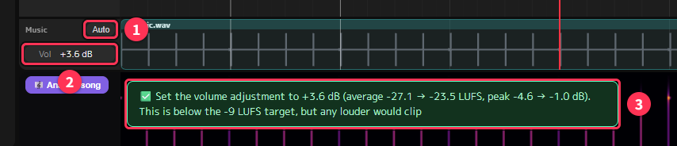

| No. | Name | Description |
|---|---|---|
| ① | Auto | Measures the loudness of the song and raises it to a good level |
| ② | Vol | The volume adjustment (dB). ‹ › changes it by ±0.5 dB, **Shift + ‹ ›** by ±0.1 dB. Click the number to type a value (-20 to +20 dB) |
| ③ | Result message | How much Auto raised the volume |

**How Auto works**

- It measures the average loudness of the song (LUFS — an average that follows how loud it sounds to the ear) and its loudest moment (peak)
- It raises the volume toward an average of **-9 LUFS**, but stops where the peak would go above **-1 dB** (any louder would clip)
- **It never lowers the volume.** A song that is already loud enough stays at 0.0 dB
- It measures only the parts that go into the exported song (if you split the Music or deleted part of it, the sound after that). Pressing it again gives the same value

The result appears at the bottom of the screen, for example "Set the volume adjustment to +7.5 dB (average -17.3 → -9.8 LUFS, peak -8.5 → -1.0 dB)".
In this example the peak reached -1 dB, so it stopped a little short of the -9 LUFS target
(in that case the message goes on with "This is below the -9 LUFS target, but any louder would clip").

> **Rule of thumb:** most Beat Saber custom songs are around -13 to -5 LUFS on average.
> Quieter songs sound quieter than the songs before and after them in the game.

**Where it applies**

- It is shared by all difficulties. It is saved with the project and can be undone with Ctrl + Z
- It applies as-is to playback with Space and to **▶ Preview** on the **Song Preview** node of INFO
- When exporting, it is written into the audio of song.egg itself, so ffmpeg is needed for the conversion even for an ogg song ([chapter 13](#a-message-says-ffmpeg-was-not-found))
- It is different from **Music volume** in Preferences ([chapter 12](#volume)). Music volume only changes what you hear while editing and is not included in the exported song

<!-- chapter-nav -->
> **Go to chapter:** [1. Working faster](#1-working-faster) ｜ [2. Displays that help placement](#2-displays-that-help-placement) ｜ [3. Making the most of the NLE](#3-making-the-most-of-the-nle) ｜ [4. Making several difficulties efficiently](#4-making-several-difficulties-efficiently) ｜ [5. Songs with tempo changes, and fixing beat offsets](#5-songs-with-tempo-changes-and-fixing-beat-offsets) ｜ [6. Analyzing the song (tempo and structure)](#6-analyzing-the-song-tempo-and-structure) ｜ [7. Advanced lighting](#7-advanced-lighting) ｜ [8. More about the INFO nodes](#8-more-about-the-info-nodes) ｜ [9. Checks before publishing](#9-checks-before-publishing) ｜ [10. Watching your replays (REPLAY)](#10-watching-your-replays-replay) ｜ [11. Responding to review notes](#11-responding-to-review-notes) ｜ [12. Customizing the settings](#12-customizing-the-settings) ｜ [13. Troubleshooting](#13-troubleshooting) ｜ [▲ Contents](#contents)
<!-- /chapter-nav -->

---

## 6. Analyzing the song (tempo and structure)

NLM can analyze the audio of the song and give you its **tempo** (a suggested BPM and lead-in) and its **structure** (sections such as intro, verse and chorus).
Using it right after loading a song makes it faster to set the BPM and to plan what kind of patterns go where.
You can also create NLE clips that follow the sections ([Creating clips from the analysis](#creating-clips-from-the-analysis)).

- Analysis takes about 15 to 30 seconds per song (depending on the length of the song and your PC; the first analysis after starting the app
  takes about 5 seconds longer to get ready). You can keep editing meanwhile
- The analysis runs on your PC. The song is not sent to the internet
- mp3, ogg, wav, flac and similar formats can be analyzed as they are. Formats such as m4a need ffmpeg ([chapter 13](#analyze-song-shows-an-error))
- The results are **estimates** from the sound of the song. Check the BPM with the metronome and the structure by ear in the end

### Starting the analysis

Start it in one of these ways.

- **Analyze** in "**Analyze this song?**", which appears when you load a song (see "[When you load a song](#when-you-load-a-song)" below)
- The purple **🎼 Analyze song** at the left of the spectrogram, below the Music row of the NLE (shown only while there are no analysis results)
- **Analyze song (tempo & structure)…** in the Mapping menu

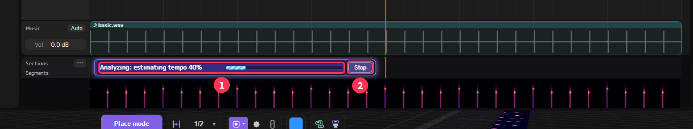

While analyzing, a dark purple message appears at the left of the band.

| No. | Name | Description |
|---|---|---|
| ① | Progress | Goes like "estimating tempo 40%" → "waiting for the tempo choice" → "analyzing structure 60%". The bar on the right shows the progress; while its stripes are moving, the analysis is running |
| ② | Stop | Stop the analysis |

One button takes it all the way: tempo estimate → (if it differs from the current settings) tempo confirmation → structure analysis.

### When you load a song

When you load a new song, NLM asks "**Analyze this song?**". It also tells you what the analysis can do.

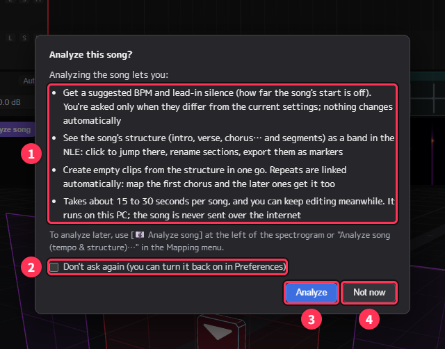

| No. | Name | Description |
|---|---|---|
| ① | What the analysis can do | A suggested tempo (BPM and lead-in), the structure band, creating clips from the structure, and how long it takes |
| ② | Don't ask again | Check it and close the dialog to stop being asked (you can turn it back on in Preferences; [chapter 12](#application)) |
| ③ | Analyze | Start the analysis right away |
| ④ | Not now | Close without doing anything (Esc does the same). To analyze later, use 🎼 Analyze song or the Mapping menu |

- You are asked when you bring in a new song: with "Load music file…" in the Mapping menu, by putting a song from MEDIA into the Music row, or with "Load song data"
- You are not asked when the song is loaded automatically as you open a project, or when you reconnect the song. You are also not asked if that song already has analysis results
- Because this dialog pops up right after loading a song, the Enter key doesn't press any button

### Confirming the tempo

If the estimated tempo differs from the current BPM and lead-in, a confirmation dialog appears. **Nothing is changed automatically.**

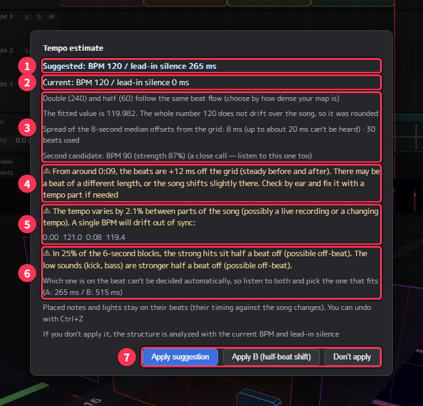

| No. | Line | Description |
|---|---|---|
| ① | Suggested | The estimated BPM and lead-in |
| ② | Current | The current BPM and lead-in |
| ③ | Notes | That double and half the BPM follow the same beat flow, that the BPM was rounded to a whole number, how much the beats spread around the grid, the second BPM candidate, and so on |
| ④ | Beat shift | Shown when, from some point in the song, the beats are off the grid by a constant amount. Check by ear and fix it with a tempo part ([chapter 5](#using-tempo-parts)) if needed |
| ⑤ | Tempo variation | Shown when the tempo differs between parts of the song (possibly a live recording or a changing tempo). The BPM of each part is listed too |
| ⑥ | Possible off-beat | Shown when the strong hits sit half a beat off. Lists the lead-in of the suggestion (A) and of candidate B, shifted by half a beat |
| ⑦ | Buttons | Apply suggestion / Apply B (half-beat shift) / Don't apply |

The image is a sample made for the explanation and shows every warning (④–⑥). With a normal song, warnings that don't apply are not shown.

| Button | What it does |
|---|---|
| **Apply suggestion** | Set the BPM and lead-in to the suggested values |
| **Apply B (half-beat shift)** | Set the BPM to the suggested value and the lead-in to the value shifted by half a beat. When "possible off-beat" (⑥) is shown, NLM can't tell which one is on the beat, so compare both with the metronome and pick the one that fits |
| **Don't apply** | Keep the current settings |

- Whichever you press, the structure is then analyzed with the BPM and lead-in at that point
- Applying can be undone with **one Ctrl + Z**. Placed notes and lights stay on their beats (their timing against the song changes)
- If the project has tempo parts, only the starting BPM and the lead-in change
- Because this dialog can pop up in the middle of your work, the Enter key doesn't press any button (so that an Enter while editing doesn't apply it by accident). Esc means "Don't apply"
- If the current settings are the same as the suggestion, no dialog appears; the bottom of the screen says "Tempo estimate: same as the current BPM and lead-in silence".
  If the current settings follow the same beat flow as the suggestion (double or half the BPM, etc.), the dialog says so (you don't need to apply it)
- For songs with few strong hits (such as quiet songs), the tempo can't be estimated, and the structure is analyzed with the current BPM and lead-in
- You can open this dialog again later with "**Tempo estimate…**" in the band menu (and apply from there)

### The structure band

When the structure analysis is done, a "Sections / Segments" band appears between the Music row and the spectrogram.

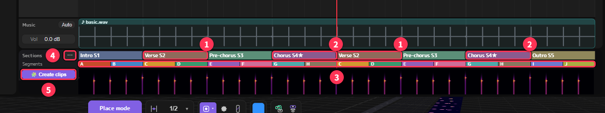

| No. | Name | Description |
|---|---|---|
| ① | Sections (upper row) | The large sections of the song, with a tentative name and a number, such as "Verse S2". **The same number means the same content repeated**, shown in the same color (two "Verse S2" in the image) |
| ② | Chorus candidates | Sections with a **★** after the number |
| ③ | Segments (lower row) | Shorter sections. The same letter (A, B, C, …) means similar content |
| ④ | ⋯ | The band menu (same as right-clicking the band) |
| ⑤ | 🧩 Create clips | In the left gutter of the band (below "Sections / Segments"). Creates clips that follow the band (see "[Creating clips from the analysis](#creating-clips-from-the-analysis)" below). Shown only while there are analysis results |

- The tentative names (Intro, Verse, Pre-chorus, Chorus, Interlude, Bridge, Outro) are guesses from the order of the sections. If they don't fit, rename them as described below
- **Click** the band to move the playback position to the start of that section (the visible range doesn't move)
- Hover over the band to see the beat range and how many times the same number appears; for segments, also where the most similar segment is (%)
- The wheel over the band moves in time, as in the NLE (Ctrl + wheel to zoom)
- The band is shown only while there are analysis results or an analysis is running (the spectrogram moves down meanwhile)

### The guide after the analysis

When the structure analysis started with [Analyze song] finishes and the band appears, a guide "**Analysis complete — what to do next**" is shown.

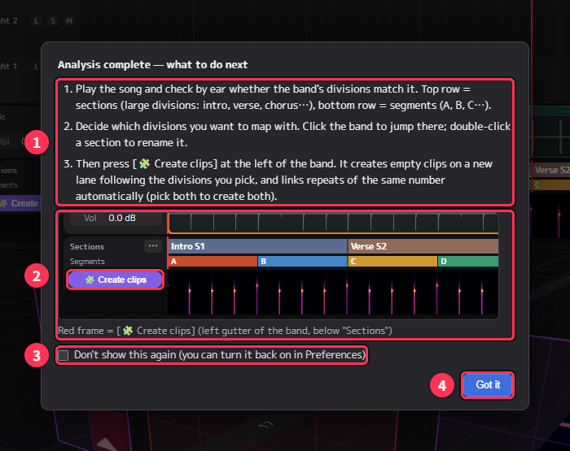

| No. | Name | Description |
|---|---|---|
| ① | What to do next | 1. Play the song and check by ear whether the band's divisions match it　2. Decide which divisions (sections / segments) you map with　3. Press **🧩 Create clips** at the left of the band |
| ② | Where the button is | A picture showing where **🧩 Create clips** is in the left gutter of the band (red frame) |
| ③ | Don't show this again | Check it and close the guide to stop showing it (you can turn it back on in Preferences; [chapter 12](#application)) |
| ④ | Got it | Close the guide (Esc does the same). When it closes, **🧩 Create clips** at the left of the band glows for a moment to show where it is |

- The guide never creates clips by itself. Check that the divisions match the song first, then press the button yourself
- It is also shown when you analyze again. It is not shown when you open saved results, stop the analysis, or get an error
- Because the guide pops up at the end of the analysis, the Enter key doesn't close it

### Renaming sections

**Double-click** a section to get a box for its name. The name is given to **all sections with the same number**
(for example, naming S3 "Guitar solo" turns both S3 sections into "Guitar solo S3"; see ② in the image under "Exporting to markers" below).

- Clear the name and press Enter to go back to the automatic name
- Renaming can be undone with Ctrl + Z

### The band menu

Right-click the band (or press **⋯** in the gutter) to open the menu.

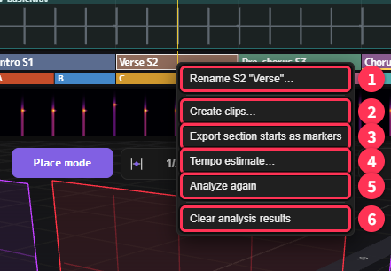

| No. | Item | What it does |
|---|---|---|
| ① | Rename S2 "Verse"… | Rename the section you right-clicked (shown only when you right-click a section) |
| ② | Create clips… | Create empty clips that follow the band (same as **🧩 Create clips** in the gutter; see "[Creating clips from the analysis](#creating-clips-from-the-analysis)" below) |
| ③ | Export section starts as markers | See "Exporting to markers" below |
| ④ | Tempo estimate… | Show the tempo confirmation dialog again (you can apply from here too) |
| ⑤ | Analyze again | Analyze again with the current BPM, lead-in and Music placement ("Stop analyzing" while it is running) |
| ⑥ | Clear analysis results | Remove the band (can be undone with Ctrl + Z) |

"Create clips…" and "Export section starts as markers" are also in the **Mapping** menu of the menu bar ("Create clips from the analysis…" and so on; you can use them only when there are analysis results).

### Exporting to markers

"**Export section starts as markers**" puts a marker with the name and number (such as "Verse S2") at the start of each section.
As markers, you can split clips to match the structure of the song with [Cut at markers](#splitting-and-joining),
and jump to the start of each section with **Ctrl + [ / Ctrl + ]** ([chapter 1](#marking-sections-of-the-song-with-markers)).

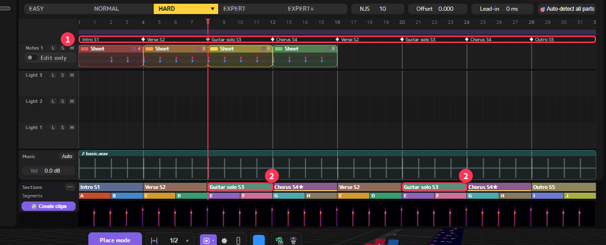

- Positions that already have another marker are skipped
- If you rename sections and export again, the markers exported earlier are renamed, unless you renamed them by hand
- The exported markers are normal markers. They stay even if you clear the analysis results

### When you change the BPM and so on

If you change the BPM, lead-in, tempo parts or Music placement (or the song itself) after the analysis, the band may no longer match the current grid.
Then the band is dimmed and "⚠ The beat grid has changed. Please analyze again" appears.

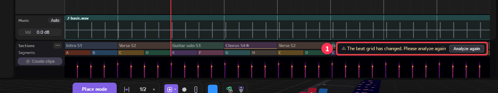

- **🧩 Create clips** at the left of the band is dimmed too, and pressing it doesn't create clips (analyze again first)
- Press **Analyze again** to analyze with the current settings. Names you gave are carried over, as far as possible, to the sections at the same position
- If you change the settings back to the values at the time of the analysis, the message disappears

### Saving the results

The analysis results (tempo estimate, structure and the names you gave) are saved in the project (`.nlmf`). You don't need to analyze again after reopening it.

- When the results arrive, when you rename sections and when you clear the results, the project is marked as unsaved (you are asked to confirm if you try to close it without saving)
- The BPM and other settings at the time of the analysis are saved too, so if you change the settings after reopening, the "Please analyze again" message above still appears

### Creating clips from the analysis

You can create empty clips in the NLE that follow the sections of the structure band. Placing notes clip by clip makes it easier to build a map that follows the structure of the song.
Sections with the same number (repeats) are [linked](#linked-clips) automatically, so the notes you place in the first one also go into the later ones.

Press **🧩 Create clips** in the left gutter of the band (or right-click the band or press **⋯** in the gutter → "**Create clips…**") to open the confirmation dialog.

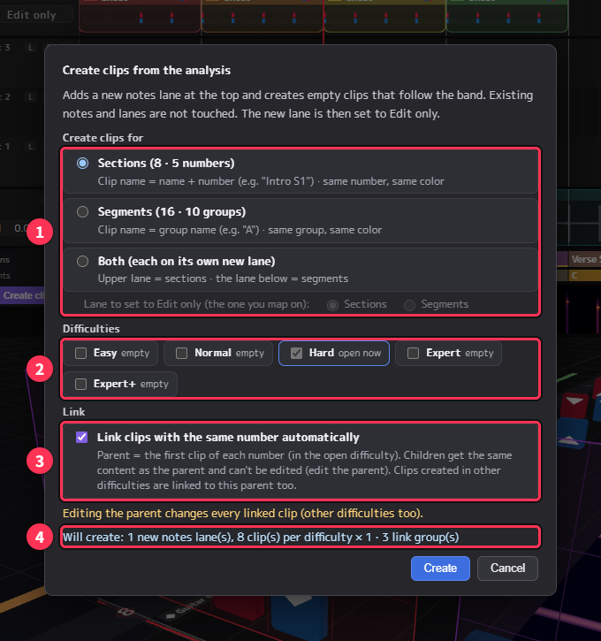

| No. | Name | Description |
|---|---|---|
| ① | Create clips for | **Sections** (the default) / **Segments** / **Both**. With Both, two lanes are created (upper = sections, lower = segments), and you choose which lane is set to Edit only (the one you map on) |
| ② | Difficulties | Clips are always created in the open difficulty. Check other difficulties to create the same clips there too (the number of notes or "empty" is shown next to each difficulty name) |
| ③ | Link | "**Link clips with the same number automatically**" (on by default). The parent is the first clip of each number (in the open difficulty). Clips created in other difficulties are linked to this parent too |
| ④ | Summary | The number of lanes to add, clips and link groups |

Press **Create**, and the result looks like this.

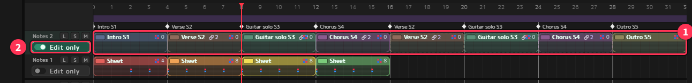

- One new notes lane (two with Both) is added at the top, with empty clips that follow the band (①). Existing notes and the content of existing clips are not touched
- Clips are named "band name S number" (such as "Verse S2"; names you gave are used too) and get the band's colors. For segments, the clips are named after the groups (A, B, …)
- From the second clip of the same number on, the clips become children of the first one (🔗 and a dashed border; [Linked clips](#linked-clips)).
  A number that appears only once is linked only when clips are also created in other difficulties (to the clips there)
- The new lane is set to [Edit only](#edit-only) (②). Notes you place in the 3D view go into the clips of that lane
- Because a lane is added, lane solo and mute are cleared
- **One Ctrl + Z** undoes everything: the lanes, clips and links (in other difficulties too). Edit only is turned off as well
- Once you have created clips, **🧩 Create clips** at the left of the band turns dark purple (a sign that clips were created from these results).
  Pressing it again creates another set on a new lane. Analyzing again returns it to the normal purple

> **Example: mapping section by section**
> After analyzing the song, checking the divisions by listening to the song and renaming the sections, create section clips with **🧩 Create clips** at the left of the band.
> Place notes in the first clip of each number (the parent), and the repeated sections get the same pattern.
> If you want to change only the second chorus, [unlink](#unlinking-and-deleting-clips) that clip first and then edit it.

**When clips can't be created**

- If there are no structure analysis results, press [Analyze song] first
- If the message "The beat grid (BPM, lead-in silence, tempo parts, Music placement) has changed since the analysis…" appears (when **🧩 Create clips** in the gutter is dimmed), the band may not match the current beats.
  Press **Analyze again** first and then create the clips ([When you change the BPM and so on](#when-you-change-the-bpm-and-so-on))
- If the notes lanes are at the maximum (10), delete an empty lane first. "Both" can be selected only when two lanes can be added

The created clips are normal clips that are not tied to the analysis. They stay as they are even if you analyze again or clear the analysis results (their names are in the display language at the time you created them).

<!-- chapter-nav -->
> **Go to chapter:** [1. Working faster](#1-working-faster) ｜ [2. Displays that help placement](#2-displays-that-help-placement) ｜ [3. Making the most of the NLE](#3-making-the-most-of-the-nle) ｜ [4. Making several difficulties efficiently](#4-making-several-difficulties-efficiently) ｜ [5. Songs with tempo changes, and fixing beat offsets](#5-songs-with-tempo-changes-and-fixing-beat-offsets) ｜ [6. Analyzing the song (tempo and structure)](#6-analyzing-the-song-tempo-and-structure) ｜ [7. Advanced lighting](#7-advanced-lighting) ｜ [8. More about the INFO nodes](#8-more-about-the-info-nodes) ｜ [9. Checks before publishing](#9-checks-before-publishing) ｜ [10. Watching your replays (REPLAY)](#10-watching-your-replays-replay) ｜ [11. Responding to review notes](#11-responding-to-review-notes) ｜ [12. Customizing the settings](#12-customizing-the-settings) ｜ [13. Troubleshooting](#13-troubleshooting) ｜ [▲ Contents](#contents)
<!-- /chapter-nav -->

---

## 7. Advanced lighting

For the basics of placing lights, see [chapter 6](tutorial.en.md#6-lighting) of the basic tutorial. This chapter explains how to work faster and in more detail.

### Light lanes

In LIGHTING mode, you place lights on these 10 lanes.

| Lane | Content |
|---|---|
| BACK, RINGS, CENTER, L LASER, R LASER | On / off and color of the lights in each place |
| L SPEED, R SPEED | Rotation speed of the left / right lasers |
| RING ROT, RING ZOOM | Ring rotation / zoom |
| BOOST | Switching colors (boost colors). Shown only when the light color mode is vanilla |

### Choosing quickly with keys

| Action | What it does |
|---|---|
| **W** (hold, choose, release) | Behavior pie menu (Off, On, Flash, Fade, Transition) |
| **C** (hold, choose, release) | Color pie menu (in vanilla: ①, ② and White. In Chroma: the left note color, the right note color, White and your saved colors) |
| **F** | Cycle through the colors to place |
| **1 / 2 / 3** (over the 3D view) | Choose a color (in vanilla: ①, ② and White; in Chroma: left, right and White). Here the number keys do not switch the difficulty |

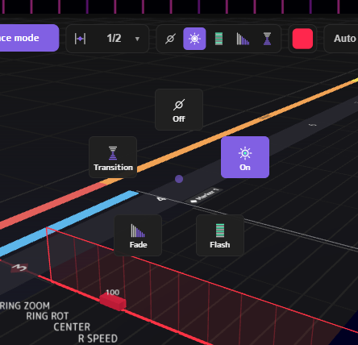 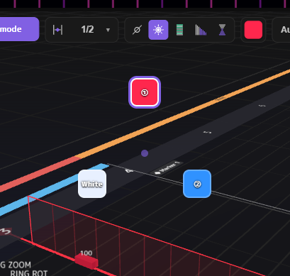

On the left is the behavior pie menu of the W key, on the right the color pie menu of the C key (the screenshot is in vanilla mode, so it shows ①, ② and White).
Hold the key, move the mouse toward the item you want, and release the key to choose it.

### Changing brightness and speed

Point at a light, or at selected lights, and turn **Alt + wheel** to change the value.
When there is no light under the mouse, the value of the light you are about to place changes.

| Target | Alt + wheel | Ctrl + Alt + wheel |
|---|---|---|
| Lights that turn on | Brightness ±10 | Brightness ±1 |
| L SPEED, R SPEED | Laser speed ±1 (0–50) | Same |

### Selecting and editing together

Click a light you placed to select it. **Shift + drag** selects all lights inside the box.
Selected lights can be edited together, for example with Alt + wheel.

### Light color mode (Chroma and vanilla)

Choose how lights are colored with **Light color mode** in Preferences.

| Mode | Colors | What players need |
|---|---|---|
| **Vanilla** (the default) | Red, blue, white, and boost colors switched with the BOOST lane | No mods; everyone sees the same colors |
| **Chroma** | Any color for each light | Players need the Chroma mod to see the colors |

The base light colors and boost colors are set on the **Settings** node of the INFO screen ([chapter 8](#8-more-about-the-info-nodes)).
If you are thinking of a ranked submission, or want many people to see the same look, vanilla is the safe choice.

### Auto lighting (making lights from the notes)

NLM can make lights automatically from the positions of the notes. Use it as a base when you make lights from scratch,
or to quickly clear "not enough lights" in the map check.

#### Starting it

You can start it from any of these:

- **Auto light** on the LIGHTING mode toolbar (①)
- **Auto lighting…** in the Mapping menu
- **💡 Auto lighting…**, shown next to map check items about too few lights ([chapter 9](#common-items-and-how-to-fix-them))

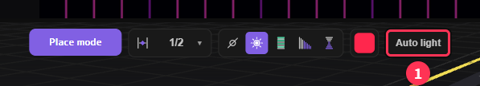

A confirmation shows the source difficulty, the difficulties that get the lights, the stage, and the number of lights to be made. Press **Create** to make them.

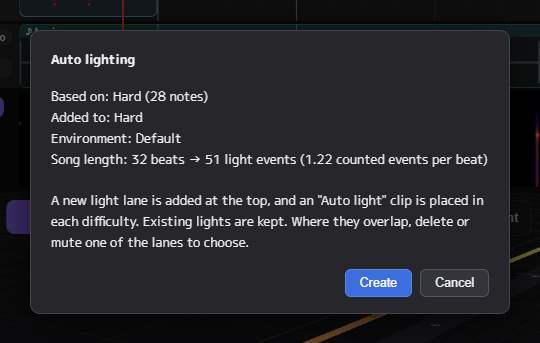

#### The lights it makes

| Kind | Content |
|---|---|
| Base | Keeps BACK on from the start of the song until a little after the last note (so bombs are always lit). Switches between blue and red every 16 beats (or at each marker, if there are markers) |
| Following the notes | L LASER lights up on red notes, R LASER on blue notes. Flashes where notes are dense, fades where they are spaced out |
| Accents | Ring zoom and rotation at the start of each section, CENTER at the start of each bar. Laser speed changes with the number of notes in each bar |
| Filling the count | Where there are few lights (intro, outro, etc.), RINGS lights up on every beat so the whole song has at least 1.2 lights per beat |

- Only **vanilla red and blue** are used (no Chroma colors). The actual colors are set by the light colors of the Settings node
- Some lights are skipped on closely spaced notes, so the same laser does not keep blinking rapidly
- Behaviors that the chosen stage does not have (such as the laser speed of Kaleidoscope) are not made

#### Where they go

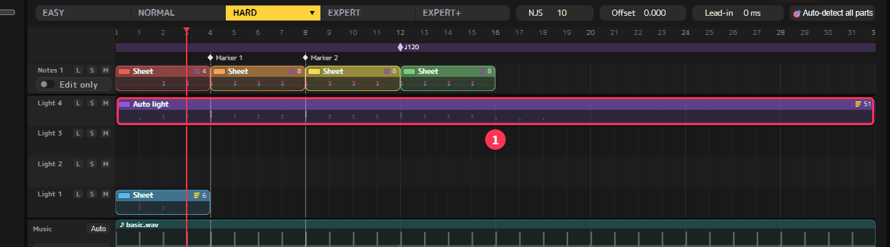

- One light lane is added at the top, with an "**Auto light**" clip (①) from the start to the end of the song
- The lights are made from **the difficulty with the most notes**, and the same lights go into **every difficulty** that has content (notes, bombs, walls, etc.)
- Your existing lights are kept
- **One Ctrl + Z** undoes it for all difficulties at once
- It cannot be made when the light lanes are at the maximum (10). Remove an empty lane first

#### Tips

- **When it overlaps your own lights**: stop one of them with the lane's **M** (mute), compare them in PREVIEW, and delete the clip you don't need.
  When lights overlap on the same beat and the same lane, a duplicate light notice appears
- **Use it as a base and finish it yourself**: keep the auto lights and add your own lights on another lane only where you want to stand out, such as the chorus
- **After editing the notes**: auto lights do not follow later note edits. If you change the notes a lot,
  delete the old "Auto light" clip and make it again (you can remove the empty lane as described in [chapter 3](#adding-lanes-lock-solo-and-mute))

### Checking and finishing

- Check it in **PREVIEW**, which looks close to the game. The buttons at the top right of PREVIEW toggle the lights and structures,
  and the ambient light (brightens the structures so you can see the motion)
- Choose the stage (environment) in the field at the top of the NLE, to the left of the BPM field ("Default" at first). How the lights look depends on the stage
- Finishing the lights in one difficulty and then copying them with "Send lighting" is faster ([chapter 4](#copy-the-lights-at-the-end))
- Before publishing, check that "Insufficient light events" and "Unlit bomb" do not appear in the map check ([chapter 9](#9-checks-before-publishing)).
  If they do, you can fix them quickly with [auto lighting](#auto-lighting-making-lights-from-the-notes)

<!-- chapter-nav -->
> **Go to chapter:** [1. Working faster](#1-working-faster) ｜ [2. Displays that help placement](#2-displays-that-help-placement) ｜ [3. Making the most of the NLE](#3-making-the-most-of-the-nle) ｜ [4. Making several difficulties efficiently](#4-making-several-difficulties-efficiently) ｜ [5. Songs with tempo changes, and fixing beat offsets](#5-songs-with-tempo-changes-and-fixing-beat-offsets) ｜ [6. Analyzing the song (tempo and structure)](#6-analyzing-the-song-tempo-and-structure) ｜ [7. Advanced lighting](#7-advanced-lighting) ｜ [8. More about the INFO nodes](#8-more-about-the-info-nodes) ｜ [9. Checks before publishing](#9-checks-before-publishing) ｜ [10. Watching your replays (REPLAY)](#10-watching-your-replays-replay) ｜ [11. Responding to review notes](#11-responding-to-review-notes) ｜ [12. Customizing the settings](#12-customizing-the-settings) ｜ [13. Troubleshooting](#13-troubleshooting) ｜ [▲ Contents](#contents)
<!-- /chapter-nav -->

---

## 8. More about the INFO nodes

On the INFO screen (Tab over the NLE), the information of the exported song is defined by combining **nodes**.

### Kinds of nodes

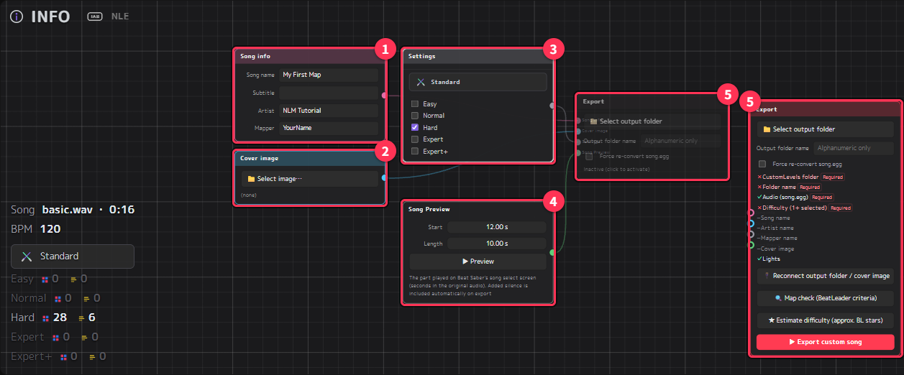

| Node | Color | What it sets |
|---|---|---|
| **Song info** | Pink | Song name, subtitle, artist, mapper |
| **Cover image** | Blue | The cover on the song select screen (if its shape or size is not right, it can be [fixed when exporting](#fixing-the-cover-image)) |
| **Settings** | Gray | Note colors, light colors, boost colors, stage, and the difficulty checks required for export |
| **Song Preview** | Green | The part played on the song select screen (start in seconds and length) |
| **Export** | — | Output folder, output folder name and the export button |

When the four nodes on the left are connected to the **Export** node with lines, their values are used for the export.

### Connecting and disconnecting

- **Drag** from a node's connector (round dot) to the export node to connect them. There is only one line of each kind; connecting another replaces it
- Drag a line to an empty spot and release to disconnect it
- **Right-click** an empty spot to add a new node
- Select a node and press **Ctrl + C → Ctrl + V** to duplicate it, **X** to delete it
- Zoom with the **wheel**, and press **.** (period) to bring all nodes back into view

### Using several export nodes

You can make several export nodes. For example:

- **Separate output folder names for testing and publishing**: export under another name while testing, so you don't overwrite the folder for publishing
- **Make versions with a different cover or colors**: prepare an export node connected to another Settings node or Cover image node

A newly added export node has nothing connected yet (⑤ on the right in the image above). Connect lines from the Song info node and the others.

**Click an export node to choose the one to use** (the chosen one becomes "Active"; the others show "Inactive (click to activate)").
The note colors and stage in the editor, the map check and Estimate difficulty all use the values connected to the active export node.
The exported map (notes and lights) is the same whichever export node you use.

The last remaining export node cannot be deleted.

> The stage and note color fields at the top of the NLE (to the left of the BPM field) directly change the values of the **Settings** node connected to the active export node.
> You can change colors and the stage without switching to the INFO screen.

### The Song Preview node

Sets the part played when the song is selected on the song select screen. The seconds are **seconds in the original song** (the lead-in silence is added automatically when exporting).

- **▶ Preview** loops that part with fades so you can check it
- Right-click a marker in the NLE → "**▶ Set as song preview start**" to start it at the marker, such as the start of the chorus
- If no Song Preview node is connected, it is exported as 10 seconds from 12 s (the map check shows "Preview time is still the default")

### Re-creating song.egg

To make exporting faster, the song.egg conversion is skipped if the song is the same as last time.
If the song sounds wrong or you want to re-create it, check "**Force re-convert song.egg**" on the export node and export.

<!-- chapter-nav -->
> **Go to chapter:** [1. Working faster](#1-working-faster) ｜ [2. Displays that help placement](#2-displays-that-help-placement) ｜ [3. Making the most of the NLE](#3-making-the-most-of-the-nle) ｜ [4. Making several difficulties efficiently](#4-making-several-difficulties-efficiently) ｜ [5. Songs with tempo changes, and fixing beat offsets](#5-songs-with-tempo-changes-and-fixing-beat-offsets) ｜ [6. Analyzing the song (tempo and structure)](#6-analyzing-the-song-tempo-and-structure) ｜ [7. Advanced lighting](#7-advanced-lighting) ｜ [8. More about the INFO nodes](#8-more-about-the-info-nodes) ｜ [9. Checks before publishing](#9-checks-before-publishing) ｜ [10. Watching your replays (REPLAY)](#10-watching-your-replays-replay) ｜ [11. Responding to review notes](#11-responding-to-review-notes) ｜ [12. Customizing the settings](#12-customizing-the-settings) ｜ [13. Troubleshooting](#13-troubleshooting) ｜ [▲ Contents](#contents)
<!-- /chapter-nav -->

---

## 9. Checks before publishing

Before publishing a map, you can check the following inside NLM.

| Feature | What it tells you |
|---|---|
| **Map check** (same as BS Map Check) | Mistakes, awkward patterns, and places that do not meet BeatLeader's ranking criteria |
| **NLM BL criteria list** | A checklist that lists the written BeatLeader ranking criteria item by item |
| **AutoModder checks** | The results of a tool reviewers often use (AutoModder), with an add-on plugin |
| **Estimate difficulty** | An approximation of BeatLeader's ★ (stars) |

Responding to the review notes you receive after submitting a map for ranking is explained in [chapter 11](#11-responding-to-review-notes).

Even if you won't submit the map for ranking, the map check is useful for finding mistakes.

All of them check **the same content as the export** (all exported difficulties and the values of Info.dat), so you can use them before exporting.
You can also keep the panel open while you fix the map and check again with one button.

### Recommended order

1. Clear "🚧 Unrankable" and "❌ Error" in the **Map check**
2. Look at the ★ of each difficulty with **Estimate difficulty**
3. If you are thinking of a ranked submission, check the remaining items in the **NLM BL criteria list** (the ★ values are used here too).
   The **AutoModder** tab shows how the map looks in the reviewers' tool
4. Finally, check for anything you missed with the "Checklist before publishing" below

### Map check (same as BS Map Check)

Open it from **Map check (same as BS Map Check)…** in the Check menu, or from
**🔍 Map check (BeatLeader criteria)** on the export node of the INFO screen. The check starts as soon as it opens.
The Check menu also has items that open the **NLM BL criteria list** and **AutoModder** tabs.

The judgement is the same as the map check site [BS Map Check](https://github.com/KivalEvan/BeatSaber-MapCheck)
with the BeatLeader preset.

#### Reading the results

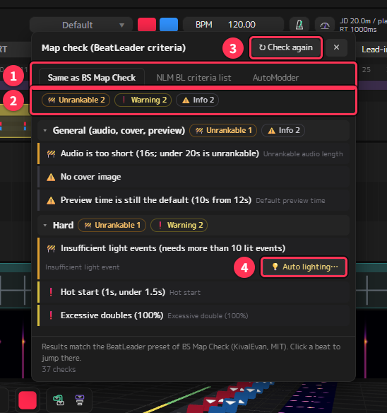

The image shows the check of a short map made for the explanation (16 seconds, few lights), with Hard open (Expert has the same notes).

| No. | Name | Description |
|---|---|---|
| ① | Tabs | Switch between "Same as BS Map Check", "NLM BL criteria list" and "AutoModder" |
| ② | Summary | The number of items for each mark (all difficulties together) |
| ③ | ↻ Check again | Refresh the results after fixing the map |
| ④ | 💡 Auto lighting… | Shown only on items about too few lights. Starts [auto lighting](#auto-lighting-making-lights-from-the-notes) (chapter 7) and checks again afterwards. On cover image items, [🖼 Fix cover image…](#fixing-the-cover-image) appears in the same place |
| ⑤ | Current difficulty | The results of the difficulty you are editing. Its heading has an **Editing** tag, and it is shown expanded |
| ⑥ | Other difficulties | Shown collapsed (the heading still shows the number of items for each mark). Click the heading to expand it |

The results are split into "General (audio, cover, preview)" and a section for each difficulty. The mark at the start of each item shows how serious it is.

| Mark | Meaning | What to do |
|---|---|---|
| 🚧 Unrankable | Does not meet the ranking criteria | Always fix it if you submit for ranking |
| ❌ Error | A big problem | Fix it unless you have a reason |
| ❗ Warning | Possibly a problem | Check it and fix it if needed |
| ⚠️ Info | A minor problem, or not a problem | For reference |

If there is no unrankable item or error, "✓ No unrankable issues or errors" is shown at the top.

The results cover all the difficulties that will be exported, but **only "General" and the difficulty you are editing (⑤) are expanded**,
so that you don't mistake the beats of another difficulty for those of the one you are editing.

- The other difficulties (⑥) are collapsed. Their headings show whether they have problems. Click a heading to expand it
- When you switch difficulties, the difficulty you switched to is expanded and the others are collapsed
- **↻ Check again** and switching tabs keep the sections as you expanded or collapsed them

The numbers under each item are the **beats** where the problem is.

- Point at a number to see the time from the start of the song (min:sec)
- **Click a number of the difficulty you are editing to move to that beat and select the notes etc. in question.** You can fix them right away
- **Click a number of another difficulty, and NLM asks "This result is for Expert (you are editing Hard). Switch to Expert and show it?"**
  Press **Switch to Expert** to switch to that difficulty, move to that beat and select the objects there (the number you clicked is scrolled into view in the panel).
  **Cancel** (or Esc) does nothing
- For items with many beats, click "{n} more" to show them all

After fixing, press **↻ Check again** at the top right of the panel to refresh the results.
You can drag the panel by its heading to move it anywhere.

#### Common items and how to fix them

| Item | Fix |
|---|---|
| Hot start (under 1.5 s) | Move the first note later, or add silence at the start of the song with **Lead-in** in the header |
| Preview time is still the default | Set the part played on the song select screen with the **Song Preview** node of the INFO screen |
| No cover image | Choose a square image of at least 256×256 with **Cover image** on the INFO screen |
| Cover image is not square / too small | Use **🖼 Fix cover image…** next to the item to make it square and at least 256×256 when exporting ([below](#fixing-the-cover-image)) |
| Jump distance (JD) / reaction time too short / too long | Adjust **NJS** and **Offset** in the header, while watching the JD / RT display in the header |
| Off-beat precision (not on 1/8 or 1/6) | A note placed with too fine a snap or at an off position. Click the beat to check the position |
| Insufficient light events | Add lights (more than 10 lit events are needed). **💡 Auto lighting…** next to the item makes them automatically |
| Unlit bomb | Turn on a light before the bomb. Lights made by auto lighting always light bombs |

#### Fixing the cover image

The cover image must be a **square of at least 256×256** in **png or jpg** format.
If an image is only slightly off, like 512×510, you can fix it inside NLM without making the image again.

When the map check shows a cover image item (not square / too small), or R1.A.4 (cover image) of the NLM BL criteria list is a violation,
**🖼 Fix cover image…** appears on that row. Press it to open a confirmation.

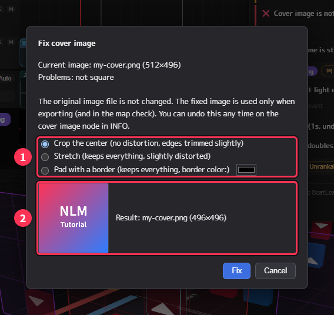

| No. | Name | Description |
|---|---|---|
| ① | How to fix | Can be chosen only when the image is not square (see the table below) |
| ② | Preview | The image after fixing, with its file name and size |

| How to fix | Content |
|---|---|
| **Crop the center** (the default) | Crops the middle to fit the short side. The picture is not distorted, but the ends of the long side are trimmed slightly |
| **Stretch** | Stretches to fit the long side. The whole picture is kept, but slightly distorted |
| **Pad with a border** | Fits the long side and fills the rest with a border. The whole picture is kept. You can choose the border color |

- Images smaller than 256×256 are enlarged to 256×256
- Formats other than png and jpg (webp, etc.) are converted to png (jpg stays jpg)
- When a lot is cut off (5% or more of the long side), a warning is shown. If too much of the picture is lost, choose "Pad with a border"

Press **Fix** and the map check runs again; the cover image item disappears.

**The original image file is not changed.** Only when exporting is the fixed image written to the output folder as `cover.png` (`cover.jpg` for jpg).
The map check also judges the fixed image.

The cover image node on the INFO screen shows what is fixed (①) and **Stop fixing** (②).

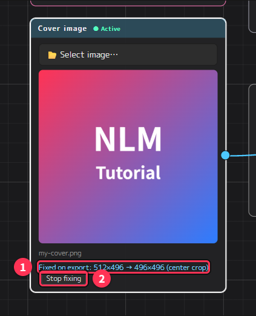

- Press **Stop fixing** to export the original image. **Ctrl + Z** also undoes it
- The fix setting is saved in the project
- Choosing another image on the cover image node removes the fix setting (if the new image does not fit either, fix it again)

> Images with a very different shape look better if you remake them in an image editor.
> This fix is for quickly correcting images that are "only slightly off".

### NLM BL criteria list

The second tab of the map check panel. **Its frame and background turn teal.**

It lists the written ranking criteria on the official BeatLeader website (Ranking Criteria) in the order of their item numbers (R1.A.1, etc.),
with NLM's own judgement for each item. **It is not an official result from BeatLeader or BS Map Check.**
The colors are different from the map check so they are not mistaken for each other.

#### Marks and kinds

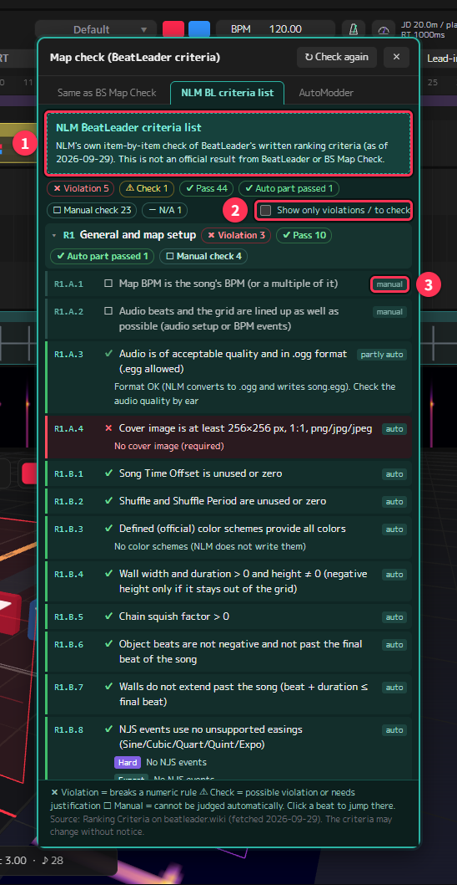

| No. | Name | Description |
|---|---|---|
| ① | Notice band | Shows that the list is made by NLM (it is not an official result) |
| ② | Show only violations / to check | Narrow it down to the items that probably need fixing |
| ③ | Kind of judgement | auto / partly auto / candidates / manual / N/A |

The mark at the start of each item is the result.

| Mark | Meaning |
|---|---|
| ✖ Violation | Breaks a numeric rule of the criteria |
| ⚠ Check | A possible violation. Fix it, or be ready to explain why it is fine |
| ✔ Pass / Auto part passed | It meets the criteria (for some items, only the part that could be judged automatically passed) |
| ☐ Manual check | Cannot be judged automatically. Check it yourself |
| － N/A | Does not apply to this map |

The kind of judgement (auto / partly auto / candidates / manual / N/A) is shown at the right end of each item.
"Candidates" are items that depend on diagrams or the reviewers' judgement; NLM interprets them and lists suspicious places.
How NLM interpreted an item is written in the "＊" note under the item.

Check **Show only violations / to check** at the top to narrow the list down to the items that probably need fixing.

When R10.A (at least one light per beat) or R7.B (bomb lighting) is a violation or "Check", **💡 Auto lighting…** appears on that row.
It starts [auto lighting](#auto-lighting-making-lights-from-the-notes) (chapter 7) and checks again afterwards.
When R1.A.4 (size, shape and format of the cover image) is a violation, **🖼 Fix cover image…** appears ([Fixing the cover image](#fixing-the-cover-image)).

#### Findings for the current and other difficulties

The BL criteria list is ordered by item (R1.A.1, etc.), so one item can list findings for several difficulties.
Here too, only the findings of the difficulty you are editing show their beats.

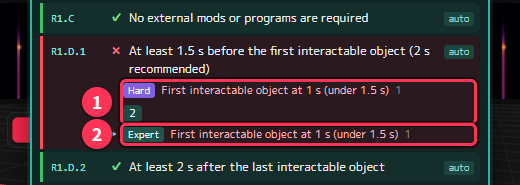

| No. | Name | Description |
|---|---|---|
| ① | Finding for the current difficulty | The difficulty tag is purple. The beat numbers are shown; click one to jump to that beat |
| ② | Finding for another difficulty | The difficulty tag is teal. Only the difficulty, the text and the number of beats are shown; the beats are hidden. Click the row to show the beats (click again to hide them) |

- Clicking a beat of another difficulty asks before switching, just like the map check tab
- When you switch difficulties, the beats you had shown are hidden, and the findings of the difficulty you switched to show their beats

#### Tested on ranked maps, and what to keep in mind

The NLM BL criteria list has been run on 189 BeatLeader ranked maps (the versions that passed the review) to check that it doesn't report violations there.
99% of the difficulties that passed the review show no violation. If you get a violation, look at the map first, then fix it or be ready to explain it.

The following items can't be judged exactly as written, so NLM handles them like this:

- For maps brought in with "📥 Load song data", difficulties whose original map had **light boxes** (the newer lighting system introduced in v3)
  get **☐ Manual check** for R10.A and R7.B, because NLM can't read light boxes. Check the lights in the game or in the official editor
- R7.B (bomb lighting) judges the same way as the reviewers' tool (AutoModder): it checks whether a light is on 250 ms before the bomb.
  Where this is more lenient than the written criteria is explained in the "＊" note of the item
- R8.A (wall dodges) approximates whether your head really has to move, so going over the limits is shown as **⚠ Check**
- Overlaps (R3.A.1) and short walls (R8.C) inside a time skip (the BPM briefly set very high) appear at almost the same moment in the game too,
  so they are shown as **⚠ Check**
- The **NJS events** of v4 maps are used for judging (they are lost on export, but the map is judged as loaded)

#### The items that use ★ and Tech (R5.A, R11.H.5)

R5.A (whether notes are visible long enough to react) is judged with a formula that uses BeatLeader's ★ and Tech values.
The item has fields for each difficulty (②). If the plugin of "Estimate difficulty" below is installed,
the values are calculated and filled in automatically when you open the BL criteria list (①). After you fix the map, they are measured again when you re-check.

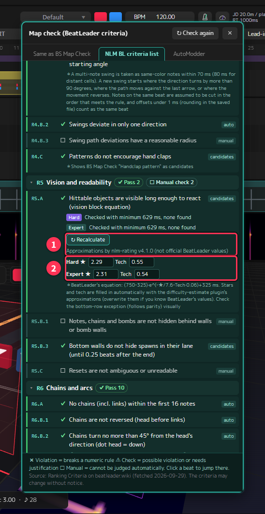

- If the plugin is not installed yet, ① shows **📥 Install the plugin and auto-calculate…**.
  Pressing it shows an explanation; press **Install from GitHub** to install the plugin and calculate right away
- The values are approximations. If you know BeatLeader's actual values, you can overwrite the fields.
  Overwritten fields get a yellow border and are kept when measuring again (**Back to auto** returns to the calculated value)
- The values are remembered only while the app is open
- R11.H.5 (whether the difficulties are in ascending order of ★) is also judged with the ★ in these fields.
  Because the values are approximations, an inverted order is shown as "Check", not as a "Violation"

### Estimate difficulty (approximate BeatLeader ★)

Open it from **Estimate difficulty (approx. BeatLeader stars)…** in the Check menu, or from
**★ Estimate difficulty (approx. BL stars)** on the export node of the INFO screen.

#### The first time: install the plugin

The calculation needs the add-on plugin [nlm-rating](https://github.com/Oz-Co-two/nlm-rating) (about 34 MB, Windows only).
It is not included in NLM, so press **Install from GitHub** in the panel to install it.

- The downloaded file is checked against the publisher's information (SHA-256) before use
- The installed plugin is saved in the `plugins` folder of the app. It is kept when you update NLM
- NLM connects to the internet only when you press the button, and for the update check at startup (only once the plugin is installed)
- When the installation finishes, the measurement starts right away

Use **Check for updates** to look for a newer version of the plugin. From v2.1.1-oz on, once the plugin is installed, NLM also checks at startup
and, if there is a new version, shows its changes in the same kind of dialog as app updates (**Update** installs it, with no restart needed.
If you choose **Don't update**, you can still update later with **Check for updates…** in the Help menu or **Check for updates** in the panel).
You can turn off the startup check with "At startup, check for new versions of the app and installed plugins" in Preferences.
If you have installed two or more versions, a field to choose the version appears, so you can go back to an older one.

#### Reading the results


| No. | Name | Description |
|---|---|---|
| ① | Results | ★ and Pass / Tech / Acc for each difficulty. The lower row shows ★ with speed modifiers |
| ② | ↻ Measure again | Measure again after fixing the map |
| ③ | Plugin | The version of the plugin in use, and the update check |

It measures every time you open the panel (if the map has not changed since the last measurement, that result is shown as is).
If you fix the map with the panel open, press **↻ Measure again**. Results measured in the NLM BL criteria list also appear here.

| Column | Meaning |
|---|---|
| ★ | Overall difficulty (BeatLeader stars) |
| Pass | How hard it is to clear |
| Tech | Technical difficulty of angles and patterns |
| Acc | How hard it is to get high accuracy |

- Under each difficulty, ★ with speed modifiers is also shown (SS = 0.85×, FS = 1.2×, SFS = 1.5×)
- Point at a row to see the predicted accuracy (%)
- **Difficulties with fewer than 20 notes cannot be measured**

> **These are approximations.** They are calculated with the source code published by BeatLeader, but may differ from the values on the BeatLeader website
> (in particular, BeatLeader adjusts each map's Acc from players' scores. Maps without enough scores yet, right after they are ranked, have no adjustment,
> so the values here correspond to what a map gets right after it is ranked). This is not an official BeatLeader tool.

#### Ways to use it

- **Check the order of ★ across difficulties**: check that higher difficulties have higher ★
  (ranking criterion R11.H.5 requires difficulties to be in ascending order of ★, with an inversion of up to 0.5★ allowed. The NLM BL criteria list also checks it)
- **Adjust the gaps between difficulties**: use it as a guide when neighboring difficulties are too close or too far apart in ★
- The measured ★ and Tech are filled in automatically in R5.A and R11.H.5 of the NLM BL criteria list (no need to copy them)
- With the same plugin, you can also calculate the ★ of songs in the MEDIA library at once ([chapter 3](#calculating--nlm-estimate))

### AutoModder checks (the third tab)

The third tab of the map check panel. **Its frame turns amber.**

AutoModder is a ChroMapper (map editor) extension that reviewers often use. This tab runs AutoModder's automatic checks unchanged inside NLM and shows the results
(the same calculation as AutoModder, not an approximation remade by NLM). You can see how the map looks in the reviewers' tool before you submit it.


| No. | Name | Description |
|---|---|---|
| ① | Notice band | Shows that these are AutoModder's checks (version, default settings) and that they differ from the current BeatLeader criteria in places |
| ② | Results for the current difficulty | Its heading has an **Editing** tag, and it is shown expanded. The results are listed most severe first, and results with the same item and text are combined into one row with their beats |
| ③ | Beats | Click one to jump to that beat. For a beat of another difficulty, NLM asks before switching to that difficulty (same as the map check) |
| ④ | Plugin | The version of the plugin in use, **↻ Check again** (check again after fixing the map) and **Check for updates** |
| ⑤ | Results for another difficulty | Shown collapsed (the heading still shows the counts and AutoModder's pass/fail). Click the heading to expand it |

| Mark | Meaning |
|---|---|
| ❌ Error (Unrankable) | AutoModder considers it unrankable |
| ❗ Warning (Questionable) | AutoModder considers it questionable |
| ❔ Inconclusive (Questionable) | AutoModder can't judge it automatically (the BPM is always shown like this) |
| 💡 Suggestion, ℹ️ Info, 📊 Reference | For reference. Not a judgement against the criteria |

- The check runs automatically when you open the tab. If the map has not changed since the last check, that result is shown as is
- The results are split into the song info (Info.dat) and each difficulty, and only the song info and the difficulty you are editing are expanded
  (same as the map check tab; when you switch difficulties, the one you switched to is expanded). A difficulty where AutoModder stopped in the middle of the checks is expanded so you notice it
- Passed items are combined into one row, "✓ N passed"
- Each difficulty is checked with AutoModder's default settings
- AutoModder uses the song length, so load the audio before checking
- AutoModder does not check difficulties with fewer than 20 notes

#### Installing the plugin (AutoModder)

The add-on plugin nlm-automodder (about 12 MB, Windows only) is needed. It is not included in NLM.

1. Press **📥 Install the plugin…** in the tab to see an explanation
2. Press **Install from GitHub** to install it and run the check right away


- The downloaded file is checked against the publisher's information (SHA-256) before use
- The installed plugin is saved in the `plugins` folder of the app. It is kept when you update NLM
- NLM connects to the internet only when you press the install or **Check for updates** button, and for the update check at startup
  (only once the plugin is installed). New versions are announced the same way as for "Estimate difficulty"

> **AutoModder differs from the current BeatLeader criteria in places** (the R5.A vision block time formula, the wall dodge rate and so on).
> When its results differ from the NLM BL criteria list, check against the written BeatLeader criteria.
> It is not an official BeatLeader or AutoModder tool, and the results are not ranking decisions.

### Checklist before publishing

- [ ] **Song info**: entered the song name, subtitle, artist and mapper (your mapper name)
- [ ] **Exported difficulties**: no notes or lights are left in unfinished difficulties you won't publish
  (every difficulty with content is exported, regardless of the checks on the Settings node)
- [ ] **Cover image**: chose a square image of at least 256×256
- [ ] **Preview section**: set the part played on the song select screen with the Song Preview node (and checked it with ▶ Preview)
- [ ] **Start of the song**: at least 1.5 seconds before the first note (2 seconds or more is recommended)
- [ ] **Song volume**: raised a quiet song with **Auto** on the Music row ([chapter 5](#song-volume-volume-adjustment))
- [ ] **NJS and offset**: chose comfortable values for each difficulty while watching JD / RT in the header
- [ ] **Lights**: every difficulty has lights, and you checked how they look in PREVIEW (if there are not enough, auto lighting can make a base)
- [ ] **Map check**: no unrankable items or errors (and you looked through the warnings)
- [ ] **Order of ★**: higher difficulties have higher ★ (R11.H.5 of the NLM BL criteria list is not "Check")
- [ ] **Test play**: exported the map and played every difficulty all the way through in Beat Saber (REPLAY shows your replays together with where you missed; [chapter 10](#10-watching-your-replays-replay))
- [ ] **Project saved**: saved the `.nlmf` (you need it to make fixes later)

<!-- chapter-nav -->
> **Go to chapter:** [1. Working faster](#1-working-faster) ｜ [2. Displays that help placement](#2-displays-that-help-placement) ｜ [3. Making the most of the NLE](#3-making-the-most-of-the-nle) ｜ [4. Making several difficulties efficiently](#4-making-several-difficulties-efficiently) ｜ [5. Songs with tempo changes, and fixing beat offsets](#5-songs-with-tempo-changes-and-fixing-beat-offsets) ｜ [6. Analyzing the song (tempo and structure)](#6-analyzing-the-song-tempo-and-structure) ｜ [7. Advanced lighting](#7-advanced-lighting) ｜ [8. More about the INFO nodes](#8-more-about-the-info-nodes) ｜ [9. Checks before publishing](#9-checks-before-publishing) ｜ [10. Watching your replays (REPLAY)](#10-watching-your-replays-replay) ｜ [11. Responding to review notes](#11-responding-to-review-notes) ｜ [12. Customizing the settings](#12-customizing-the-settings) ｜ [13. Troubleshooting](#13-troubleshooting) ｜ [▲ Contents](#contents)
<!-- /chapter-nav -->

---

## 10. Watching your replays (REPLAY)

When you play your exported map in Beat Saber, the BeatLeader mod saves a record of the play (a replay, a `.bsor` file) on your PC.
**REPLAY** in the top-left area plays that replay back in the BL replay app (the same app that shows replays on the BeatLeader website)
and moves it together with NLM's playhead. You can overlay where you missed and which notes scored low on the map in the NLE and the 3D view,
so you can fix the spots you noticed while playing right away.

> The replays are saved by the **BeatLeader mod** installed in Beat Saber (in `UserData\BeatLeader\Replays` in the Beat Saber folder).
> Without the mod, no replays are saved.

### Opening REPLAY

- Put the mouse over the top-left area and press **Tab** to switch MEDIA → PREVIEW → REPLAY. You can also click **REPLAY** in the heading
- When it opens, it reads the list of replays of the current song and automatically opens the newest replay that can be played. Press **≡ List** to see the list
- The "current song" is decided by the **song name** and the **mapper** in the song info on INFO (the same values as in the exported Info.dat). The list is not shown while the song name is empty

### Reading the list


| No. | Name | Description |
|---|---|---|
| ① | Heading | MEDIA, PREVIEW and REPLAY. The current view (REPLAY) is shown large in a purple frame. Click one of the other names to switch to that view |
| ② | ↻ | Reload the list. Right after playing in Beat Saber, press it to show the new replay |
| ③ | The open replay | The row in a purple frame. Click a row to go to the playback view of that replay |
| ④ | Earlier export | A replay played on an earlier version that you fixed and exported again after playing. It plays back on the map as it was when played (the date in parentheses is when that version was exported) |
| ⑤ | Replay that can't be played | A gray row (**No map**). NLM has no kept copy of the version you played, so it can't be played (see "Which replays are listed" below) |
| ⑥ | Replay folder | The replay folders NLM reads, and **Change…** (see "Replay folder" below) |

Each row shows when you played, the difficulty, the accuracy (score ÷ max score, as a guide), and the numbers of misses, bad cuts, bombs and walls.
Plays with modifiers (FS, NF and so on) also show their abbreviations (point at one to see its name).
Plays you quit partway are tagged **Quit**, failed plays **Failed**, and plays in practice mode **Practice**. The rows are listed with the newest play first.

#### Which replays are listed

- The list shows **only replays played on maps of the current song exported from NLM**. Replays of other songs are not listed
- **Every time you export**, NLM keeps a copy of the exported map (Info.dat, the difficulty .dat files and the cover image) and the song (song.egg) in the `replays` folder
  in NLM's folder (in the app version, the folder with `NonLinearMapper.exe`). A replay can be played if its map is the same as one of these copies.
  Even if you fix and re-export the map after playing, the replay plays back on the map as it was when you played (the kept copy; ④)
- Maps exported before the REPLAY feature (up to v2.1.2-oz) have no kept copy. When you open the project and show REPLAY while the output folder of the export node on INFO
  is connected, NLM keeps the map that is already exported there, once (replays played on that map can then be played)
- Replays played on a version without a kept copy (⑤) are shown as gray rows if the song name and mapper match, but they can't be played. NLM does not download maps from BeatSaver or elsewhere

#### Replay folder

- NLM looks for the replay folders automatically. From the Beat Saber song folders registered in the MEDIA library (`Beat Saber_Data\CustomLevels`;
  for BSManager's shared song folder, the folder of each version), it looks for `UserData\BeatLeader\Replays` of the same Beat Saber.
  It also looks in Steam's default location (`C:\Program Files (x86)\Steam\steamapps\common\Beat Saber\UserData\BeatLeader\Replays`). It reads every folder it finds
- If none is found, the list says "Replay folder not found". In the app version (exe), choose the `Replays` folder with **Change…** (⑥).
  The chosen folder is remembered and used the next time you start NLM. **Back to automatic** returns to automatic search
- In the browser version (started with `serve.py`), **Change…** is not shown (only the folders found automatically are read)
- NLM only reads the replay folders and never writes to them

### Playback and sync

Click a row in the list to show the BL replay app playing the replay inside the window.


| No. | Name | Description |
|---|---|---|
| ① | ≡ List | Back to the list (the replay stops) |
| ② | Sync | Moves NLM and the replay together (connected while the dot is green; on at first). Click it again to disconnect them so they move independently |
| ③ | Score | Overlays the scores on NLM's map (see "[Overlaying scores](#overlaying-scores)" below; on at first) |
| ④ | ↻ | Reopen this replay (e.g. if it does not load) |
| ⑤ | Legend | The number of cuts for each score color, and the numbers of misses, bad cuts, bombs and walls |
| ⑥ | Wheel to zoom | Turn the wheel over the 3D view in the window to zoom in on the point under the mouse (see "Zoom" below) |

The line under the heading shows when you played, the difficulty, the accuracy, and whether it is the latest export or an earlier one.

- When you open a replay, NLM also switches to the difficulty of the replay (for Standard plays whose difficulty is in the project)
- While **Sync** is on, NLM's **▶**, **Space**, clicks on the ruler and **← / →** move the replay too. When you move the replay with the play button or the time bar inside the window,
  NLM's playhead (NLE and 3D view) follows. You hear the replay's audio; NLM's song audio does not play
- What you see inside the window is the BL replay app itself. The playback bar that appears when you point at the window (speed, camera switching, settings and so on)
  works just as in the BL replay app
- Plays you quit partway and failed plays stop where the recording ends (a message above the window says so)
- When you open a replay played on a version edited after playing (④ in the list), "This version was edited after playing (it may not match the current map)" is shown
- The replay stops when you switch the top-left area to another view or go back to the list. It closes when you create a new project or open another project
- The player's name and avatar may not be shown (the square at the top left of the window stays empty)

#### Zoom

- Turn the wheel over the 3D view in the window to zoom in on the point under the mouse (1× to 8×). Turn it the other way to zoom out; at 1× the view returns to where it was. The hint (⑥) shows the current zoom level
- With the camera at the player's eyes (switched with the camera buttons of the BL replay app), it zooms by narrowing the field of view
- Reopening the replay resets the zoom to 1×

#### Keys after clicking inside the window

After you click inside the replay window, key presses go to the window (the BL replay app).

- **Space**, **← / →** and similar keys are handled by the BL replay app (play, pause, skip; with Sync on, NLM follows)
- **Tab** and **Ctrl** combinations (**Ctrl + S** to save, **Ctrl + Z** to undo and so on) are handled by NLM.
  Tab switches the top-left area to the next view (MEDIA), and key presses go back to NLM
- Clicking anywhere else in NLM also sends key presses back to NLM

### Overlaying scores

While **Score** in the heading is on (it is on at first), the results of the open replay are overlaid on NLM's current map.
They are overlaid **only while the current difficulty is the same as the replay's** (if it differs, or for plays other than Standard, the legend line says so).
They disappear when you go back to the list or switch the top-left area.

The colors are the same as in the BL replay app (decided by score ÷ max score × 115).

| Color | Meaning |
|---|---|
| Rainbow (6 colored bands) | 115 (max) |
| Purple | 113 or more |
| Blue | 110 or more |
| Green | 106 or more |
| Yellow | 100 or more |
| Pink | 99 or less |
| Orange | Bad cut |
| Red | Miss |
| Magenta | Hit a bomb |
| Gray | Hit a wall (NLE marks only) |

A chain head is colored by its score out of 85 converted to 115. A chain gets the worst color among all its parts, including the links.

#### Marks on the NLE


Marks appear at the bottom of the NLE's beat-number strip, on the beats where you missed and so on.

| No. | Mark | Meaning |
|---|---|---|
| ① | ◆ (orange) | Bad cut |
| ② | ✕ (red) | Miss |
| ③ | ● (magenta) | Hit a bomb |
| ④ | ▬ (gray) | Hit a wall |

- Point at a mark to see the replay time, the beat and the kind (the tooltip at the bottom of the image). Click it to jump there (with Sync on, the replay moves there too)
- Marks with no matching note in the current map are faded (notes you deleted or moved after playing, and so on)
- When there are also review note marks (▼; [chapter 11](#marks-on-the-timeline)), they are drawn in two rows (▼ on top)

#### Rings in the 3D view


In NOTES of the 3D view, notes, bombs and chain heads that match the replay's events get a ring in their score color.

| No. | Ring | Meaning |
|---|---|---|
| ① | Thin rainbow ring | 115 (max) |
| ② | Thin colored ring | The color of the score level (yellow = 100 or more in this example) |
| ③ | Thick orange ring | Bad cut |
| ④ | Thick red ring and a big ✕ | Miss |

- Where you hit a bomb, the ring is thick and magenta
- Point at a note to see the replay time and the score ("Replay 0:02.00: 104 points (max 115)" in the image)
- The replay's events are matched to notes with the same beat, column, row and color. Notes that no longer match because you edited them after playing get no ring, and the legend line shows "Unmatched notes: N"
- They are not shown in LIGHTING

### What REPLAY does not do

- The replay is shown with **the JD (jump distance) you played with**. It is not adjusted to NLM's current NJS and offset
- The list shows only the replays of the current song. It does not show replays of other songs or the history of all your plays
- Replays played on a version without a kept copy of the map (gray rows) can't be played. NLM does not download maps from BeatSaver or rebuild maps from replays

<!-- chapter-nav -->
> **Go to chapter:** [1. Working faster](#1-working-faster) ｜ [2. Displays that help placement](#2-displays-that-help-placement) ｜ [3. Making the most of the NLE](#3-making-the-most-of-the-nle) ｜ [4. Making several difficulties efficiently](#4-making-several-difficulties-efficiently) ｜ [5. Songs with tempo changes, and fixing beat offsets](#5-songs-with-tempo-changes-and-fixing-beat-offsets) ｜ [6. Analyzing the song (tempo and structure)](#6-analyzing-the-song-tempo-and-structure) ｜ [7. Advanced lighting](#7-advanced-lighting) ｜ [8. More about the INFO nodes](#8-more-about-the-info-nodes) ｜ [9. Checks before publishing](#9-checks-before-publishing) ｜ [10. Watching your replays (REPLAY)](#10-watching-your-replays-replay) ｜ [11. Responding to review notes](#11-responding-to-review-notes) ｜ [12. Customizing the settings](#12-customizing-the-settings) ｜ [13. Troubleshooting](#13-troubleshooting) ｜ [▲ Contents](#contents)
<!-- /chapter-nav -->

---

<!-- keeps links to the old chapter number (e.g. in the v2.1.0-oz release notes) landing on this chapter -->
<a id="10-responding-to-review-notes"></a>

## 11. Responding to review notes

When you submit a map to BeatLeader's ranking review, reviewers send you notes in the "beat - text" form, as a .txt file or in a Discord message.
Load them into NLM to jump to each note and fix it, mark what you have fixed as "done", add replies, and send them back as a .txt in the same form.

### Loading review notes

Load them from these items in the Review menu.

| Menu | When to use it |
|---|---|
| **Load review notes (.txt)…** | Choose the .txt files with the notes. You can choose files split by difficulty all at once |
| **Paste review notes…** | Paste the text of a Discord message into the field that appears and press **Read** (or **Ctrl + Enter**) |
| **Review notes list…** | Opens the list of loaded notes (shows the list again after you closed it) |

You can also load them with **Load…** and **Paste…** at the top of the list.


NLM reads **lines that start with a beat** as notes. Reviewers write them a little differently, but forms like these can be read:

```
Expert+
12.5 - (comment)
24, 25 - (comment)
64-72 - (comment)
```

- The difficulty is taken from a heading line (`Expert+`, `Ex+`, `Hard:` and so on) or from the file name (such as `Expert.txt`).
  If a map brought in with "Load song data" has its own difficulty names, headings with those names can be read too
- Beats are read as the beats of the map file (the beats shown in editors). Lists such as `24, 25` and ranges such as `64-72` or `72 to 74` can be read too
- Besides "beat - text", the forms "beat text" and "beat: text" can be read
- Indented lines under a note are read as the rest of that note
- You can paste Discord text as it is, including parts in `` ``` `` and heading lines
- Lines without a beat (general comments and so on) are kept too, at the bottom of the list

### The confirmation when loading

A confirmation window appears before the notes are loaded.


| No. | Name | Description |
|---|---|---|
| ① | Counts per file | For each file (or pasted text): the number of notes per difficulty, lines without beats and unreadable lines |
| ② | Notes on how it was read | Places where NLM guessed (for example, it took a line ending in a colon as a difficulty heading). Open it to see the line numbers and contents |
| ③ | Choosing the difficulty | For notes without a heading, or under a heading with an unknown name, choose which difficulty they belong to (the current difficulty at first) |
| ④ | Add / replace | Shown only when notes are already loaded. Add to the current notes, or delete them (with their done marks and replies) and replace them |
| ⑤ | Number of notes to load | Press **Load** to put them in the list |

- If there are notes for a difficulty whose beats were converted by "Load song data", a checkbox for converting the beats also appears (see [Retimed difficulties](#retimed-difficulties) below)
- Notes for modes other than Standard (such as One Saber) are loaded too, but NLM can't open them, so they are grouped at the bottom of the list

### Reading the list

After loading, the **📝 Review notes** list opens at the top left. Drag its heading to move it, so you can use it side by side with the map check panel.


| No. | Name | Description |
|---|---|---|
| ① | Load… / Paste… / Export… | Add notes or export them ([Exporting](#exporting-review-notes)) |
| ② | Filter | **All difficulties** / **Current difficulty**, and **Hide done** (the selected row is never hidden) |
| ③ | Done mark | Check the notes you have fixed or checked |
| ④ | Beats | The beats of the note. Each number can be clicked |
| ⑤ | Text | The reviewer's text (as loaded) and its continuation lines |
| ⑥ | Reply | Shown only on the selected row and on rows that have a reply |

- The list is split by difficulty (hardest first), and each group is in the order the notes were written. The number of notes and done notes is shown next to each difficulty
- Notes with an unknown difficulty and notes for modes other than Standard are grouped below them (clicking them doesn't jump)
- Lines without beats and unreadable lines are grouped in a closed section at the very bottom
- **X**, **?**, **S** and **N** before the beats are severity marks written by the reviewer (unrankable, questionable, suggestion, note)
- Marks after the beats: **…** means the note says "etc." or "repeats" (not every position is written), **range?** means "a - b text" was read as a range
  (the "-" may be a separator), and **↑** means the same as the previous note. Point at a mark to see an explanation
- The size of the list text (11–20 px) can be changed with the **Aa** slider at the left of the count row, or with **Ctrl + wheel** over the list

### Jumping to a note

Click a row to switch to that difficulty, jump to that beat, and select the notes, bombs, walls, arcs and chains there. You can fix them right away.

- Click a beat number to jump to just that beat (for notes that list several beats)
- For a range, the objects inside the range are selected
- If nothing is exactly on that beat, the nearest objects within 1/16 beat are selected and the row gets **≈**
- If nothing is found even then, only the playhead moves, NLM says "No objects at beat … (the note may be outdated)", and the row gets **⚠**
  (this happens, for example, when you changed the map after receiving the notes and the objects moved)
- At a beat that has only lights and no notes, the lights are selected
- Objects on locked lanes, outside Edit only, or in linked child clips are not selected (NLM tells you how many)

### Marks on the timeline

The notes of the current difficulty are shown as **▼** on the NLE's beat ruler (below the numbers, above the tempo band); ranges are shown as bands.


- The color is the color of the severity mark (yellow for notes without one). Done notes are faded
- The note selected in the list is shown as a dotted line over the lanes (a light band for a range)
- Click a ▼ to select that note in the list (the playhead doesn't move). Point at it to see the beat and the start of the text

### Done marks and replies

- Mark a note you have fixed or checked as **done** with the checkbox at the left of the row (③). Check **Hide done** to see only the remaining notes
- Write a reply in the field that appears when you select a row (⑥). Press **Enter** or click outside the field to confirm it; **Esc** goes back to what it was.
  When exporting, the reply is added after the original line as " - reply"
- **Ctrl + Z** undoes done marks and replies

### Retimed difficulties

When you bring in someone else's map with "📥 Load song data" and its BPM changes differ between difficulties, the beats of some difficulties are converted
([chapter 3](#messages-after-loading-song-data)). The beats of those difficulties differ from the beats of the original map (the map the reviewer looked at).

So when you load notes for such a difficulty, the confirmation window shows a checkbox: "Read the beats as the original map's beats and convert them to NLM beats" (on at first).

- If you load with it on, the list shows both the original beats and "→ NLM beats". Jumping and the timeline marks use the NLM beats
- When exporting replies, the beats are written as the reviewer wrote them
- The beats are converted when loading. If you change the tempo or move clips afterwards, they can be off

### Exporting review notes

**Export…** in the list (or **Export (replies / NLM check results)…** in the Review menu) makes a .txt in the same form as the notes. Choose one of two kinds.


| No. | Name | Description |
|---|---|---|
| ① | What to export | **The review notes with your replies** / **NLM's check results** |
| ② | Options | Detailed settings for each kind (see the table below) |
| ③ | Preview | The content to be written. You can also select and copy it here |
| ④ | Copy / save | **Copy to clipboard** / **Save to output folder** |

| What to export | Content | Options |
|---|---|---|
| The review notes with your replies | Each loaded line with " - reply" added after it. The beats stay as the reviewer wrote them. Lines without beats are also put under their difficulty heading | Write "fixed" for done notes without a reply; which file to reply to (when two or more were loaded) |
| NLM's check results | The findings of the NLM BL criteria list in the same form as the notes (English, difficulty headings + "beat, beat - [rule] text (NLM)") | BL criteria list violations and needs review (on at first), BS Map Check (unrankable, error, warning), a severity mark at the start of each line |

- **Save to output folder** saves a .txt whose name ends in `_review_reply.txt` (replies) or `_nlm_check.txt` (check results) in the folder chosen on INFO's export node
  (such as CustomLevels; it is one level above the map folder, so it doesn't go into the map). If there is no output folder, the file is downloaded instead
- AutoModder's "Import Mod" (in ChroMapper) can also read NLM's check results
- R5.A (vision blocks) in NLM's check results needs ★ and Tech. The results of "Estimate difficulty" are used; without them, R5.A is left out ([chapter 9](#9-checks-before-publishing))

### Saving and clearing notes

- The loaded notes, done marks and replies are saved in the project (`.nlmf`). Loading notes, marking them done or writing replies turns on the unsaved lamp
- Loading, replacing, done marks and replies can each be undone with a single **Ctrl + Z**
- **Clear notes** at the bottom of the list deletes all loaded notes, done marks and replies (Ctrl + Z brings them back)
- Creating a new project or opening another project empties the list
- The filter and "Hide done" are not saved

<!-- chapter-nav -->
> **Go to chapter:** [1. Working faster](#1-working-faster) ｜ [2. Displays that help placement](#2-displays-that-help-placement) ｜ [3. Making the most of the NLE](#3-making-the-most-of-the-nle) ｜ [4. Making several difficulties efficiently](#4-making-several-difficulties-efficiently) ｜ [5. Songs with tempo changes, and fixing beat offsets](#5-songs-with-tempo-changes-and-fixing-beat-offsets) ｜ [6. Analyzing the song (tempo and structure)](#6-analyzing-the-song-tempo-and-structure) ｜ [7. Advanced lighting](#7-advanced-lighting) ｜ [8. More about the INFO nodes](#8-more-about-the-info-nodes) ｜ [9. Checks before publishing](#9-checks-before-publishing) ｜ [10. Watching your replays (REPLAY)](#10-watching-your-replays-replay) ｜ [11. Responding to review notes](#11-responding-to-review-notes) ｜ [12. Customizing the settings](#12-customizing-the-settings) ｜ [13. Troubleshooting](#13-troubleshooting) ｜ [▲ Contents](#contents)
<!-- /chapter-nav -->

---

## 12. Customizing the settings

In **Preferences** in the menu, you can adjust how the app feels and looks.
The settings are divided into six tabs.


The image shows the Application tab scrolled down.

> Slider changes take effect after restarting the app (the Preview settings take effect when you open PREVIEW; Note lanes takes effect immediately).

### Application

| Item | Content |
|---|---|
| 言語 / Language | Switch between Japanese and English |
| UI font size | The size of the text on screen (80–120%) |
| Show shortcuts | Show or hide the floating shortcut windows by kind (Standard, NOTES, LIGHTING, NLE, INFO) |
| Note lanes (③) | The number of notes lanes in the NLE (1–5; 1 at first). Applied to the current project immediately and used for new projects (it can't be reduced while the top lane has a clip). There are always three light lanes to start with ([chapter 3](#adding-lanes-lock-solo-and-mute)) |
| Light color mode | How lights are colored ([chapter 7](#7-advanced-lighting)) |
| Previous notes display | Whether to show the helper display of [chapter 2](#previous-notes-display) (also toggled with the H key) |
| Same-direction warning | Whether to show the warning of [chapter 2](#same-direction-warning) |
| Song analysis (④) | "**Ask whether to analyze when a song is loaded**" ([chapter 6](#when-you-load-a-song)) and "**Show the next steps when an analysis finishes**" ([chapter 6](#the-guide-after-the-analysis)). Both are on at first. If you turned them off with "Don't ask again" / "Don't show this again", turn them back on here |
| Update check | Whether to check for a new version at startup (connects to GitHub) |

Once you have learned the shortcuts, hiding the floating windows gives you more room on screen.
Instead of hiding them, you can also fold each window into a single line showing only its title with its **—** button.

### Volume

You can set the volume of master, music (the song), note hits and the metronome separately.
When placing notes, turning up the note hit sound makes it easier to check the timing.

These only change what you hear while editing. To change the volume of the exported song, use the volume adjustment on the Music row ([chapter 5](#song-volume-volume-adjustment)).

### Preview

Fine-tunes the look of PREVIEW (100% is the standard).

| Item | Content |
|---|---|
| Bloom strength / radius / threshold | How the lights glow and bleed |
| Ambient level | The brightness of the whole stage |
| Emission | The strength of the glow of lights and notes |
| Reflection | The strength of reflections on the floor, etc. |

Try lowering them if your PC is slow, or if the glow is so bright that notes are hard to see.

### Camera

| Item | Content |
|---|---|
| Rotation, zoom, pan | The speed of moving the view in the 3D view (50–150%) |
| Invert 3D view wheel scroll | Reverse the direction you move in time when turning the wheel in the 3D view |
| Invert 2D view (NLE / Music) wheel scroll | Reverse the direction you move in time when turning the wheel in the NLE and Music |

The wheel direction can be set separately for the 3D view and the 2D views (NLE, Music).

### Shortcuts

Change the key assignments ([chapter 1](#customizing-shortcuts)).

### MEDIA

Settings for the MEDIA library ([chapter 3](#media-library-record-song-folders-then-list-and-search-them)).


| No. | Item | Content |
|---|---|---|
| ① | Download the song data | Download the song data (upload date, rating, ★ and more) from jsDelivr at most once a day (on at first). Nothing is sent from your PC. When off, it is not downloaded or shown in the list. "Status" shows the date of the data in use |
| ② | ★ calculations at the same time | How many songs are calculated at the same time when you calculate NLM-estimated ★ (4 at first; the maximum is the number of CPU cores of your PC or 5, whichever is smaller). More finishes sooner, but your PC is slower while it calculates. It applies from the next calculation, without restarting |
| ③ | Game play records (PlayerData.dat) | The status and location of the play records. At first it is automatic (the default location of Beat Saber on PC, `AppData\LocalLow\Hyperbolic Magnetism\Beat Saber`). If it is not found, choose it with **Choose file…** (desktop version only). **Use default** returns to automatic |

### Reset to defaults

**Reset to defaults** at the bottom left of Preferences returns all the settings here to their initial state.
Projects, assets, plugins, the folders recorded in MEDIA and the location of the play records are not deleted
(the names shown in the catalog and the columns, sort order and filter of the detail view return to their initial state).

<!-- chapter-nav -->
> **Go to chapter:** [1. Working faster](#1-working-faster) ｜ [2. Displays that help placement](#2-displays-that-help-placement) ｜ [3. Making the most of the NLE](#3-making-the-most-of-the-nle) ｜ [4. Making several difficulties efficiently](#4-making-several-difficulties-efficiently) ｜ [5. Songs with tempo changes, and fixing beat offsets](#5-songs-with-tempo-changes-and-fixing-beat-offsets) ｜ [6. Analyzing the song (tempo and structure)](#6-analyzing-the-song-tempo-and-structure) ｜ [7. Advanced lighting](#7-advanced-lighting) ｜ [8. More about the INFO nodes](#8-more-about-the-info-nodes) ｜ [9. Checks before publishing](#9-checks-before-publishing) ｜ [10. Watching your replays (REPLAY)](#10-watching-your-replays-replay) ｜ [11. Responding to review notes](#11-responding-to-review-notes) ｜ [12. Customizing the settings](#12-customizing-the-settings) ｜ [13. Troubleshooting](#13-troubleshooting) ｜ [▲ Contents](#contents)
<!-- /chapter-nav -->

---

## 13. Troubleshooting

### The song, output folder or cover image is not connected after opening a project

A project (`.nlmf`) saves the **locations** of the song, the output folder and the cover image, and connects them automatically when opened.
They are not connected automatically in these cases:

- You moved or renamed the files or folders
- You opened the project on another PC
- You updated from a version before v1.2.0-oz (only the first time)
- You opened a project you received from someone else

For safety, an output folder is connected automatically only if it is **a folder you have selected once in the folder dialog on this PC**.
This is so that NLM never writes to an unknown export location planted in a project you received.

**How to fix**

- Output folder and cover image: select them again with "**🔌 Reconnect output folder / cover image**" on the export node of the INFO screen
- Song: select it again with **Mapping → Load music file…**

Once you have selected them again, they are connected automatically from the next time.

### "Cannot export" appears when pressing the export button

Some "Required" items in the export node's checklist have a ✕.


| Item | Fix |
|---|---|
| CustomLevels folder | Choose Beat Saber's CustomLevels with "Select output folder" |
| Folder name | Enter the output folder name (letters and numbers only) |
| Audio (song.egg) | Load the song |
| Difficulty (1+ selected) | Check at least one difficulty on the Settings node |

### A message says ffmpeg was not found

To export songs other than ogg (mp3, wav, etc.), or to use lead-in or the volume adjustment, **ffmpeg** is needed to convert the song.
ffmpeg is not installed together with NLM.

1. Open Windows "Terminal" (or PowerShell) and run this to install it

   ```
   winget install Gyan.FFmpeg
   ```

2. **Close NLM and start it again** (otherwise the newly installed ffmpeg is not found)
3. Export again

ffmpeg is also needed to analyze songs such as m4a with "Analyze song" (see the next section, '"Analyze song" shows an error'). The installation steps are the same.

### "Analyze song" shows an error

| Message | Fix |
|---|---|
| Analyzing this audio format needs ffmpeg… | Songs such as m4a, aac, wma and mp4 are read with ffmpeg before analysis. Install ffmpeg as described above, **restart NLM**, then press [Analyze song] again (songs converted to mp3, ogg, wav or flac can be analyzed without ffmpeg) |
| The song is too short to analyze | Songs shorter than 5 seconds can't be analyzed. The structure also can't be analyzed if the part with sound is shorter than 6 beats |
| The audio file is too large to analyze | Files larger than 300 MB can't be analyzed. Convert it to a compressed format such as mp3 or ogg and load it again |
| Could not read the audio (it may be damaged or in an unsupported format) | Check that the file is not damaged. Convert it to mp3, ogg or wav and load it again |
| Load a song first | Load a song, then press it |
| The audio file was not found (load the song again) | The song file was moved or deleted. Load the song again |
| Another analysis is running. Try again when it finishes | Wait until the analysis finishes (press Stop on the band to stop it) |
| The analysis job was not found / The audio sent for analysis was not found | This appears after restarting the app, for example. Press [Analyze song] again |

If the results look wrong (the BPM doesn't fit, or the sections are in the wrong place), read the warnings in the confirmation dialog of [chapter 6](#6-analyzing-the-song-tempo-and-structure) (beat shift, tempo variation, possible off-beat) and check with the metronome.
After fixing the BPM or lead-in, analyze the structure again with **Analyze again** in the band menu.

### The exported song sounds wrong although you haven't changed it

To make exporting faster, the song.egg conversion is skipped if the song is the same as last time.
If it still sounds wrong, check "**Force re-convert song.egg**" on the export node and export again.

### Keys do nothing

- Shortcuts apply to **the area under the mouse** (3D view, NLE, PREVIEW, etc.). Put the mouse over the area you want to operate, then press the key
- If you changed shortcut assignments, check them in the **Shortcuts** tab of **Preferences**. **Reset all to default** returns them to the defaults
- Note operations in the 3D view do not work if the lane is **locked** ([chapter 3](#adding-lanes-lock-solo-and-mute))
- While **Edit only** is on, notes outside the Edit only lane can't be edited ([chapter 3](#edit-only)). The bottom left of the 3D view shows something like "✎ Edit only: Notes 2"
- Notes and lights inside a **linked child** clip can't be edited. Edit the parent instead ([chapter 3](#children-cant-be-edited))

### An operation cannot be undone

Most operations can be undone with Ctrl + Z. Send / Receive between difficulties is undone in all difficulties with **one Ctrl + Z**, whether "Link to the parent difficulty" is on or off ([chapter 4](#the-confirmation-before-copying-link-to-the-parent-difficulty)).

The following are not part of Ctrl + Z.

- Switching Edit only ([chapter 3](#edit-only))
- Changes in Preferences
- An operation cancelled with **Cancel** in "Choose the next parent" (redo doesn't bring it back either; [chapter 3](#unlinking-and-deleting-clips))

Save with Ctrl + S before big changes to be safe.

### A new project has only one notes lane

Since v2.0.0-oz, a new project starts with one notes lane and three light lanes.
Projects saved with an earlier version open with the number of lanes they were saved with.

- To add one, right-click an empty spot at the left end of the lanes → "**＋ Add Notes lane (at top)**" ([chapter 3](#adding-lanes-lock-solo-and-mute))
- When you put a clip where there is no free space, a lane is added at the top automatically
- The number for new projects can be changed with **Preferences → Application → Note lanes** ([chapter 12](#application))

### "Analyze this song?" or the guide after the analysis doesn't appear (or you don't want it)

Turn them on or off with the two checkboxes in **Preferences → Application → Song analysis** ([chapter 12](#application)).
If you checked "Don't ask again" or "Don't show this again" in the dialogs, you can turn them back on here.

- "Analyze this song?" appears only when you bring in a new song, and not if that song already has analysis results ([chapter 6](#when-you-load-a-song))
- Even without the guide, you can create clips with **🧩 Create clips** at the left of the band ([chapter 6](#creating-clips-from-the-analysis))

### "Unlinked … clips" appears when opening a project

A linked child clip had different content from its parent, so its link was removed.
This happens, for example, when the project was opened in a version before v2.0.0-oz and a child clip was edited and saved.
The content of the unlinked clips stays, and they can be edited as normal clips. To link them again, see [chapter 3](#linking).

### "… will be lost on export" appears after loading song data

The loaded map has things NLM can't handle (light boxes, or the NJS events of a v4 map).
You can edit the loaded map in NLM, but those parts are lost on export ([chapter 3](#messages-after-loading-song-data)).

- Lights made with light boxes are not shown in NLM. To keep lights, remake them in NLM ([auto lighting](#auto-lighting-making-lights-from-the-notes) in chapter 7 can make a base),
  or add them again after exporting, in an editor that handles light boxes
- NJS events are dropped from the exported map; only the NJS in the header remains

### A message says there are many lights

"This project has N lights in total. Editing may pause for a moment now and then (while checking for unsaved changes)" appears once
when you open a project or load song data and all difficulties together have 150,000 lights or more.

NLM checks every few seconds whether there are unsaved changes. With a huge number of lights this check takes time, and editing may pause for a moment.

- Deleting light clips you don't use (such as lights borrowed from other maps) makes it lighter
- If the pauses don't bother you, you can keep working as it is

### No replays appear in the REPLAY list

- **The song name on INFO is empty**: the list shows the replays of the "current song". Enter the song name on INFO, export, and play that map
- **"Replay folder not found" appears**: choose `UserData\BeatLeader\Replays` in the Beat Saber folder with **Change…** under the list (app version).
  If that folder does not exist, check that the BeatLeader mod is installed in Beat Saber ([chapter 10](#replay-folder))
- **Right after playing**: reload the list with **↻** at the top right of the list
- **You changed the song name or mapper after exporting**: the list shows only replays with the current song name and mapper. Change them back to see the replays

### A row in the REPLAY list is gray and says "No map"

NLM has no kept copy of the version you played ([chapter 10](#which-replays-are-listed)).

- If you exported and played before the REPLAY feature (up to v2.1.2-oz), open the project and show REPLAY with the output folder on INFO connected.
  NLM keeps the map exported there once and reloads the list (the replay becomes playable only if you have not exported to the same output folder again after playing)
- Otherwise, export again and play again; the new replay can be played

### The REPLAY window does not load, or the scores are not overlaid

- If "The replay viewer has not loaded after 25 seconds" appears, reopen it with **↻** in the heading
- Scores are overlaid only while the current difficulty is the same as the replay's. If the legend line says the current difficulty differs from the replay, switch the difficulty
- If **Score** in the heading is off (gray dot), click it to turn it on

### Clicking a review note says no objects were found

There are no notes or other objects at that beat ([chapter 11](#jumping-to-a-note)).

- This happens when you changed the map after receiving the notes and moved or deleted the objects. Read the note and check whether you already fixed it
- For a difficulty whose beats were converted by "Load song data", the beats are off if you unchecked "Read the beats as the original map's beats and convert them to NLM beats" when loading.
  Delete the notes with **Clear notes** and load them again with the checkbox on ([chapter 11](#retimed-difficulties))
- The beats are also off if you changed the tempo or moved clips after the beats were converted
- Notes without a heading are looked up in the difficulty you chose when loading. If you chose the wrong one, load them again

### Resetting the preferences

**Preferences → Reset to defaults** returns all preferences — screen ratio, volume, camera speed, shortcuts and so on — to their initial state.
Projects and assets are not deleted.

### "Estimate difficulty" shows an error

| Message | Fix |
|---|---|
| Could not connect to GitHub | Check your internet connection |
| The downloaded file does not match the release information | The download may be broken. Wait a while and install again |
| This plugin version cannot be used with this version of NLM | Update NLM to a newer version |
| Cannot measure: fewer than 20 notes | That difficulty cannot be measured (it can be once it has more notes) |

### The AutoModder tab shows an error

| Message | Fix |
|---|---|
| Could not connect to GitHub | Check your internet connection |
| The downloaded file does not match the release information | The download may be broken. Wait a while and install again |
| This plugin version cannot be used with this version of NLM | Update NLM to a newer version |
| There is no audio | AutoModder uses the song length. Load the song before checking |
| AutoModder does not check this difficulty because it has fewer than 20 notes | That difficulty can't be checked (it can be once it has more notes) |
| AutoModder stopped in the middle of the checks | There are no results for that part. Press **↻ Check again** |

### NLM does not start and shows "Failed to resolve Python.Runtime.Loader.Initialize ..."

It is caused by the "downloaded from the internet" mark that Windows adds to the downloaded zip.
NLM normally removes it automatically at startup; if it still does not start, remove it as follows.

1. Right-click the downloaded zip → "Properties"
2. At the bottom of the "General" tab, check "Unblock" and click OK
3. Extract the zip again and start the app

### Things are not working well after an update

If you updated inside the app, the previous version is kept in `_previous_<version>` in the app folder.
Close NLM and copy `NonLinearMapper.exe` and `_internal` from that folder back to the original place to return to the previous version.

If NLM is in a place that cannot be written to, such as Program Files, it cannot update itself.
Update it manually as described in the [README](../README.en.md).

### If nothing helps

Please let us know on [GitHub Issues](https://github.com/Oz-Co-two/nlm-oz-co2/issues) (English is fine).
It helps if you include the **version number** shown at the top right of the screen (for example, v2.0.0-oz) and what happened after which operation.

<!-- chapter-nav -->
> **Go to chapter:** [1. Working faster](#1-working-faster) ｜ [2. Displays that help placement](#2-displays-that-help-placement) ｜ [3. Making the most of the NLE](#3-making-the-most-of-the-nle) ｜ [4. Making several difficulties efficiently](#4-making-several-difficulties-efficiently) ｜ [5. Songs with tempo changes, and fixing beat offsets](#5-songs-with-tempo-changes-and-fixing-beat-offsets) ｜ [6. Analyzing the song (tempo and structure)](#6-analyzing-the-song-tempo-and-structure) ｜ [7. Advanced lighting](#7-advanced-lighting) ｜ [8. More about the INFO nodes](#8-more-about-the-info-nodes) ｜ [9. Checks before publishing](#9-checks-before-publishing) ｜ [10. Watching your replays (REPLAY)](#10-watching-your-replays-replay) ｜ [11. Responding to review notes](#11-responding-to-review-notes) ｜ [12. Customizing the settings](#12-customizing-the-settings) ｜ [13. Troubleshooting](#13-troubleshooting) ｜ [▲ Contents](#contents)
<!-- /chapter-nav -->
