**日本語** | [English](tutorial-advanced.en.md)

# チュートリアル（上級編）：もっと速く・公開できる譜面へ

[基本のチュートリアル](tutorial.md) を一通り終えた人向けに、作業を速くする操作や、曲の解析（テンポと構成）、
譜面を公開する前のチェック、難易度（★）の測り方を説明します。
画面は Oz-Co2 版 v2.0.0-oz のものです。画面の番号（①・②…）は、本文の表の番号と対応しています。

## 目次

1. [作業を速くする操作](#1-作業を速くする操作)
2. [配置を助ける表示](#2-配置を助ける表示)
3. [NLE を使いこなす](#3-nle-を使いこなす)
4. [難易度をまとめて作る](#4-難易度をまとめて作る)
5. [テンポが変わる曲と、拍のずれの直し方](#5-テンポが変わる曲と拍のずれの直し方)
6. [曲を解析する（テンポと構成）](#6-曲を解析するテンポと構成)
7. [ライティングの応用](#7-ライティングの応用)
8. [INFO ノードの応用](#8-info-ノードの応用)
9. [公開前のチェック](#9-公開前のチェック)
10. [自分に合わせた設定](#10-自分に合わせた設定)
11. [困ったとき](#11-困ったとき)

---

## 1. 作業を速くする操作

### 時間を移動する

| 操作 | 動き |
|---|---|
| **← / →**・ホイール | スナップの細かさ（1/2 拍など）ずつ進む・戻る |
| **Shift + Ctrl + ← / →** | 4 拍ずつ、なめらかに進む・戻る |
| **Ctrl + ← / →** | 曲の頭・曲の終わりへ移動 |
| **.**（ピリオド） | 表示を再生ヘッド（いまの拍）へ戻す |

「**.**」は、カメラ固定モードで視点を動かしているうちに、いまの拍が画面の外に出てしまった時に便利です。
3D ビューではカメラの角度はそのままで、いまの拍の位置まで平行に移動します。
NLE では、いまの拍が中央に来るように表示をずらします。

### スナップの細かさを素早く変える

**「,」（カンマ）キー**を押すと、スナップ（進む拍の細かさ）を選ぶ円形のメニュー（パイメニュー）が出ます。
1/4 拍の刻みを置く時だけ細かくする、といった切り替えがツールバーまでマウスを動かさずにできます。

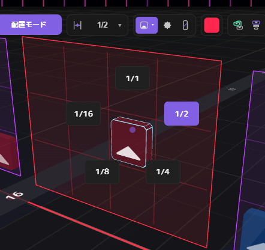

キーを押したままマウスを選びたい項目の方へ動かし、キーを離すと決まります。

同じように **W キー**で、選択 / ノーツ / ボム / 壁 を選ぶパイメニューが出ます。

### 配置モードのまま、選んだノーツを直す

配置モードでも、**選んでいるノーツの上にマウスを合わせて**次のキーを押すと、選んだノーツ全部をまとめて直せます。
カメラ固定モードへ切り替える手間が省けます。

| 操作 | 動き |
|---|---|
| **F** | 色を反転する（赤 ⇄ 青） |
| **Alt + ホイール** | 切る向きを回す |
| **D** | ドット（向きなし）にする |

マウスが選んだノーツの上に無い時は、これまでどおり「これから置くノーツ（ブラシ）」の色・向きが変わります。

**Alt + ホイール** で回る向きは、ドットを含まない 8 方向だけです。
そのため、複数のノーツを選んでまとめて回しても、ノーツ同士の向きの関係（例：左右対称）が崩れません。
ドットにしたい時は **D キー**を使います。ブラシに対して D キーを押すと、ドットと直前の矢印の向きが切り替わります。

### アーク・チェーンの形を細かく調整する

アークやチェーンを選んだ状態で、ホイールに次のキーを組み合わせると形を変えられます。

| 対象 | 操作 | 変わるもの |
|---|---|---|
| アーク | **Alt + ホイール** | 頭側の曲がり具合 |
| アーク | **Ctrl + Alt + ホイール** | 尾側の曲がり具合 |
| チェーン | **Shift + ホイール** | 分割数（リンクの数） |
| チェーン | **Ctrl + Alt + ホイール** | 詰め具合（squish。リンクを頭側へ寄せる量） |

### マーカーで曲の区切りに印を付ける

**Ctrl + E** で、マウスのある位置（マウスが無ければいまの拍）にマーカー（目印）を置きます。
サビやブレイクの始まりに置いておくと、**Ctrl + [ / Ctrl + ]** で前後のマーカーへ移動できます。

NLE の上の段（マーカーの帯）で、マーカーをドラッグして動かしたり、名前をダブルクリックして名前を変えたりできます。
マーカーを右クリックすると、次のこともできます。

- **▶ 試聴の開始に転送**：選曲画面で流れる区間の開始位置を、マーカーの位置にする
- 名前の変更・削除

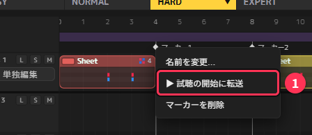

また、NLE のクリップを右クリック →「**マーカーでカット**」で、クリップの中にあるマーカーの位置すべてでクリップを分割できます（[3 章](#3-nle-を使いこなす)）。

### ショートカットを自分用に変える

メニューの **環境設定 → ショートカット編集** タブで、キーの割り当てを変えられます。

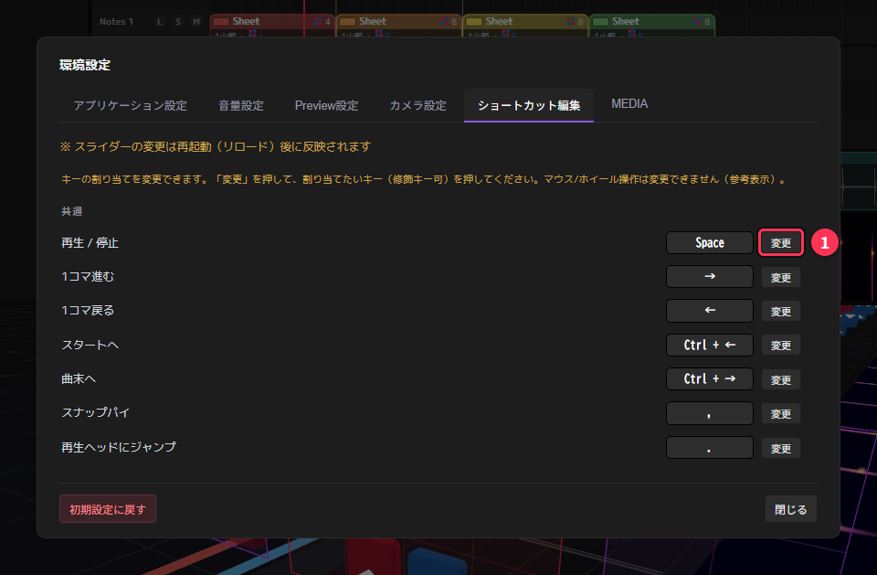

1. 変えたい操作の **変更** ボタンを押す
2. 新しく割り当てたいキー（Ctrl・Alt・Shift との組み合わせも可）を押す。やめる時は Esc

- 他の操作と同じキーになった時は、キーの枠が赤くなって知らせます
- 変えた操作には **既定** ボタンが出て、個別に元に戻せます。**全て既定に戻す** で全部まとめて戻せます
- 変えられるのはキーボードの操作だけです（マウスやホイールの操作は変えられません）
- 画面に浮かぶショートカット一覧の小窓にも、変えたキーが出ます
- 割り当ては環境設定と一緒に保存されるので、アプリを再起動しても残ります

<!-- 章ナビ -->
> **ほかの章へ：** [1. 作業を速くする操作](#1-作業を速くする操作) ｜ [2. 配置を助ける表示](#2-配置を助ける表示) ｜ [3. NLE を使いこなす](#3-nle-を使いこなす) ｜ [4. 難易度をまとめて作る](#4-難易度をまとめて作る) ｜ [5. テンポが変わる曲と、拍のずれの直し方](#5-テンポが変わる曲と拍のずれの直し方) ｜ [6. 曲を解析する（テンポと構成）](#6-曲を解析するテンポと構成) ｜ [7. ライティングの応用](#7-ライティングの応用) ｜ [8. INFO ノードの応用](#8-info-ノードの応用) ｜ [9. 公開前のチェック](#9-公開前のチェック) ｜ [10. 自分に合わせた設定](#10-自分に合わせた設定) ｜ [11. 困ったとき](#11-困ったとき) ｜ [▲ 目次](#目次)
<!-- /章ナビ -->

---

## 2. 配置を助ける表示

ノーツを置く時に「次はどの向きに振るか」「遊びやすい速さか」を判断しやすくする表示です。

### 直前ノーツの補助表示

配置する枠（配置モードでは赤枠、カメラ固定モードでは黄色枠）の **左右の外側** に補助のマスがあり、
赤・青それぞれ **直前に置いたノーツ** を、位置と向きごと半透明で表示します。

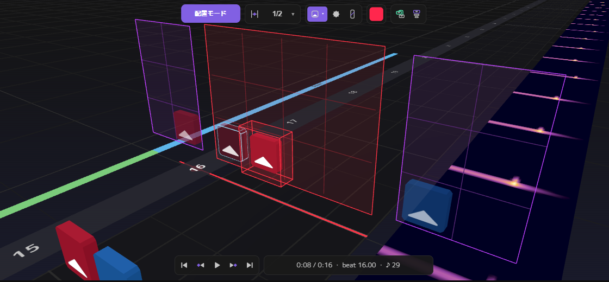

画像では、左の紫の枠に赤の直前のノーツ（上向き）、右の紫の枠に青の直前のノーツが出ています。
中央の赤枠の中のノーツは、直前の赤と同じ上向きに置いたため、次の「同じ向きの連続の警告」の赤枠が付いています。

前のノーツから自然に振り返せる向きを選ぶのに使います。たとえば直前の青が下向きなら、次の青は上向きが自然です。

- **H キー**で表示の ON / OFF を切り替えます（環境設定の「直前ノーツ表示」でも切り替えられます）
- 赤と青の直前ノーツが同じマスに来た時は、両方を小さくして斜めにずらして表示します（赤＝左上、青＝右下）

### 同じ向きの連続の警告

ノーツを置いた時、**同じ色の前後のノーツと切る向きの差が 45° 以内**だと、次の 3 つで知らせます。
同じ向きに 2 回続けて振ると、振り返しができず、そこから先の流れが崩れるためです。

- 問題のノーツに **赤枠** が付く
- 画面上部の **「同じ向き」ランプ** が点灯する
- 短い警告音が鳴る

赤枠は上の画像の中央のノーツ、ランプは次の「JD / RT の表示」の画像の②です。

赤枠が付くノーツは、次のように決まります。

- 前のノーツと同じ向きになった時は、**いま置いたノーツ** に付きます
- 後ろのノーツと同じ向きになった時は、**後ろのノーツ** に付きます（途中のノーツを置き直した時など）

**ランプをクリックすると、赤枠のノーツのうち一番前の位置へ移動** します。
向きを直したり消したりすると、赤枠とランプは自動で消えます。

次の場合は判定しません（意図した配置であることが多いため）。

- ドットのノーツ
- 前後の間隔が 1/5 拍未満（スライダーなど、ひと振りで切る配置とみなします）
- 間にボムがある（ボムで振りをリセットしているとみなします）

チェーンは、頭の向きで尾までひと振りとして判定します。

選んだノーツを Alt + ホイールで回したり F で色を反転したりした時は、回している途中では鳴らさず、
**選択を外した時点** でまとめて判定します。

警告が要らない時は、環境設定の「同じ向きの連続の警告」で OFF にできます。

> この警告は配置中の目安で、[9 章](#9-公開前のチェック) の譜面チェックほど厳密ではありません。
> 公開前には譜面チェックも使ってください。

### JD / RT の表示

ヘッダーの BPM 欄の右に、ノーツの見え方に関わる 3 つの値が出ます。

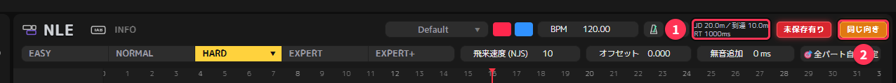

| 表示 | 意味 |
|---|---|
| **JD**（m） | ノーツが出現してから消えるまでの距離 |
| **到達**（m） | ノーツの出現位置から、プレイヤーの位置までの距離（JD の半分） |
| **RT**（ms） | ノーツが出現してから、プレイヤーの位置に届くまでの時間（反応時間） |

BPM・NJS（飛来速度）・オフセットから、Beat Saber 本体と同じ式で計算しています。
この欄は表示だけです。値を変えたい時は、ヘッダーの **NJS** や **オフセット** を調整します。

- RT が短いほど、ノーツが急に現れるように感じます。長いほど、遠くから見えていて読みやすい反面、画面にノーツが多く並びます
- 難易度ごとに NJS とオフセットが別なので、難易度を切り替えると値も変わります
- 計算には Info.dat の基準の BPM を使います（テンポパートで途中の BPM を変えても、この表示は変わりません）

### スペクトログラム（周波数の表示）

曲を読み込むと、音の周波数の強さを色の帯で表示します（弱い → 強い：黒 → 紫 → 赤 → 橙 → 白）。

- **NLE**：Music の段の波形の下
- **3D ビュー**：ノーツを置く空間の外側

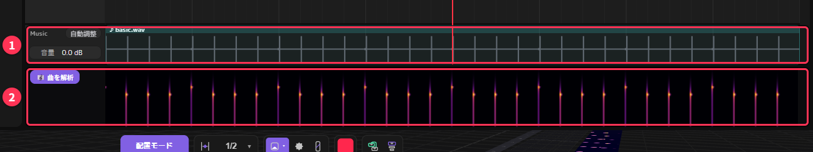

画像の曲は説明用のクリック音なので、拍ごとに縦の線が並んでいます。普通の曲では、盛り上がる所ほど帯全体が明るくなります。

サビなど音が厚い所は明るく、静かな所は暗く見えるので、曲の構成をひと目でつかめます。
ノーツを密にする所・休ませる所を決める目安になります。

NLE のスペクトログラムは、Music の配置（開始位置・分割・トリム）どおりに、実際に鳴る音の並びで描かれます。
Music のクリップを動かしたり切ったりすると、波形と一緒に動きます（音の無い所には何も描きません）。

NLE のスペクトログラムの左の紫の **🎼 曲を解析** を押すと、曲の構成（イントロ・Aメロ・サビなどの区切り）を帯で出せます（[6 章](#6-曲を解析するテンポと構成)）。

<!-- 章ナビ -->
> **ほかの章へ：** [1. 作業を速くする操作](#1-作業を速くする操作) ｜ [2. 配置を助ける表示](#2-配置を助ける表示) ｜ [3. NLE を使いこなす](#3-nle-を使いこなす) ｜ [4. 難易度をまとめて作る](#4-難易度をまとめて作る) ｜ [5. テンポが変わる曲と、拍のずれの直し方](#5-テンポが変わる曲と拍のずれの直し方) ｜ [6. 曲を解析する（テンポと構成）](#6-曲を解析するテンポと構成) ｜ [7. ライティングの応用](#7-ライティングの応用) ｜ [8. INFO ノードの応用](#8-info-ノードの応用) ｜ [9. 公開前のチェック](#9-公開前のチェック) ｜ [10. 自分に合わせた設定](#10-自分に合わせた設定) ｜ [11. 困ったとき](#11-困ったとき) ｜ [▲ 目次](#目次)
<!-- /章ナビ -->

---

## 3. NLE を使いこなす

NLE は、譜面を **クリップ**（色の付いた帯）単位で並べるタイムラインです。
サビのくり返しなど、同じ配置を何度も使う曲では、クリップをコピーして並べると早く作れます。

### NLE の各部

上から順に、次の段が並んでいます。

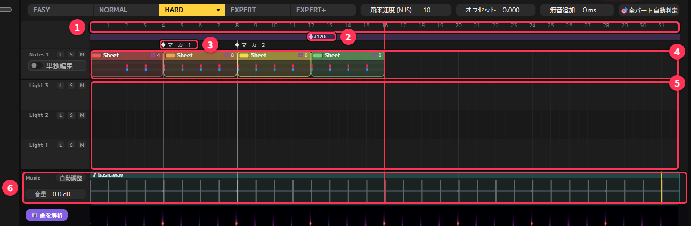

| 番号 | 段 | できること |
|---|---|---|
| ① | 数字の目盛り（ルーラー） | クリック・ドラッグで再生位置を動かす |
| ② | テンポパートの帯（紫） | 曲の途中で BPM を変える（[5 章](#5-テンポが変わる曲と拍のずれの直し方)）。画像では 12 拍目に ◆ がある |
| ③ | マーカーの帯 | マーカーの移動・名前の変更（[1 章](#マーカーで曲の区切りに印を付ける)） |
| ④ | Notes のレーン | ノーツ・ボム・壁・アーク・チェーンのクリップ（色の付いた帯） |
| ⑤ | Light のレーン | ライトのクリップ |
| ⑥ | Music | 曲の波形。その下はスペクトログラム。左端で曲の音量を変えられる（[5 章](#曲の音量音量補正)）。スペクトログラムの左の **🎼 曲を解析** は [6 章](#6-曲を解析するテンポと構成) |

レーンの左端の **L / S / M** のボタンは、レーンのロック・ソロ・ミュートです（下の「レーンを増やす・ロック・ソロ・ミュート」）。
ノーツのレーンには、その下に **単独編集** の帯（スイッチ）もあります（下の「[単独編集](#単独編集)」）。

新しいプロジェクトは、ノーツのレーン 1 本・ライトのレーン 3 本から始まります（画像も 1 本と 3 本です）。
レーンは、右クリックで足せるほか、空きが無い所へクリップを置いた時に自動で一番上に足されます（下の「[レーンを増やす・ロック・ソロ・ミュート](#レーンを増やすロックソロミュート)」）。

**クリップは難易度ごとに別々** です。難易度を切り替えると、その難易度のクリップに入れ替わります。
別の難易度へ中身を写す方法は [4 章](#4-難易度をまとめて作る) で説明します。

### クリップを選ぶ・動かす

| 操作 | 動き |
|---|---|
| クリップを **左クリック** | 選ぶ |
| **Shift + 左クリック** | 選んだものに追加する（もう一度で外す） |
| 何もない所から **左ドラッグ** | 囲んだクリップをまとめて選ぶ |
| **A** | 選択を解除する |
| クリップを **ドラッグ** | 動かす（選んだクリップはまとめて動く） |
| クリップの **左右の端をドラッグ** | 長さを変える |
| **X / Delete** | 消す |

同じレーンの中でクリップを重ねることはできません。

### 分ける・つなげる

| 操作 | 動き |
|---|---|
| クリップを選び、分けたい拍にマウスを置いて **C** | その位置で分ける |
| **R** | 分割モードの ON / OFF。ON の間は、クリップをクリックした位置で分ける |
| 右クリック →「**マーカーでカット**」 | クリップの中のマーカーの位置すべてで分ける |
| 2 つ以上選んで **Ctrl + G** | 1 つのクリップにつなげる |

- 分けた後ろ側のクリップは、名前の後ろに「'」が付き、別の色になります
- **Ctrl + G** は、ノーツ同士・ライト同士なら、別のレーンにあっても、離れていても 1 つにつなげます。
  時間が重なっていた所のノーツはそのまま重なるので、[9 章](#9-公開前のチェック) の譜面チェックで確かめてください

サビの始まりなど曲の区切りにマーカーを置いてから「マーカーでカット」を使うと、クリップを曲の構成どおりに分けられます。

### コピーと貼り付け

1. クリップを選んで **Ctrl + C**（切り取りは **Ctrl + X**）
2. **Ctrl + V** を押すと、貼り付ける予定のクリップがマウスについてくる
3. 貼り付けたい位置で **クリック**（やめる時は Esc か右クリック）

複数のクリップを選んでコピーすると、並び方を保ったまま貼り付けられます。

- **Ctrl + Shift + V** は「リンクして貼り付け」です。貼り付けたクリップがコピー元とつながり、コピー元を直すと貼り付けた方にも入ります（下の「[リンクしたクリップ](#リンクしたクリップ)」）
- 別の難易度へ切り替えてから貼り付けることもできます。その時は、コピー元と **繋ぐ（リンク）** か **切る（普通に貼り付け）** かを選ぶ画面が出ます

### クリップの右クリックメニュー

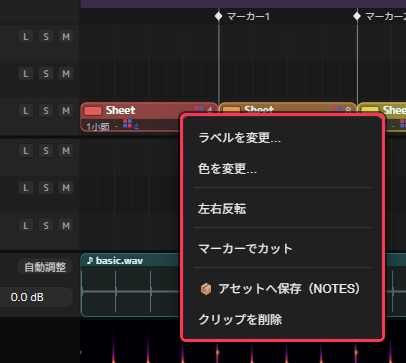

| 項目 | 動き |
|---|---|
| ラベルを変更… | クリップの名前を変える（「サビ1」など） |
| 色を変更… | クリップの色を変える（クリップの左上の色の四角をクリックしても変えられます） |
| 🔗 他の難易度の同じ位置のクリップとリンク… | 下の「[難易度をまたいでリンクする](#難易度をまたいでリンクする)」を参照 |
| **左右反転** | 中身を左右に反転し、赤と青を入れ替える |
| マーカーでカット | 上の「分ける・つなげる」を参照 |
| **📦 アセットへ保存** | 下の「アセット」を参照 |
| クリップを削除 | クリップを消す |

2 つ以上のクリップを選んで右クリックした時は **🔗 リンクする**、リンクしたクリップでは **リンクを解除** なども出ます（下の「リンクしたクリップ」）。

何もない所を右クリックすると、**空のクリップを作成**（16 拍）と **マーカーを作成** が出ます（クリップをコピーしてあれば **🔗 リンクして貼り付け** も）。

> **例：2 回目のサビを作る**
> 1 回目のサビのクリップを Ctrl + C → 2 回目のサビの位置で Ctrl + V → 右クリック →「左右反転」。
> 同じ配置の左右を入れ替えるだけで、2 回目に変化が付きます。

### レーンを増やす・ロック・ソロ・ミュート

新しいプロジェクトは、ノーツのレーン 1 本・ライトのレーン 3 本から始まります。
新しいプロジェクトのノーツのレーンの本数は、環境設定の「**ノーツのレーンの本数**」で変えられます（[10 章](#アプリケーション設定)）。

レーンの左端の何もない所を右クリックすると、ノーツ・ライトそれぞれのレーンを **一番上に追加・削除** できます。

- レーンは最大 10 本です
- 削除できるのは、一番上のレーンが空の時だけです（他の難易度も含めて空である必要があります）
- レーンの本数は全難易度で共通です
- レーンの追加・削除は **Ctrl + Z を 1 回** で戻せます（全難易度のクリップの位置も一緒に戻ります）

**空きが無い時は、一番上にレーンが足されます**

次の操作で、入れる所のレーンが埋まっている時は、一番上にレーンを 1 本足して入れます（今あるクリップは 1 段ずつ下へずれます）。

- 3D ビューでノーツなどを置いた時（置いた拍に入れるクリップも、1 小節のクリップを作る空きも無い時）
- MEDIA の譜面やアセットのクリップを、NLE へドラッグした時
- NLE でクリップを貼り付けた時（足すレーンに入る物は、貼り付ける予定のクリップの名前の前に「＋」が出ます）

レーンが上限の 10 本の時は足さずに、画面の下で知らせます。足したレーンは、Ctrl + Z で操作と一緒に戻ります。

**縦のスクロールバー**

レーンが多くて全部が見えない時は、ノーツ・ライトのグループごとに、NLE の **右端** と **左端**（レーンの名前の左の細い帯）に縦のスクロールバーが出ます。
左右のスクロールバーはいつも同じ位置を指していて、どちらを使っても同じです。

- つまみをドラッグする・スクロールバーの何もない所をクリックすると、その位置へ動きます
- スクロールバーの上でホイールを回すと、約 1 レーンずつ動きます

レーンにマウスを置いて次のキーを押す（またはレーン左端のボタンを押す）と、レーンの状態を切り替えられます。

| キー | 状態 | 動き |
|---|---|---|
| **L** | ロック | 中身が暗くなり、3D ビューで選んだり直したりできなくなる |
| **M** | ミュート | 中身を 3D ビューに表示しない |
| **S** | ソロ | そのレーンだけを 3D ビューに表示する |
| **E** | 単独編集 | ノーツのレーンだけ。3D ビューで置くノーツがそのレーンだけに入り、他のレーンは直せなくなる（下の「[単独編集](#単独編集)」） |

ミュートとソロは **表示を切り替えるだけ** です。書き出しには、全部のレーンの中身が入ります。
ライトを作る時に、ノーツのレーンをロックしておけば、うっかりノーツを動かしてしまうのを防げます。
レーンの状態は、プロジェクトと一緒に保存されます。

### 単独編集

ノーツのレーンを 1 本だけ編集できるようにします。
レーンを分けて配置を重ねている時に、別のレーンのノーツをうっかり動かしたり、思っていたのと違うレーンに置いたりするのを防げます。
新しいプロジェクトはノーツのレーンが 1 本なので、レーンを分けて使う時は、先に [レーンを足します](#レーンを増やすロックソロミュート)。

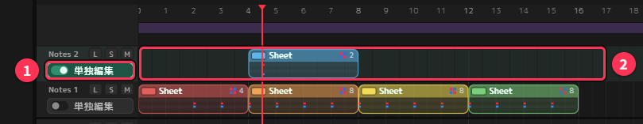

| 番号 | 名前 | 説明 |
|---|---|---|
| ① | 単独編集のスイッチ | ノーツのレーンの左端の、名前と L / S / M の下の帯。帯のどこを押しても切り替わる。オンで緑になり、もう一度押すとオフ |
| ② | 単独編集のレーン | 3D ビューで置いたノーツは、すべてこのレーンに入る |

画像は、ノーツのレーンを一番上に 1 本足して（Notes 2）、そのレーンを単独編集にし、拍 4 あたりにノーツを置いたところです。
下の Notes 1 には、前に置いたノーツのクリップがあります。

- NLE でノーツのレーンにマウスを置いて **E** を押しても、オン・オフを切り替えられます（**Ctrl + E** はマーカーの追加で、別の操作です）
- 単独編集にできるのは 1 本だけです。別のレーンをオンにすると、前のレーンはオフになります
- オンの間は、3D ビューで置く・貼り付けるもの（ノーツ・ボム・壁・アーク・チェーン）が、すべてそのレーンに入ります。
  置いた所にそのレーンのクリップが無い時は、1 小節のクリップを作って入れます
- 他のレーンのノーツは、ロックした時と同じように暗くなり、選んだり動かしたりできません
- レーンの並びは全難易度で共通なので、難易度を切り替えても同じレーンが単独編集のままです
- ライトのレーンにはありません（LIGHTING モードでは効きません）

**他のレーンのノーツをクリックした時**

3D ビューで他のレーンのノーツをクリックすると、クリック自体では何も変わらず、画面の上に帯（①）が出ます。

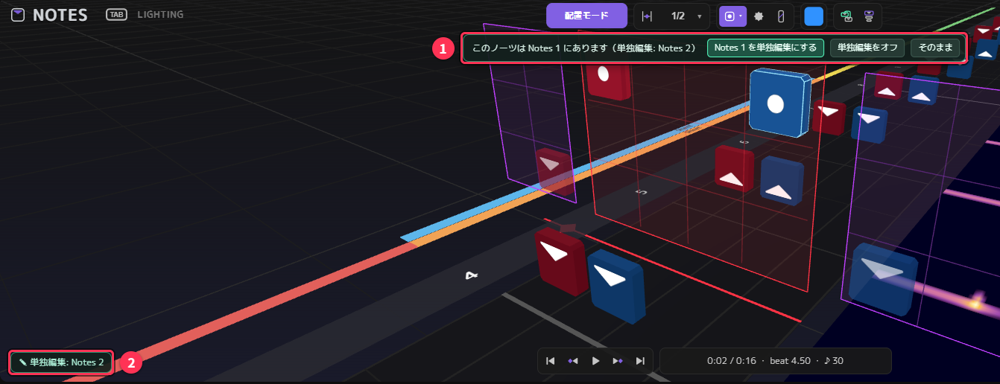

| ボタン | 動き |
|---|---|
| **Notes 1 を単独編集にする** | クリックしたノーツのレーンを単独編集にする |
| **単独編集をオフ** | 単独編集をやめる（どのレーンにも置けるように戻る） |
| **そのまま** | 帯を閉じる |

- 単独編集の間は、3D ビューの左下に「✎ 単独編集: Notes 2」のように出ます（②）
- ドラッグで囲んで選んだ時は、他のレーンのノーツは帯を出さずに選択から外れます（外れた数が、左下の表示に少しの間だけ出ます）
- ロック中のレーンを単独編集にすると、ロックは外れます
- 単独編集のレーンをロック・ミュートした時や、他のレーンのソロで見えなくなった時は、置こうとしても置かずに、画面の下で知らせます
- どのレーンを単独編集にしているかは、プロジェクトと一緒に保存されます（切り替えただけでは「未保存」になりません。Ctrl + Z の対象でもありません）

### リンクしたクリップ

同じ中身にしたいクリップどうしを **リンク**（つなぐ）しておくと、1 か所を直すだけで、つないだ全部に同じ直しが入ります。
くり返すサビや、難易度をまたいで同じにしたい配置に使います。

- リンクしたクリップのうち、編集できるのは **親** の 1 つだけです。残りは **子** で、いつも親と同じ中身になります
- 親にノーツを置く・消す・動かす、親を左右反転する、といった直しは、子にもそのまま入ります
- 名前と色は、リンクした全部で同じです（どのクリップで変えても全部が変わります）
- 別の難易度のクリップともリンクできます（下の「[難易度をまたいでリンクする](#難易度をまたいでリンクする)」）
- ノーツのクリップどうし、ライトのクリップどうしでリンクできます（ノーツとライトは混ぜられません）

#### リンクする

1. リンクしたい 2 つのクリップを選ぶ（クリック → **Shift + クリック**）
2. **K** を押す（または右クリック →「**🔗 リンクする（K）**」）
3. 親を選ぶ画面で、どちらを親にするかを選んで **リンクする**

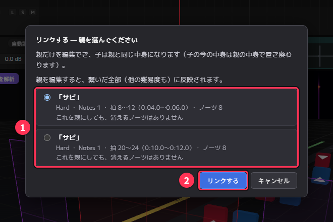

| 番号 | 名前 | 説明 |
|---|---|---|
| ① | 親の候補 | クリップの名前と、難易度・レーン・拍の範囲（曲の時刻）・ノーツの数。最初は拍の早い方が選ばれている |
| ② | リンクする | 選んだ方を親にしてリンクする |

- 子になる方の今の中身は、親の中身で置き換わります。2 つの中身が違う時は、候補の下に「これを親にすると、消えるノーツ: Hard 8個」のように赤い字で出ます
- 小節の頭からの位置がずれている 2 つ（拍 8 と拍 21 など）でもリンクできます（その時は、画面にそのことが出ます）
- 新しく一度にリンクできるのは 2 つだけです。3 つ目からは、リンクしたクリップ（親でも子でも）と一緒に選んで K を押すと、そのリンクに子として加わります
- 別々の 2 つのリンクのクリップを選んで K を押すと、親を選んで 1 つのリンクにまとめられます（選ばなかった方は、親も子も全部、選んだ親の子になります）

**リンクして貼り付け**

クリップを選んで **Ctrl + C** → **Ctrl + Shift + V** → 貼り付けたい位置で **クリック** すると、貼り付けたクリップがコピー元とリンクします
（何もない所を右クリック →「**🔗 リンクして貼り付け**」でも同じです）。

- コピー元がまだリンクしていなければ、コピー元が親、貼り付けた方が子になります
- コピー元が子なら、貼り付けた方はその親の子になります
- **Ctrl + X**（切り取り）した物は、コピー元が無くなるので、リンクして貼り付けはできません

> **例：くり返すサビを 1 か所で直す**
> 1 回目のサビのクリップを選んで Ctrl + C → 2 回目・3 回目のサビの位置で Ctrl + Shift + V。
> あとで 1 回目のサビ（親）を直すと、2 回目・3 回目にも同じ直しが入ります。
> 2 回目だけ変えたくなったら、そのクリップのリンクを解除してから直します。

#### 親と子の見分け方

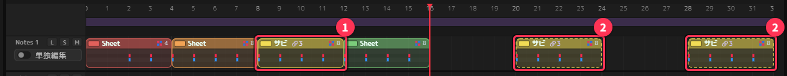

| 番号 | 名前 | 説明 |
|---|---|---|
| ① | 親 | 名前の右に 🔗 と、リンクしているクリップの数が出る。他の難易度にも子がある時は「他の難易度にも 1」のように続く |
| ② | 子 | 枠が点線になる。中身は親と同じで、ここでは直せない |

画像は、拍 8 の「サビ」を親にして、拍 20 と拍 28 に子を置いたところです（🔗3＝3 つのクリップでリンク）。

#### 子は直せない

子の中のノーツやライトは、3D ビューで選んだり動かしたりできません（ロックしたレーンと同じように暗く表示されます）。
子のノーツをクリックしたり、子の範囲にノーツを置こうとしたりすると、クリック自体では何も変わらず、画面の上に帯（①）が出ます。

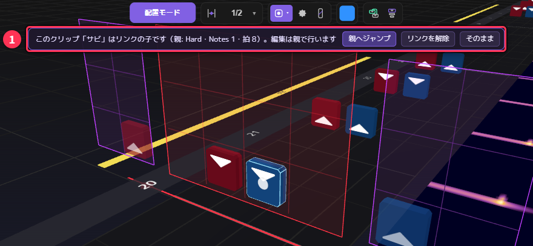

| ボタン | 動き |
|---|---|
| **親へジャンプ** | 親のクリップを選び、再生位置を親の頭へ移す（親が別の難易度にある時は、その難易度へ切り替える） |
| **リンクを解除** | このクリップのリンクを外して、普通のクリップにする（中身はそのまま残る） |
| **そのまま** | 帯を閉じる |

- NLE でも、子の **左右反転** と **左端のトリム** はできません（同じ帯が出ます）。右端はドラッグして長さを変えられます
- 子を親より長くした所は斜線で表示され、中身は入りません
- 親を直した時に、他の難易度にも子があれば、「…他の難易度（Expert）にも繋がっています。親の編集は繋いだ全部に反映されます」と帯で知らせます（リンクごとに 1 回だけ）

#### リンクしたクリップの右クリックメニュー

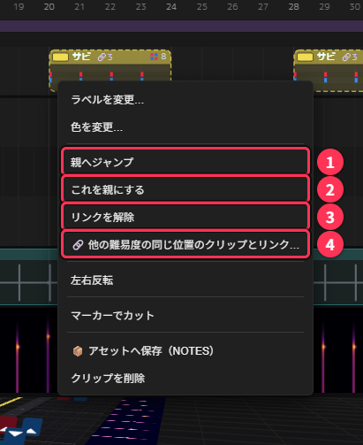

| 番号 | 項目 | 動き |
|---|---|---|
| ① | 親へジャンプ | 子だけに出る。上の帯と同じ |
| ② | これを親にする | 子だけに出る。このクリップを新しい親にする（それまでの親は子になる） |
| ③ | リンクを解除 | このクリップのリンクを外す。リンクしたクリップを複数選んでいれば、まとめて外す（「リンクを解除（2個）」のように出る） |
| ④ | 🔗 他の難易度の同じ位置のクリップとリンク… | 下の「難易度をまたいでリンクする」を参照 |

#### リンクを外す・クリップを消す

- リンクを解除したクリップは、その時の親の中身を写した普通のクリップになります
- リンクしているクリップが 1 つだけになると、そのリンクは自動で外れます
- **親を消したり、親のリンクを解除したりして、2 つ以上が残った時は、次の親を選ぶ画面が出ます**（どれを選んでも中身は同じです。下の画像）
- リンクしている間は、クリップの **分割**（C・分割モード・マーカーでカット）も **結合**（Ctrl + G）もできません。
  分割しようとすると帯が出るので、［リンクを解除］してから分割します
- 他の難易度とリンクしているクリップがある難易度は、難易度のメニューの「全ノーツを削除」などで中身を消せません（先にリンクを解除します）

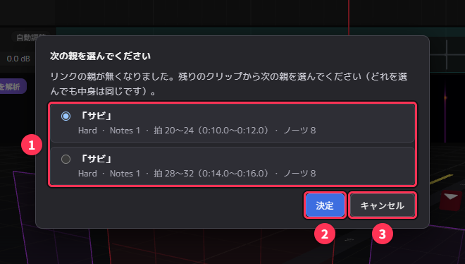

| 番号 | 名前 | 説明 |
|---|---|---|
| ① | 次の親の候補 | 残ったクリップ。最初は一番上の候補が選ばれている |
| ② | 決定 | 選んだクリップを次の親にする（Enter でも同じ） |
| ③ | キャンセル | 画面を出すきっかけになった操作を、まるごと取り消す（Esc でも同じ） |

画像は、拍 8 の親（サビ）を選んで Delete で消したところです。子が 2 つ残ったので、次の親を選ぶ画面が出ています。

**キャンセル** を押すと、きっかけになった操作（親のクリップの削除・切り取り、リンクの解除、難易度の転送・受信で写し先の親が消えた時は、その転送）が無かったことになり、操作の前とまったく同じ状態に戻ります（他の難易度のクリップやリンクも戻ります）。

- 取り消した操作は、やり直し（Shift + Ctrl + Z）でも戻りません
- 2 つのリンクで続けて画面が出た時は、どちらの画面でキャンセルしても、操作の全部を取り消します

#### 難易度をまたいでリンクする

リンクは難易度をまたげます。たとえば Expert+ のクリップを親にして、Expert の同じクリップを子にしておくと、
Expert+ を直した時に Expert にも同じ直しが入ります。作り方は 3 つあります。

| 方法 | 内容 |
|---|---|
| 難易度のメニューの **転送・受信** | 確認の画面の「**親の難易度に繋ぐ（リンク）**」（最初からオン）のまま写すと、写し先のクリップが、写し元の同じクリップの子になる（[4 章](#転送受信のメニューを開く)） |
| 別の難易度へ **貼り付け** | 別の難易度でコピーしたクリップを Ctrl + V で貼り付けると、「**繋ぐ（リンク）**／**切る（普通に貼り付け）**」を選ぶ画面が出る。繋ぐと、コピー元の子になる。Ctrl + Shift + V なら画面を出さずに繋ぐ |
| 右クリック →「**🔗 他の難易度の同じ位置のクリップとリンク…**」 | 他の難易度で、拍・レーン・長さが同じクリップの一覧が出る。チェックした難易度のクリップが、このクリップ（リンクしていれば、その親）の子になる |

- 写し元・コピー元のクリップが子の時は、その親につなぎます
- リンクを付け外しして他の難易度も変わった時は、**Ctrl + Z を 1 回** 押すと、全部の難易度が元に戻ります

### Music（曲）のクリップ

Music の段を右クリックすると、**曲の長さぶんのクリップ**（ノーツとライト、ノーツだけ、ライトだけ）を一度に作れます。
曲全体を 1 つのクリップで作り、あとからマーカーでカットして分ける、という作り方もできます。

Music も、選んでから C で分けたり、選んで X / Delete で一部を消したりできます（曲の終わりの余韻を切る時など）。
分けた Music は、2 つ以上選んで Ctrl + G でつなげ直せます。

### アセット（配置パターンを保存して使い回す）

クリップを右クリック →「**📦 アセットへ保存**」で、クリップの中身を部品として保存できます。

- 保存したアセットは **MEDIA** の一覧に出ます。NLE のレーンへドラッグすると、その位置にクリップとして置けます（空きが無い時は一番上にレーンが足されます）
- 別のプロジェクト・別の曲でも使えます
- MEDIA でアセットを右クリックすると、名前を変えられます
- アセットは、アプリのフォルダの `asset` に `.nlmclip` ファイルとして保存されます

よく使うリズムの型や、ライトの演出をアセットにしておくと、新しい曲を作る時に便利です。

### MEDIA ライブラリ（曲のフォルダを記録して一覧・検索する）

Beat Saber の CustomLevels（ダウンロードした曲が入っているフォルダ）や音楽のフォルダを MEDIA に登録すると、
中の曲を一覧・検索して、譜面や音源を素材として NLE へドラッグできます。
自分の前の譜面から配置を借りる、同じくらいの難しさの譜面を探して NJS や NPS を比べる、といった使い方ができます。

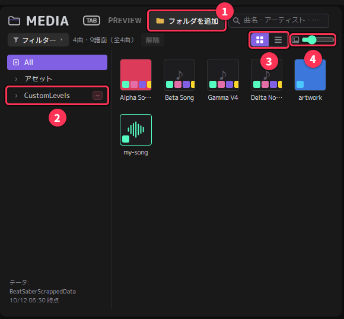

| 番号 | 名前 | 説明 |
|---|---|---|
| ① | フォルダを追加 | フォルダを選んで、ライブラリに足す |
| ② | カタログ | 登録したフォルダの一覧。選んだフォルダの中だけを一覧に出す（**All** は全部、**アセット** は上の [アセット](#アセット配置パターンを保存して使い回す)） |
| ③ | 表示の切り替え | グリッド（カバー画像の並び）と詳細表示（1 行＝1 難易度の表）を切り替える |
| ④ | 大きさ | グリッドではカバー画像の大きさ、詳細表示では文字の大きさ（一覧の上で **Ctrl + ホイール** でも変えられます） |

#### フォルダを追加する

① **フォルダを追加**（またはファイルメニューの **MEDIAにフォルダを追加…**）で、フォルダを選びます。
CustomLevels のように曲のフォルダがたくさん入ったフォルダを選ぶと、中の曲をまとめて読み込みます。

- デスクトップ版（exe）では、選んだフォルダが **記録** され、次に起動した時も自動で読み込みます
- 初めて読み込む時は、曲の数に応じて時間がかかります（件数の所に「読み込み中 12/85」、カタログに「12/85」のように進み具合が出ます）。
  2 回目からは、変わった曲だけを読み直すので速くなります
- 曲を足した・消した時は、カタログのフォルダを右クリック →「**🔄 読み直す**」
- カタログのフォルダ名をダブルクリックすると、カタログに出す名前を変えられます（フォルダの名前そのものは変わりません）
- フォルダの右の **−** で、ライブラリから外します（記録からも消えます。フォルダの中身は消えません）
- 外付けドライブを外した時など、フォルダが見つからない時は薄く表示されます。記録は残り、クリックすると探し直します
- ライブラリのフォルダは読むだけで、NLM が書き込むことはありません
- MEDIA と NLE の境目、カタログと一覧の境目をドラッグすると、幅を変えられます（カタログの境目はダブルクリックで元の幅に戻ります）

> **ブラウザ版**（`serve.py` で起動した時）では、追加したフォルダは記録されず、開き直すと消えます。
> 詳細表示も Info.dat に書かれている値だけで、NPS・長さ・アップロード日・プレイ記録などはデスクトップ版だけです。

#### 詳細表示（1 行＝1 難易度）

③ で詳細表示に切り替えると、難易度ごとに 1 行の表になります。画像は MEDIA を広げて、★の大きい順に並べたところです。

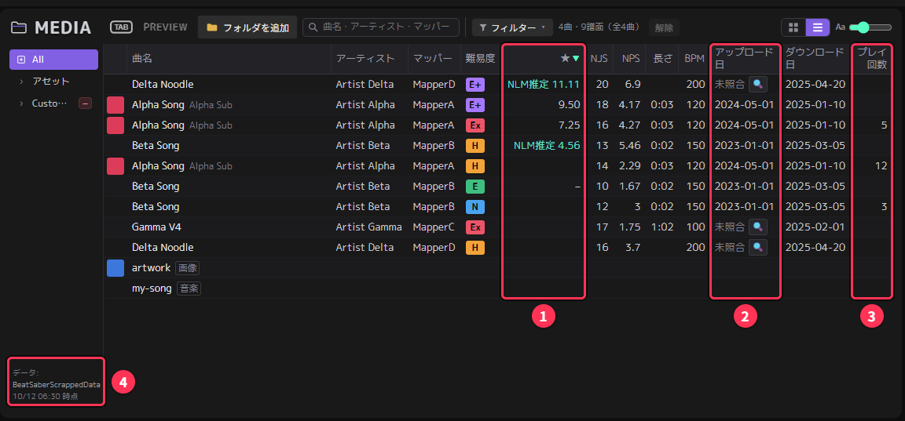

| 番号 | 列・場所 | 説明 |
|---|---|---|
| ① | ★ | BeatLeader の★。★が無い難易度は、NLM が計算した近似値を「**NLM推定 4.56**」のように色を変えて出す（[下](#を計算するnlm推定)）。見出しの ▼ は、この列で並べ替えていることを表す |
| ② | アップロード日 | BeatSaver に上がった日（[全曲データ](#インターネットから取る情報全曲データbeatsaver) から）。全曲データに無い曲は「**未照合 🔍**」 |
| ③ | プレイ回数 | その難易度を Beat Saber で遊んだ回数（[プレイ記録](#ゲームのプレイ記録) から） |
| ④ | データの出どころ | 全曲データを使っている時に、データの名前と時点が出る（マウスを乗せると詳しい説明） |

最初に出ている列は、カバー・曲名（サブタイトル付き）・アーティスト・マッパー・難易度（Standard 以外はモード名も）・★・NJS・NPS・長さ・BPM・アップロード日・ダウンロード日・プレイ回数です。

- **NPS** は BeatSaver と同じ計算です（色のノーツの数 ÷ 最初から最後の色のノーツまでの秒数）
- **長さ** は音源の長さです
- **ダウンロード日** は、MOD が曲のフォルダに残す記録の日付です（無い時は、フォルダの日付からの推定）
- 行をクリックで選び、**Ctrl + クリック** で追加、**Shift + クリック** で範囲を選べます
- 曲以外（音楽ファイル・画像・アセットのクリップ）は、名前と種類だけの行になります
- 表示の切り替え・列・並べ順・フィルターの条件は、次に起動した時も残ります

#### 並べ替えと列

- 見出しをクリックすると、その列で並べ替えます。もう一度クリックすると逆の順になります（▲ 小さい順・▼ 大きい順）
- 値の無い行は、どちらの順でも下にまとまります
- 並べ順は、グリッドのカードの並びにも使われます
- 見出しを右クリックすると、列を出す・隠すメニューが出ます。**初期の列に戻す** で最初の列に戻ります

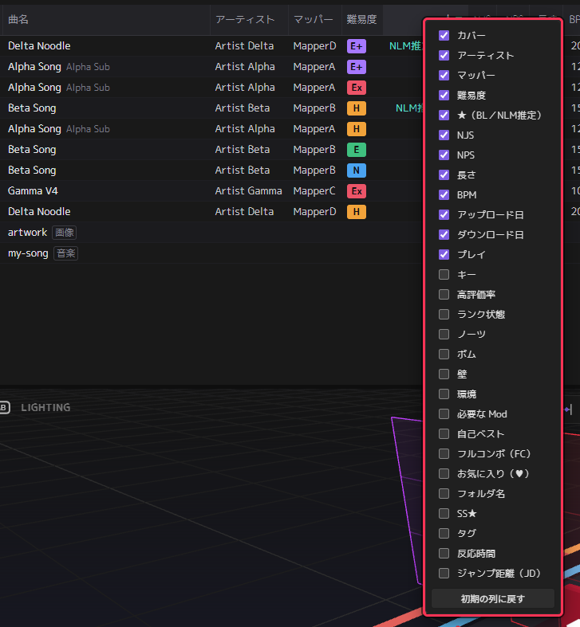

最初は隠れている列には、キー（BeatSaver）・高評価率・ランク状態・ノーツ・ボム・壁・環境・必要な Mod・自己ベスト・フルコンボ・
お気に入り・フォルダ名・SS★（ScoreSaber の★）・タグ・反応時間・ジャンプ距離（JD）があります
（反応時間と JD は、[2 章](#jd--rt-の表示) と同じ式で NJS・オフセット・BPM から計算します）。

#### 検索とフィルター

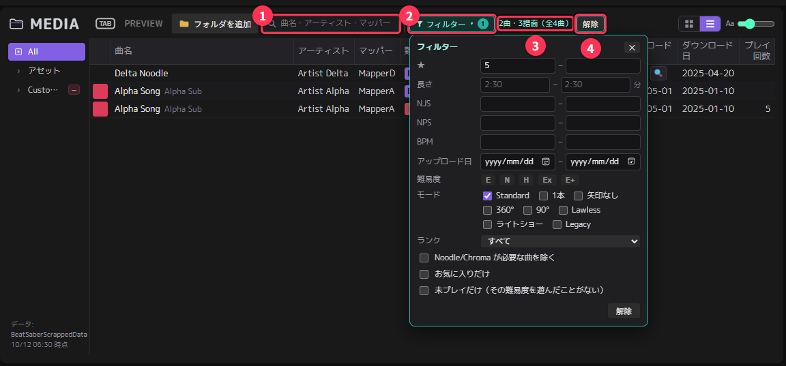

| 番号 | 名前 | 説明 |
|---|---|---|
| ① | 検索欄 | 曲名・アーティスト・マッパーで探す。打つとすぐ絞り込む（Esc か × で消す） |
| ② | フィルター ▾ | 条件のパネルを開く。丸の数字は、いま効いている条件の数 |
| ③ | 件数 | 条件に合う曲と難易度の数。「全 4 曲」は、カタログで選んだ範囲の曲の数 |
| ④ | 解除 | 検索と条件をすべて消す |

| 条件 | 内容 |
|---|---|
| ★・長さ・NJS・NPS・BPM・アップロード日 | 下限と上限（空欄は制限なし）。長さは分（「2:30」と書くと 2 分 30 秒）。★は BeatLeader の★、無ければ NLM推定の★で判定 |
| 難易度 | E・N・H・Ex・E+ から選ぶ（何も選ばなければ全部） |
| モード | Standard・1本・矢印なし・360°・90° など（最初は Standard だけ） |
| ランク | すべて／BL ランク（BeatLeader でランクの付いた難易度）／未ランク |
| Noodle/Chroma が必要な曲を除く | Noodle や Chroma（MOD）が無いと遊べない譜面を除く（あると良い、というだけの譜面は除かない） |
| お気に入りだけ | Beat Saber でお気に入りにした曲だけ（[プレイ記録](#ゲームのプレイ記録) から） |
| 未プレイだけ | その難易度を遊んだことがない行だけ（プレイ記録から） |

- 条件は難易度（行）ごとに判定します。グリッドでは、合う難易度が 1 つでもある曲を出します
- 範囲の条件を入れると、その値が無い行（★の無い譜面など）は外れます
- モードの最初の値（Standard だけ）は、丸の数字に入りません

#### 譜面を NLE へ入れる

曲（グリッドのカード・詳細表示の行）は、ドラッグした先によって次のように使えます。入る先は、いま開いている難易度です。

| ドラッグ先 | 入るもの |
|---|---|
| NLE の Notes のレーン | その難易度のノーツ（ボム・壁・アーク・チェーンを含む）を、ドロップした拍に 1 つのクリップとして置く |
| NLE の Light のレーン | その難易度のライトを、クリップとして置く |
| NLE の Music の段 | 曲の音源を、ドロップした拍に置く |
| INFO 画面 | 曲情報・カバー画像のノードを作る（曲に試聴区間があれば試聴ノードも） |

- 詳細表示の行をドラッグすると、**その行の難易度** が入ります（Expert の譜面を Hard へ入れる、といったこともできます）。
  複数の行を選んでいても、入るのはつかんだ 1 行だけです
- グリッドのカードは、いま開いている難易度と同じ名前の譜面が入ります。フィルターで絞り込んでいる時は、条件に合う難易度から選びます
  （同じ名前が無ければ、合う中で一番難しい難易度。どれが入ったかは画面下のメッセージに出ます）
- Notes・Light のレーンへ入れる時、置く所のレーンが埋まっていれば、一番上にレーンを足して入れます（[レーンを増やす](#レーンを増やすロックソロミュート)）
- Notes のレーンへ入れると、いまの難易度の NJS とオフセットも、入れた譜面の値になります
- 曲を右クリック →「**📥 曲データを読み込む**」で、音源・BPM・曲情報・カバー画像と、Standard の全難易度の譜面をまとめて読み込めます
  （すでに曲を読み込んでいる時は、音源と BPM はそのまま）
- 曲を右クリック →「**📁 フォルダの場所を開く**」で、曲のフォルダをエクスプローラーで開きます（デスクトップ版で登録したフォルダだけ）

> **v4 形式の譜面**（新しい形式の Info.dat の曲）は、一覧・並べ替え・フィルター・音源の配置はできますが、
> 譜面を NLE へ入れること（ドラッグ・曲データを読み込む）は、まだできません。

#### インターネットから取る情報（全曲データ・BeatSaver）

アップロード日・高評価率・ランク状態・★（BeatLeader・ScoreSaber）・タグは、インターネットから取った情報です。

- **全曲データ**：Kinsi さんが公開している [BeatSaberScrappedData](https://github.com/kinsi55/BeatSaberScrappedData)
  （BeatSaver・BeatLeader・ScoreSaber の公開情報をまとめたもの。Beat Saber の一部の MOD も使っています）を、jsDelivr から **1 日 1 回まで** 取得します。
  取得する時、こちらから何かを送ることはありません
- 曲は、譜面の中身から作る識別子（ハッシュ）で照合します。手元の譜面が BeatSaver の今の版と違う時（更新される前の古い版など）は、
  ★とランク状態は出しません（別の版の値のため）
- 全曲データを使っている間は、カタログの下にデータの名前と時点が出ます（詳細表示の画像の④）
- 環境設定の **MEDIA** タブで「全曲データを取得する」を OFF にすると、取得せず、一覧にも出しません（[10 章](#media)）

全曲データに無い曲（アップロードされたばかりの曲など）は、アップロード日の欄に「**未照合 🔍**」と出ます。
🔍 を押すと確認が出て、**送信する** を押した時だけ、その 1 曲の識別子（ハッシュ）を BeatSaver（api.beatsaver.com）へ送って調べます。

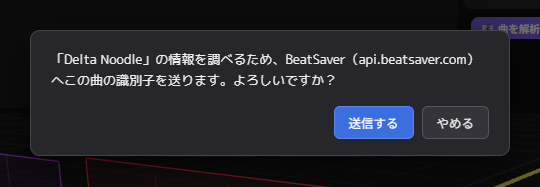

- 見つかると値が入り、🔍 は消えます（BeatSaver から直接取った値は、マウスを乗せると「BeatSaver から取得」と出ます）
- BeatSaver にも無い曲（アップロードしていない自作の譜面など）は「BeatSaver にも見つかりませんでした」と出て、🔍 は残ります
- BeatSaver のサーバーに負担をかけないよう、まとめて調べる機能はありません。押した時に、1 曲ずつ問い合わせます。
  BeatSaver が混んでいる時は「○秒ほど待ってから…」と出ます
- 🔍 は、全曲データを使っている時だけ出ます

#### ゲームのプレイ記録

デスクトップ版では、PC の Beat Saber が保存しているプレイ記録（`PlayerData.dat`）を読んで、
プレイ回数・自己ベスト・フルコンボ・お気に入りを一覧に出します（自己ベスト・フルコンボ・お気に入りは、最初は隠れている列です）。

- 読むだけで、プレイ記録を書き換えることはありません。インターネットへ送ることもありません
- 普通は自動で見つけます。見つからない時は、環境設定の **MEDIA** タブの **ファイルを選ぶ…** で選びます（[10 章](#media)）
- ライブラリを読み込む時と「読み直す」の時に、プレイ記録のファイルが更新されていれば読み直します

#### ★を計算する（NLM推定）

BeatLeader でランクの付いていない譜面には、★がありません。
[9 章](#初めて使う時プラグインを取り込む) の「難易度を測る」と同じ追加プラグイン（nlm-rating）を取り込んであれば、
★の近似値を計算して、★の列に出せます。

詳細表示で行を右クリックして、次のどちらかを選びます。

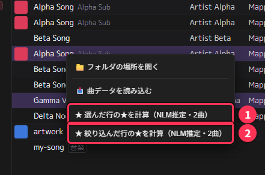

| 番号 | 項目 | 計算する曲 |
|---|---|---|
| ① | ★ 選んだ行の★を計算（NLM推定） | 選んでいる行の曲（**Ctrl・Shift + クリック** で複数選べます） |
| ② | ★ 絞り込んだ行の★を計算（NLM推定） | いま一覧に出ている（検索・フィルターで絞り込んだ）行の曲 |

- 計算するのは、公式の★が無い難易度がある曲だけです（NLM推定をすでに計算した曲と、デスクトップ版で登録したフォルダ以外の曲は除きます）。
  括弧の中の曲数が、計算する曲の数です
- 計算は曲ごとで、その曲の難易度をまとめて計算します。1 曲に 1〜数秒かかります
- 計算中は MEDIA の上に「★を計算中 3/12」のように出ます。**中止** で止められます。30 曲より多い時は、始める前に確認が出ます
- 結果は★の列に「**NLM推定 7.12**」のように色を変えて出ます。★の並べ替え・フィルターにも使われます
- 結果は記録され、次に起動した時も出ます（プラグインを新しい版にすると、前の版の結果は使わず、計算し直せるようになります）
- ノーツが 20 個未満の難易度は計算できません（「–」と出ます）。計算できなかった理由は、その欄にマウスを乗せると出ます
- 同時に何曲まで計算するかは、環境設定の **MEDIA** タブで変えられます（[10 章](#media)）
- プラグインが無い時は、取り込み方の案内が出ます（「難易度を測る」のパネルの **GitHub から取り込む** で取り込みます）

> **NLM推定の★は、BeatLeader の公式の★ではありません。** NLM がプラグインで計算した近似値で、本家サイトの値と異なる場合があります。
> 公式の★と見間違えないよう、「NLM推定」と書いて色を変えています。

<!-- 章ナビ -->
> **ほかの章へ：** [1. 作業を速くする操作](#1-作業を速くする操作) ｜ [2. 配置を助ける表示](#2-配置を助ける表示) ｜ [3. NLE を使いこなす](#3-nle-を使いこなす) ｜ [4. 難易度をまとめて作る](#4-難易度をまとめて作る) ｜ [5. テンポが変わる曲と、拍のずれの直し方](#5-テンポが変わる曲と拍のずれの直し方) ｜ [6. 曲を解析する（テンポと構成）](#6-曲を解析するテンポと構成) ｜ [7. ライティングの応用](#7-ライティングの応用) ｜ [8. INFO ノードの応用](#8-info-ノードの応用) ｜ [9. 公開前のチェック](#9-公開前のチェック) ｜ [10. 自分に合わせた設定](#10-自分に合わせた設定) ｜ [11. 困ったとき](#11-困ったとき) ｜ [▲ 目次](#目次)
<!-- /章ナビ -->

---

## 4. 難易度をまとめて作る

複数の難易度を作る時は、1 つの難易度を作り込んでから、その中身を別の難易度へ写して手直しすると早く作れます。

### 転送・受信のメニューを開く

画面上部の難易度のボタン（EASY 〜 EXPERT+）のうち、**いま選んでいる難易度のボタンをもう一度クリック** すると、メニューが出ます。

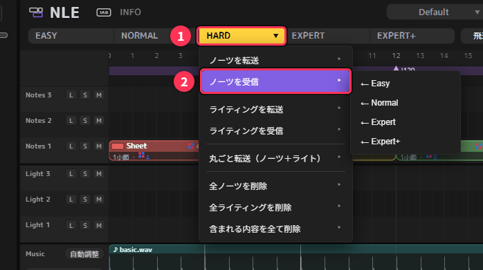

| 項目 | 動き |
|---|---|
| **ノーツを転送** → 送り先 | この難易度のノーツと、ノーツのクリップを、選んだ難易度へ写す |
| **ノーツを受信** ← 送り元 | 選んだ難易度のノーツと、ノーツのクリップを、この難易度へ写す |
| ライティングを転送／受信 | ライトと、ライトのクリップについて同じことをする |
| 丸ごと転送（ノーツ＋ライト） | ノーツとライトの両方（両方のクリップも）を写す |
| 全ノーツを削除／全ライティングを削除／含まれる内容を全て削除 | この難易度の中身を消す |

- 「ノーツ」には、ボム・壁・アーク・チェーンも含まれます
- 写すのは、選んだ種類の物だけです。たとえば「ライティングを転送」では、写し先のノーツとノーツのクリップには触りません（まだ一度も開いていない難易度へ写した時も同じです）
- 写すと、**写し先の同じ種類の中身とクリップは置き換わります**（足し合わせではありません）。NLE のクリップの並びも写し元と同じになります
- 写すのは中身だけです。NJS とオフセットは難易度ごとの値のまま変わりません
- 転送・受信は、どれも **Ctrl + Z を 1 回** で元に戻せます（下の「元に戻せるか」）
- 削除の項目は、実行前に確認が出ます。消えるのは中身だけで、NLE のクリップの枠は残ります（Ctrl + Z で戻せます）

### 写す前の確認（親の難易度に繋ぐ）

転送・受信の送り先・送り元を選ぶと、写す前に確認の画面が出ます。写し先に中身がある時は、「⚠ Expert の今のノーツは置き換わります」のように出ます。

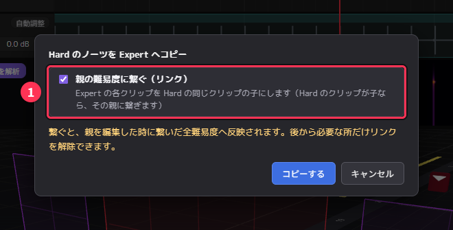

**親の難易度に繋ぐ（リンク）**（①。最初からオン）のまま **コピーする** を押すと、写し先の各クリップが、写し元の同じクリップの **子** になります
（[リンクしたクリップ](#リンクしたクリップ)）。

- 繋いだ後は、写し元（親）を直すと、写し先にも同じ直しが入ります。写し先のクリップは、そこでは直せません
- 中身の無い空のクリップも、繋いだ時は写し先で子になります（後で親にノーツを置くと、写し先にも入ります）
- 写し先で一部だけ変えたい時は、変えたいクリップだけリンクを解除してから直します
- 写し先で全体を手直しするつもりの時は、①のチェックを外してから **コピーする** を押します（普通のコピーになります）

> **元に戻せるか**
> 転送でも受信でも、①のオン・オフに関係なく、**Ctrl + Z を 1 回** 押すと、写し先・写し元（付けたリンク）を含む全部の難易度が元に戻ります。
> 画面に出ていない難易度へ転送した時も同じです（まだ中身の無かった難易度へ写した時は、その難易度も空に戻ります）。

### 例：Expert+ から Expert を作る

1. Expert+ を作り込む
2. **4 キー**（または EXPERT のボタン）で Expert に切り替える
3. EXPERT のボタンをもう一度クリック →「**ノーツを受信**」→「**← Expert+**」
4. 確認の画面で「**親の難易度に繋ぐ**」のチェックを外して **コピーする**（Expert ではほとんどのクリップを手直しするため）
5. Expert でノーツを間引く・難しい所を易しくする（失敗したら Ctrl + Z で受信前に戻せます）
6. ヘッダーで Expert の **NJS とオフセット** を決める（[2 章](#jd--rt-の表示) の JD / RT を見ながら）
7. 同じように Expert から Hard、Hard から Normal… と下の難易度へ続ける

> 逆に、難易度の間で同じにしておきたい所（イントロなど）が多い時は、繋いだまま写し、変える所のクリップだけリンクを解除する方法もあります。

最後に [9 章](#9-公開前のチェック) の「難易度を測る」で、上の難易度ほど★が高くなっているか確かめます。

### ライトは最後にまとめて写す

ライトは難易度ごとに変える必要が無いことが多いので、1 つの難易度で作り終えてから、
「**ライティングを転送**」で他の難易度へ写すと手間が省けます。
ライトだけを写すので、写し先のノーツはそのまま残ります。

確認の画面の「**親の難易度に繋ぐ**」をオンのまま転送すると、写し先のライトは写し元のライトの子になります。
あとで写し元のライトを直すと、他の難易度にも自動で入るので、転送し直す必要はありません。
（オフにして転送した時は、ライトを直したら、もう一度転送します。ノーツを直しただけなら、ライトを写し直す必要はありません。）

[自動ライティング](#自動ライティングノーツからライトを作る)（7 章）で作ったライトは、最初から全難易度に入るので、転送はいりません。

### 公開しない難易度を空にする

中身（ノーツやライト）が入っている難易度は、すべて書き出されます。
作りかけの難易度を公開したくない時は、その難易度を開いて「**含まれる内容を全て削除**」で空にします。
あとで続きを作るかもしれない時は、空にする前に「名前を付けて保存」で別のプロジェクトとして残しておくと安心です。
他の難易度とリンクしているクリップがある時は消せないので、先にリンクを解除します（[リンクしたクリップ](#リンクを外すクリップを消す)）。

<!-- 章ナビ -->
> **ほかの章へ：** [1. 作業を速くする操作](#1-作業を速くする操作) ｜ [2. 配置を助ける表示](#2-配置を助ける表示) ｜ [3. NLE を使いこなす](#3-nle-を使いこなす) ｜ [4. 難易度をまとめて作る](#4-難易度をまとめて作る) ｜ [5. テンポが変わる曲と、拍のずれの直し方](#5-テンポが変わる曲と拍のずれの直し方) ｜ [6. 曲を解析する（テンポと構成）](#6-曲を解析するテンポと構成) ｜ [7. ライティングの応用](#7-ライティングの応用) ｜ [8. INFO ノードの応用](#8-info-ノードの応用) ｜ [9. 公開前のチェック](#9-公開前のチェック) ｜ [10. 自分に合わせた設定](#10-自分に合わせた設定) ｜ [11. 困ったとき](#11-困ったとき) ｜ [▲ 目次](#目次)
<!-- /章ナビ -->

---

## 5. テンポが変わる曲と、拍のずれの直し方

### まず、ずれ方を見分ける

BPM の右のメトロノームを ON にして再生し、クリック音と曲を聴き比べます。ずれ方で直し方が変わります。

| ずれ方 | 原因 | 直し方 |
|---|---|---|
| 最初から最後まで、同じだけずれている | 曲の頭の位置が合っていない | **無音追加**（下の「無音追加の考え方」） |
| 最初は合っているのに、だんだんずれていく | BPM が違う | BPM 測定の候補から選び直す・数字を直接入れる |
| 途中まで合っていて、ある所から急にずれる | 曲の途中でテンポが変わっている | **テンポパート** |

**BPM 測定** の候補の一番上に「⚠ テンポが一定でない曲の可能性があります」と出た時は、
曲の前半と後半でテンポが違う可能性があります。テンポパートを使ってください。

BPM と無音追加の見当は、**曲を解析**（[6 章](#6-曲を解析するテンポと構成)）でも付けられます。
解析の確認の画面には、曲の途中で拍が一度ずれる所や、テンポが揺れている所も出ます。

### テンポパートを使う

テンポパートは、曲の途中から BPM を変える仕組みです。
NLE の目盛りのすぐ下にある **紫の帯**（テンポパートの帯）に、◆ と BPM で表示されます。
1 つのテンポパートは、その ◆ から次の ◆ までの区間の BPM を決めます。

**テンポパートを追加する**

- 帯の何もない所を **右クリック** →「**＋ ここにテンポパートを追加**」：マウスの位置に追加します
- 帯の何もない所を **右クリック** →「**＋ 秒で指定…**」：曲の頭からの秒数を入れて、その位置に正確に追加します
- 帯の何もない所を **ダブルクリック** しても追加できます

追加した直後は、その位置の BPM を引き継ぐので、追加しただけでは曲とのずれは変わりません。

**BPM を決める**

- ◆ を **右クリック** →「**🎯 自動判定**」：その区間の音を解析して BPM を決めます
- ◆ を **右クリック** →「**BPMを手入力…**」、または ◆ を **ダブルクリック**：数字を入れます
- ヘッダーの「**🎯 全パート自動判定**」：全部のテンポパートをまとめて自動判定します
- 消す時は ◆ を右クリック →「**テンポパートを削除**」

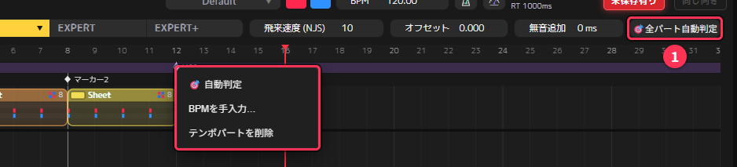

**作業の流れの例**

1. メトロノームを ON にして再生し、ずれ始める所を探す
2. その位置にテンポパートを追加する
3. 「🎯 自動判定」で BPM を決める
4. もう一度メトロノームで聴いて、合わなければ手入力で直す
5. 曲の終わりまで、1〜4 をくり返す

テンポパートは書き出し時に Beat Saber の BPM の変化（bpmEvents）として書き出されるので、ゲームの中でもテンポが変わります。

> ヘッダーの JD / RT の表示（[2 章](#jd--rt-の表示)）は、基準の BPM（ヘッダーの BPM 欄の値）で計算します。
> テンポパートで途中の BPM を変えても、この表示は変わりません。

### 無音追加の考え方

ヘッダーの **無音追加**（ms）は、曲の先頭に無音を足します。
足した分だけ曲全体が後ろへずれるので、曲の最初の拍を、拍の線にちょうど乗せられます。

たとえば BPM 120（1 拍＝500ms）の曲で、最初の拍が曲の頭から 300ms の所にある場合、
200ms の無音を足すと、最初の拍が 500ms（1 拍目の線）に乗ります。

- 無音は足すことしかできません（曲の頭を削ることはできません）
- 書き出す時に、song.egg の音そのものに無音を書き込みます。そのため変換に ffmpeg が必要です（[11 章](#ffmpeg-が見つかりませんと出る)）
- 試聴区間（選曲画面で流れる区間）は、足した無音の分を自動で補正して書き出します
- 最初のノーツまでの時間が短い（譜面チェックの「開始直後にノーツ」）時にも、無音を足すと余裕を作れます

### 曲の音量（音量補正）

NLE の一番下の **Music** の段の左端で、曲の音量を変えられます。

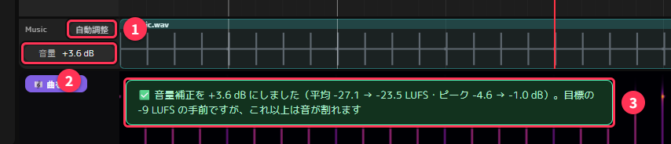

| 番号 | 名前 | 説明 |
|---|---|---|
| ① | 自動調整 | 曲の音量を測って、ちょうど良い大きさまで上げる |
| ② | 音量 | 音量補正の値（dB）。‹ › で ±0.5 dB、**Shift + ‹ ›** で ±0.1 dB。数字をクリックすると直接入力できる（-20〜+20 dB） |
| ③ | 結果のメッセージ | 自動調整で、どれだけ上げたか |

**自動調整のしくみ**

- 曲の平均の音量（LUFS。耳の感じ方に合わせた平均の大きさ）と、一番大きい瞬間（ピーク）を測ります
- 平均 **-9 LUFS** を目標に上げます。ただし、ピークが **-1 dB** を超える所で止めます（それ以上上げると音が割れるため）
- **自動では下げません**。もう十分に大きい曲は 0.0 dB のままです
- 測るのは、書き出す曲に入る所だけです（Music を分けたり一部を消したりしていれば、その後の音）。何度押しても同じ値になります

結果は画面の下に、「音量補正を +7.5 dB にしました（平均 -17.3 → -9.8 LUFS・ピーク -8.5 → -1.0 dB）」のように出ます。
この例では、ピークが -1 dB に届いたので、目標の -9 LUFS の少し手前で止まっています
（その時は「目標の -9 LUFS の手前ですが、これ以上は音が割れます」と続きます）。

> **目安**：Beat Saber のカスタム曲は、平均 -13〜-5 LUFS くらいのものが多いです。
> これより小さい曲は、ゲームの中で前後の曲より小さく聞こえます。

**効く所**

- 全難易度で共通です。プロジェクトに保存され、Ctrl + Z で戻せます
- Space の再生と、INFO の試聴ノードの **▶ 試聴** に、そのまま効きます
- 書き出す時に、song.egg の音そのものに書き込みます。そのため、ogg の曲でも変換に ffmpeg が必要です（[11 章](#ffmpeg-が見つかりませんと出る)）
- 環境設定の **ミュージック音量**（[10 章](#音量設定)）とは別物です。ミュージック音量は作業中の聞こえ方を変えるだけで、書き出す曲には入りません

<!-- 章ナビ -->
> **ほかの章へ：** [1. 作業を速くする操作](#1-作業を速くする操作) ｜ [2. 配置を助ける表示](#2-配置を助ける表示) ｜ [3. NLE を使いこなす](#3-nle-を使いこなす) ｜ [4. 難易度をまとめて作る](#4-難易度をまとめて作る) ｜ [5. テンポが変わる曲と、拍のずれの直し方](#5-テンポが変わる曲と拍のずれの直し方) ｜ [6. 曲を解析する（テンポと構成）](#6-曲を解析するテンポと構成) ｜ [7. ライティングの応用](#7-ライティングの応用) ｜ [8. INFO ノードの応用](#8-info-ノードの応用) ｜ [9. 公開前のチェック](#9-公開前のチェック) ｜ [10. 自分に合わせた設定](#10-自分に合わせた設定) ｜ [11. 困ったとき](#11-困ったとき) ｜ [▲ 目次](#目次)
<!-- /章ナビ -->

---

## 6. 曲を解析する（テンポと構成）

曲の音を解析して、**テンポ**（BPM と無音追加の提案）と **構成**（イントロ・Aメロ・サビなどの区切り）を出します。
曲を読み込んだら最初に使うと、BPM 合わせと、どこにどんな配置をするかの見当付けが早くなります。
構成の区切りどおりに、NLE のクリップを作ることもできます（[解析からクリップを作る](#解析からクリップを作る)）。

- 解析は 1 曲 30 秒〜1 分ほどかかります。その間も編集を続けられます
- 解析は PC の中で行います。曲をインターネットへ送ることはありません
- mp3・ogg・wav・flac などはそのまま解析できます。m4a などの形式は ffmpeg が必要です（[11 章](#曲を解析でエラーが出る)）
- 結果は、曲の音から推定した **目安** です。BPM は最後にメトロノームで、構成は耳で確かめてください

### 解析を始める

次のどれかで始めます。

- 曲を読み込んだ時に出る「**曲を解析しますか？**」で **解析する**（下の「[曲を読み込んだ時の確認](#曲を読み込んだ時の確認)」）
- NLE の Music の段の下、スペクトログラムの左にある紫の **🎼 曲を解析**（解析の結果が無い時だけ出ます）
- ファイルメニューの **曲を解析（テンポ・構成）…**

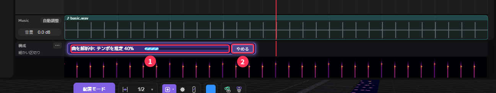

解析中は、帯の左に濃い紫の知らせが出ます。

| 番号 | 名前 | 説明 |
|---|---|---|
| ① | 進み具合 | 「テンポを推定 40%」→「テンポの確認待ち」→「構成を解析 60%」のように進む。右のバーは進み具合で、縞が流れている間は解析中 |
| ② | やめる | 解析をやめる |

ボタン 1 つで、テンポの推定 →（今の設定と違えば）テンポの確認 → 構成の解析、と最後まで進みます。

### 曲を読み込んだ時の確認

新しく曲を読み込むと、「**曲を解析しますか？**」と聞かれます。解析で何ができるかも、ここで確かめられます。

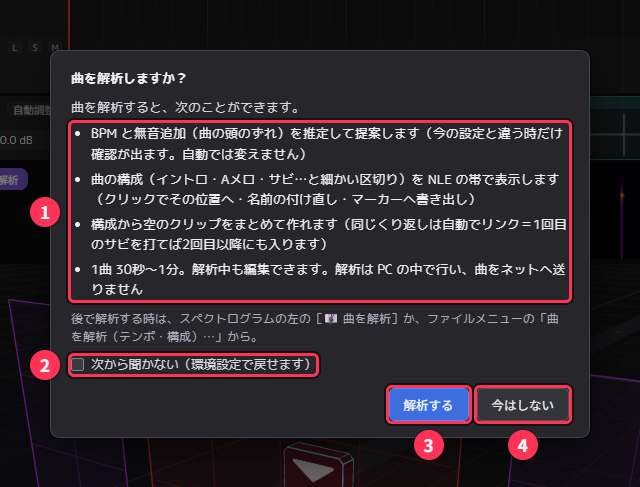

| 番号 | 名前 | 説明 |
|---|---|---|
| ① | 解析でできること | テンポ（BPM と無音追加）の提案・構成の帯・構成からクリップを作ること、と、かかる時間 |
| ② | 次から聞かない | チェックを入れて閉じると、次から聞かない（環境設定で戻せます。[10 章](#アプリケーション設定)） |
| ③ | 解析する | そのまま解析を始める |
| ④ | 今はしない | 何もせずに閉じる（Esc でも同じ）。後で解析する時は、🎼 曲を解析 かファイルメニューから |

- 聞かれるのは、ファイルメニューの「音楽ファイルを読み込む…」・MEDIA から Music の段へ曲を入れた時・「曲データを読み込む」で、新しく曲を取り込んだ時です
- プロジェクトを開いた時の曲の自動の読み込みや、曲のつなぎ直しでは聞きません。その曲の解析の結果がもうある時も聞きません
- 曲を読み込んだ直後に急に出る画面なので、Enter キーでは押せません

### テンポの確認

推定したテンポが、いまの BPM・無音追加と違う時は、確認の画面が出ます。**自動では変えません。**

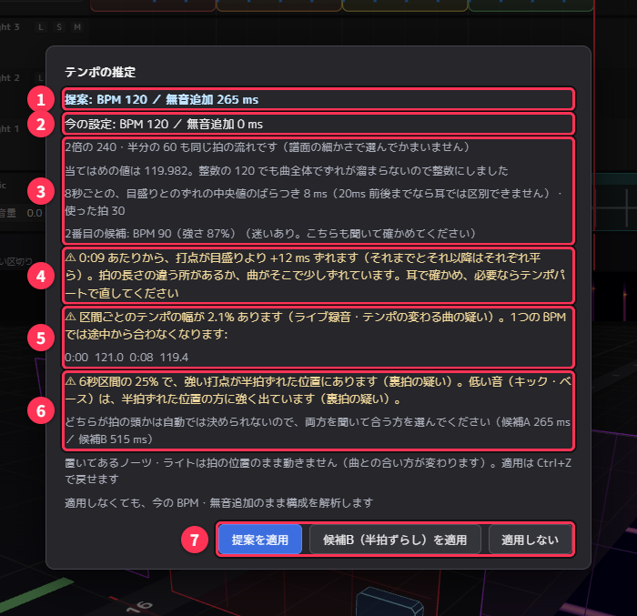

| 番号 | 行 | 説明 |
|---|---|---|
| ① | 提案 | 推定した BPM と無音追加 |
| ② | 今の設定 | いまの BPM と無音追加 |
| ③ | 補足 | BPM を 2 倍・半分にしても同じ拍の流れであること、BPM を整数にしたこと、目盛りとのずれのばらつき、2 番目の BPM の候補など |
| ④ | 拍のずれ | 曲の途中のある所から、打点が目盛りより一定だけずれている時に出る。耳で確かめ、必要ならテンポパート（[5 章](#テンポパートを使う)）で直す |
| ⑤ | テンポの揺れ | 区間ごとにテンポが違う時（ライブ録音・テンポの変わる曲の疑い）に出る。区間ごとの BPM も出る |
| ⑥ | 裏拍の疑い | 強い音が半拍ずれた位置にある時に出る。提案（候補 A）と、半拍ずらした候補 B の無音追加が出る |
| ⑦ | ボタン | 提案を適用／候補B（半拍ずらし）を適用／適用しない |

画像は説明用の見本で、知らせ（④〜⑥）が全部出ています。普通の曲では、当てはまらない知らせは出ません。

| ボタン | 動き |
|---|---|
| **提案を適用** | BPM と無音追加を、提案の値にする |
| **候補B（半拍ずらし）を適用** | BPM は提案の値、無音追加は半拍ずらした値にする。裏拍の疑い（⑥）が出た時は、どちらが拍の頭かを自動では決められないので、メトロノームで両方を聞き比べて合う方を選ぶ |
| **適用しない** | いまの設定のままにする |

- どれを押しても、続けて（その時の）BPM・無音追加で構成を解析します
- 適用は **Ctrl + Z を 1 回** で戻せます。置いてあるノーツ・ライトは拍の位置のまま動きません（曲との合い方が変わります）
- テンポパートがある時は、変わるのは曲の頭の BPM と無音追加だけです
- 解析の途中で急に出る画面なので、Enter キーでは押せません（編集中の Enter でうっかり適用しないため）。Esc は「適用しない」です
- いまの設定が提案と同じ時は画面を出さず、画面の下に「テンポの推定: 今の BPM・無音追加と同じです」と出ます。
  いまの設定が提案と同じ拍の流れ（BPM が 2 倍・半分など）の時は、画面にそのことが出ます（適用しなくても構いません）
- 強い打点が少ない曲（静かな曲など）では、テンポを推定できず、いまの BPM・無音追加のまま構成を解析します
- 後から帯のメニューの「**テンポの推定結果…**」で、この画面をもう一度見られます（そこから適用もできます）

### 構成の帯

構成の解析が終わると、Music の段とスペクトログラムの間に「構成／細かい区切り」の帯が出ます。

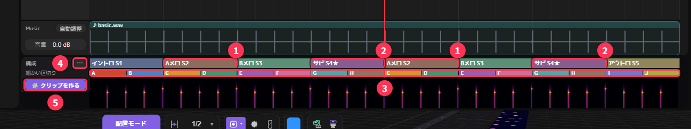

| 番号 | 名前 | 説明 |
|---|---|---|
| ① | セクション（上の段） | 曲の大きな区切り。「Aメロ S2」のように、仮の名前と番号が付く。**同じ番号は同じ中身のくり返し** で、同じ色になる（画像では 2 つの「Aメロ S2」） |
| ② | サビの候補 | 番号の後ろに **★** が付いたセクション |
| ③ | 細かい区切り（下の段） | もっと短い区切り。同じ文字（A・B・C…）は似た中身 |
| ④ | ⋯ | 帯のメニュー（帯の右クリックと同じ） |
| ⑤ | 🧩 クリップを作る | 帯の左の溝（「構成／細かい区切り」の下）。帯の区切りどおりにクリップを作る（下の「[解析からクリップを作る](#解析からクリップを作る)」）。解析の結果がある時だけ出る |

- 仮の名前（イントロ・Aメロ・Bメロ・サビ・間奏・Cメロ・アウトロ）は、並び方から付けた目安です。合わない時は、下の方法で付け直します
- 帯を **クリック** すると、その区切りの頭へ再生位置が移ります（表示の範囲は動きません）
- 帯にマウスを乗せると、拍の範囲・同じ番号が何回あるか、細かい区切りでは一番似ている所（%）が出ます
- 帯の上のホイールは、NLE と同じく時間の移動です（Ctrl + ホイールで拡大縮小）
- 帯は、解析の結果がある時と解析中だけ出ます（その間、スペクトログラムは下に詰まります）

### 解析が終わった時の案内

［曲を解析］で構成の解析が終わって帯が出ると、「**曲の解析が終わりました ― 次にやること**」の案内が出ます。

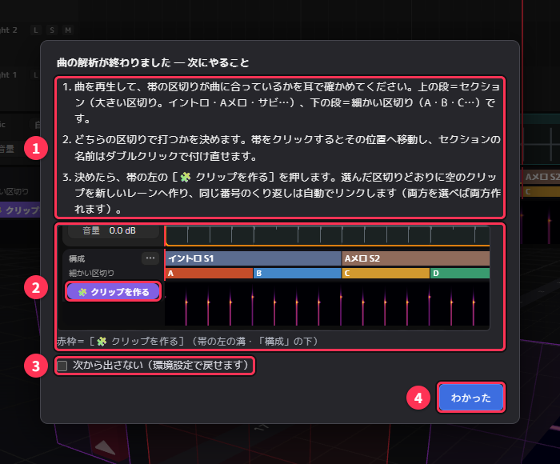

| 番号 | 名前 | 説明 |
|---|---|---|
| ① | 次にやること | 1. 曲を再生して、帯の区切りが曲に合っているかを耳で確かめる　2. どちらの区切り（セクション／細かい区切り）で打つかを決める　3. 帯の左の **🧩 クリップを作る** を押す |
| ② | ボタンの場所 | 帯の左の溝の **🧩 クリップを作る**（赤枠）の場所を示す図 |
| ③ | 次から出さない | チェックを入れて閉じると、次から出さない（環境設定で戻せます。[10 章](#アプリケーション設定)） |
| ④ | わかった | 案内を閉じる（Esc でも同じ）。閉じると、帯の左の **🧩 クリップを作る** が少しの間光って、場所を知らせる |

- 案内から、いきなりクリップを作ることはありません。区切りが曲に合っているかを確かめてから、自分でボタンを押します
- 解析し直した時も出ます。保存した結果を開いた時・解析をやめた時・エラーの時は出ません
- 解析の終わりに急に出る画面なので、Enter キーでは閉じません

### 名前を付け直す

セクションを **ダブルクリック** すると、名前を入れる欄が出ます。入れた名前は、**同じ番号のセクション全部** に付きます
（たとえば S3 を「ギターソロ」にすると、2 つある S3 が両方「ギターソロ S3」になります。次の「マーカーへ書き出す」の画像の②）。

- 名前を空にして Enter を押すと、自動の名前に戻ります
- 付け直しは Ctrl + Z で戻せます

### 帯のメニュー

帯を右クリックする（または溝の **⋯** を押す）と、メニューが出ます。

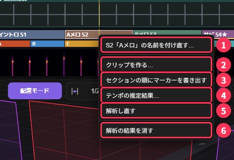

| 番号 | 項目 | 動き |
|---|---|---|
| ① | S2「Aメロ」の名前を付け直す… | 右クリックしたセクションの名前を付け直す（セクションの上で右クリックした時だけ出る） |
| ② | クリップを作る… | 帯の区切りどおりに空のクリップを作る（溝の **🧩 クリップを作る** と同じ。下の「[解析からクリップを作る](#解析からクリップを作る)」） |
| ③ | セクションの頭にマーカーを書き出す | 下の「マーカーへ書き出す」 |
| ④ | テンポの推定結果… | テンポの確認の画面をもう一度見る（ここからも適用できる） |
| ⑤ | 解析し直す | いまの BPM・無音追加・Music の配置で、もう一度解析する（解析中は「解析をやめる」） |
| ⑥ | 解析の結果を消す | 帯を消す（Ctrl + Z で戻せる） |

### マーカーへ書き出す

「**セクションの頭にマーカーを書き出す**」で、各セクションの頭に、名前と番号のマーカー（「Aメロ S2」など）を置きます。
マーカーにしておくと、[マーカーでカット](#分けるつなげる) でクリップを曲の構成どおりに分けたり、
**Ctrl + [ / Ctrl + ]** でセクションの頭へ移動したりできます（[1 章](#マーカーで曲の区切りに印を付ける)）。

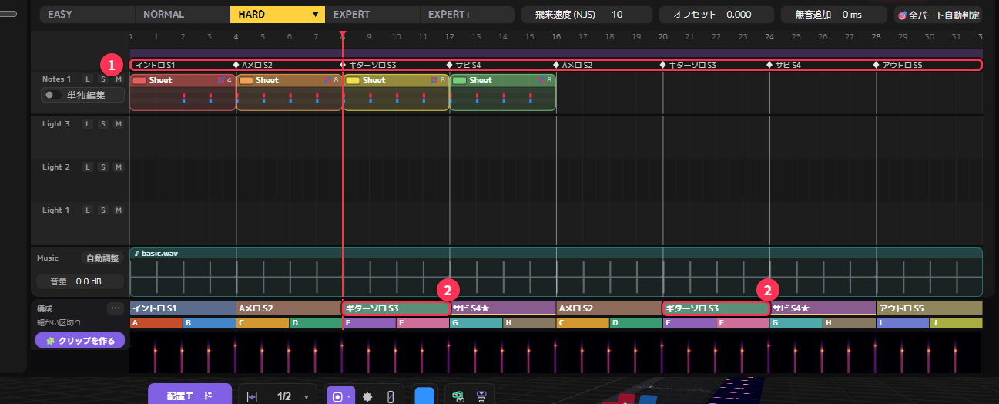

- 同じ位置に別のマーカーがある所は飛ばします
- 名前を付け直してからもう一度書き出すと、前に書き出したマーカーのうち、手で名前を変えていないものの名前が直ります
- 書き出したマーカーは普通のマーカーです。解析の結果を消しても残ります

### BPM などを変えた時

解析した後に、BPM・無音追加・テンポパート・Music の配置（または曲そのもの）を変えると、帯の位置がいまの目盛りと合わなくなることがあります。
その時は帯が薄くなり、「⚠ 目盛りが変わりました。解析し直してください」と出ます。

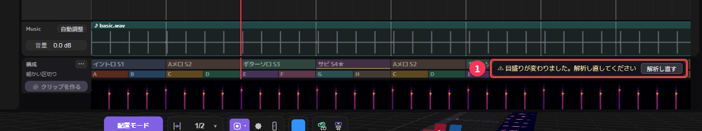

- 帯の左の **🧩 クリップを作る** も薄くなり、押しても作れません（解析し直してから押します）
- **解析し直す** を押すと、いまの設定でもう一度解析します。付け直した名前は、同じ位置のセクションへ、できる範囲で引き継ぎます
- 設定を解析した時の値に戻すと、知らせは消えます

### 結果の保存

解析の結果（テンポの推定・構成・付け直した名前）は、プロジェクト（`.nlmf`）に保存されます。開き直しても、解析し直す必要はありません。

- 解析の結果が出た時・名前を付け直した時・結果を消した時は、プロジェクトが「未保存」になります（保存せずに閉じようとすると確認が出ます）
- 解析した時の BPM なども一緒に保存されるので、開き直した後に設定を変えた時も、上の「解析し直してください」が出ます

### 解析からクリップを作る

構成の帯の区切りどおりに、NLE に空のクリップを作れます。セクションごとのクリップにノーツを置いていけば、曲の構成に沿った譜面を作りやすくなります。
同じ番号のセクション（くり返し）は自動で [リンク](#リンクしたクリップ) されるので、1 回目に置けば 2 回目以降にも同じ配置が入ります。

帯の左の溝の **🧩 クリップを作る**（または帯を右クリック・溝の **⋯** →「**クリップを作る…**」）で、確認の画面が出ます。

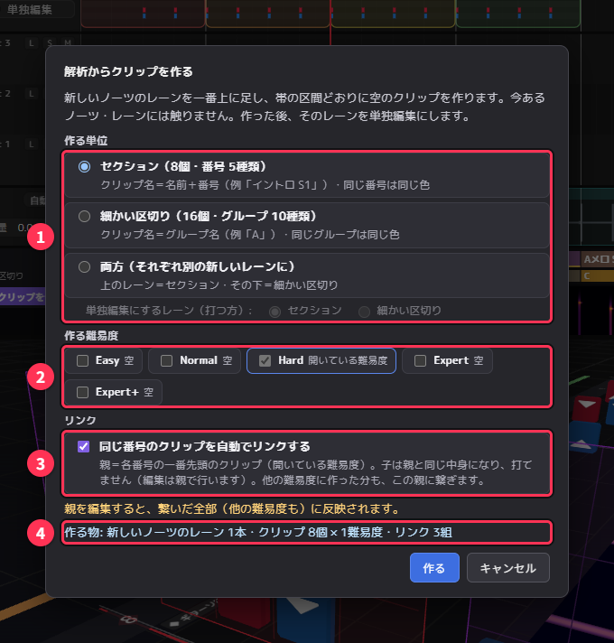

| 番号 | 名前 | 説明 |
|---|---|---|
| ① | 作る単位 | **セクション**（最初はこれ）／**細かい区切り**／**両方**。両方の時はレーンを 2 本作り（上＝セクション・下＝細かい区切り）、どちらのレーンを単独編集にするか（打つ方）を選ぶ |
| ② | 作る難易度 | 開いている難易度には必ず作る。他の難易度にもチェックを入れると、同じクリップを作る（難易度の名前の横に、ノーツの数か「空」が出る） |
| ③ | リンク | 「**同じ番号のクリップを自動でリンクする**」（最初はオン）。親は、各番号の一番先頭のクリップ（開いている難易度）。他の難易度に作った分も、この親につなぐ |
| ④ | 作る物のまとめ | 足すレーンの本数・クリップの数・リンクの組の数 |

**作る** を押すと、次のようになります。

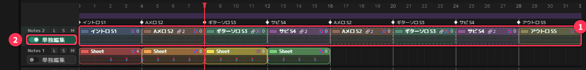

- ノーツのレーンが一番上に 1 本（両方なら 2 本）増え、帯の区間どおりの空のクリップが入ります（①）。今あるノーツやクリップの中身には触りません
- クリップの名前は「帯の名前 S番号」（「Aメロ S2」など。付け直した名前も使われます）、色は帯の色です。細かい区切りでは、グループの名前（A・B…）になります
- 同じ番号の 2 つ目からは、先頭のクリップの子になります（🔗 と点線の枠。[リンクしたクリップ](#リンクしたクリップ)）。
  1 回しか出ない番号は、他の難易度にも作った時だけ、その難易度の分とリンクします
- 新しいレーンが [単独編集](#単独編集) になります（②）。3D ビューで置くノーツは、そのレーンのクリップに入ります
- レーンを足すので、レーンのソロ・ミュートは外れます
- **Ctrl + Z を 1 回** 押すと、レーン・クリップ・リンク（他の難易度の分も）が全部元に戻ります（単独編集もオフになります）
- 一度作ると、帯の左の **🧩 クリップを作る** は暗い紫になります（この解析の結果からクリップを作った印です）。
  もう一度押すと、新しいレーンにもう 1 組作ります。解析し直すと、元の紫に戻ります

> **例：セクションごとに打つ**
> 曲を解析して、帯の区切りを曲を聞いて確かめ、名前を付け直したら、帯の左の **🧩 クリップを作る** でセクションのクリップを作ります。
> 各番号の先頭のクリップ（親）にノーツを置いていくと、くり返しのセクションにも同じ配置が入ります。
> 2 回目のサビだけ変えたい時は、そのクリップの [リンクを解除](#リンクを外すクリップを消す) してから直します。

**作れない時**

- 構成の解析の結果が無い時は、先に［曲を解析］を押します
- 「目盛り（BPM・無音追加・テンポパート・Music の配置）が解析した時と変わったため…」と出た時（溝の **🧩 クリップを作る** が薄い時）は、帯の区間がいまの拍と合っていない可能性があります。
  **解析し直す** をしてから作ります（[BPM などを変えた時](#bpm-などを変えた時)）
- ノーツのレーンが上限（10 本）の時は、空いているレーンを消してから作ります。「両方」は、レーンを 2 本足せる時だけ選べます

作ったクリップは、解析とつながっていない普通のクリップです。解析し直したり、解析の結果を消したりしても、そのまま残ります（名前は作った時の表示言語で付きます）。

<!-- 章ナビ -->
> **ほかの章へ：** [1. 作業を速くする操作](#1-作業を速くする操作) ｜ [2. 配置を助ける表示](#2-配置を助ける表示) ｜ [3. NLE を使いこなす](#3-nle-を使いこなす) ｜ [4. 難易度をまとめて作る](#4-難易度をまとめて作る) ｜ [5. テンポが変わる曲と、拍のずれの直し方](#5-テンポが変わる曲と拍のずれの直し方) ｜ [6. 曲を解析する（テンポと構成）](#6-曲を解析するテンポと構成) ｜ [7. ライティングの応用](#7-ライティングの応用) ｜ [8. INFO ノードの応用](#8-info-ノードの応用) ｜ [9. 公開前のチェック](#9-公開前のチェック) ｜ [10. 自分に合わせた設定](#10-自分に合わせた設定) ｜ [11. 困ったとき](#11-困ったとき) ｜ [▲ 目次](#目次)
<!-- /章ナビ -->

---

## 7. ライティングの応用

基本の置き方は基本編の [6 章](tutorial.md#6-ライティング) を見てください。ここでは、速く・細かく作るための操作を説明します。

### ライトのレーン

LIGHTING モードでは、次の 10 本のレーンにライトを置きます。

| レーン | 内容 |
|---|---|
| BACK・RINGS・CENTER・L LASER・R LASER | 各場所のライトの点灯・消灯・色 |
| L SPEED・R SPEED | 左右のレーザーの回る速さ |
| RING ROT・RING ZOOM | リングの回転・ズーム |
| BOOST | 色の切り替え（ブースト色）。ライト配色モードが「バニラ」の時だけ表示 |

### キーで素早く選ぶ

| 操作 | 動き |
|---|---|
| **W**（押したまま選んで離す） | 動きのパイメニュー（オフ・ライト・フラッシュ・フェード・トランジション） |
| **C**（押したまま選んで離す） | 色のパイメニュー（バニラでは ①・②・白。Chroma では左のノーツの色・右のノーツの色・白と、登録した色） |
| **F** | 置く色を順に切り替える |
| **1 / 2 / 3**（3D ビューの上で） | 色を選ぶ（バニラでは ①・②・白、Chroma では左・右・白）。この時、数字キーで難易度は切り替わりません |

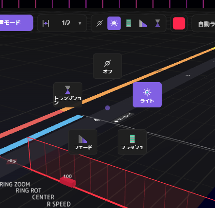 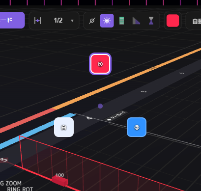

左が W キーの動きのパイメニュー、右が C キーの色のパイメニューです（画像はバニラの時で、①・②・白が並びます）。
キーを押したまま選びたい方へマウスを動かし、キーを離すと決まります。

### 明るさと速さを変える

ライトの上、または選んだライトの上にマウスを置いて **Alt + ホイール** を回すと、値を変えられます。
マウスの下にライトが無い時は、これから置くライトの値が変わります。

| 対象 | Alt + ホイール | Ctrl + Alt + ホイール |
|---|---|---|
| 点灯するライト | 明るさを 10 ずつ増減 | 明るさを 1 ずつ増減 |
| L SPEED・R SPEED | レーザーの速さを 1 ずつ増減（0〜50） | 同じ |

### 選んでまとめて直す

置いたライトをクリックすると選べます。**Shift + ドラッグ** で範囲を囲んでまとめて選べます。
選んだライトは、Alt + ホイールなどでまとめて直せます。

### ライト配色モード（Chroma とバニラ）

環境設定の「**ライト配色モード**」で、ライトの色の付け方を選びます。

| モード | 色 | 遊ぶ人の環境 |
|---|---|---|
| **バニラ**（最初はこちら） | 赤・青・白と、BOOST レーンで切り替えるブースト色 | MOD 無しで、誰でも同じ色で見える |
| **Chroma** | ライトごとに好きな色を付けられる | 色を見るには、遊ぶ人に Chroma（MOD）が必要 |

ライトの基本の色とブースト色は、INFO 画面の **設定** ノードで決めます（[8 章](#8-info-ノードの応用)）。
ランク申請を考えている場合や、多くの人に同じ見た目で遊んでほしい場合は、バニラを選ぶと確実です。

### 自動ライティング（ノーツからライトを作る）

ノーツの位置から、ライトを自動で作れます。ライトを一から作る時の下地にしたり、
譜面チェックの「ライトが足りない」を手早く無くしたりする時に使います。

#### 始め方

次のどれからでも始められます。

- LIGHTING モードのツールバーの **自動ライト**（①）
- ファイルメニューの **自動ライティング…**
- 譜面チェックで、ライトが足りない項目の横に出る **💡 自動ライティング…**（[9 章](#よく出る項目と直し方の例)）

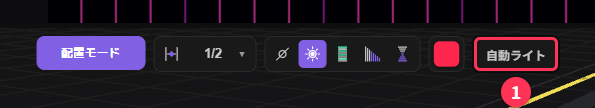

確認の画面に、元にする難易度・ライトを入れる難易度・ステージ・作るライトの数が出ます。**作成** を押すと作られます。

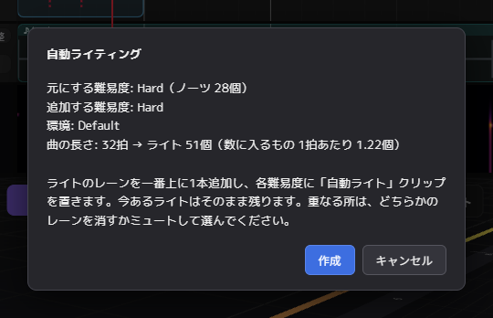

#### 作られるライト

| 種類 | 内容 |
|---|---|
| ベース | BACK を、曲の頭から最後のノーツの少し後まで点けたままにする（ボムがいつも照らされる）。16 拍ごと（マーカーがあればマーカーごと）に青と赤を切り替える |
| ノーツに合わせて | 赤のノーツで L LASER、青のノーツで R LASER が光る。ノーツが詰まった所はフラッシュ、間がある所はフェード |
| アクセント | 区切りの頭でリングのズームと回転、小節の頭で CENTER が光る。レーザーの速さは、小節ごとのノーツの多さで変わる |
| 数を満たす | ライトが少ない所（イントロやアウトロなど）は RINGS を拍ごとに光らせ、曲全体で 1 拍に 1.2 個以上にする |

- 色は **バニラの赤と青だけ** です（Chroma の色は付けません）。実際の色は、設定ノードのライトの色で決まります
- 同じレーザーが細かく点滅し続けないように、間隔の詰まったノーツでは光らせない所があります
- 選んだステージに無い動き（Kaleidoscope のレーザーの速さなど）は作りません

#### 入る場所

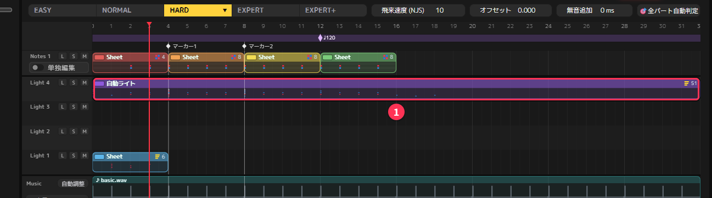

- ライトのレーンが一番上に 1 本増え、曲の頭から終わりまでの「**自動ライト**」クリップ（①）が入ります
- ライトは **ノーツが一番多い難易度** を元に作り、中身（ノーツ・ボム・壁など）のある **全難易度** に同じものが入ります
- 今あるライトは、そのまま残ります
- **Ctrl + Z を 1 回** 押すと、全難易度の分がまとめて元に戻ります
- ライトのレーンが上限（10 本）の時は作れません。空いているレーンを減らしてから作ります

#### 使い方のコツ

- **自分のライトと重なる時**：レーンの **M**（ミュート）で片方を止めて PREVIEW で見比べ、要らない方のクリップを消します。
  同じ拍・同じレーンにライトが重なると、「重複ライト」の表示が出ます
- **下地にして仕上げる**：自動ライトを残したまま、サビなど目立たせたい所だけ、別のレーンに自分でライトを置き足します
- **ノーツを直した後**：自動ライトは、後からノーツを直しても追いかけません。ノーツを大きく直した時は、
  古い「自動ライト」のクリップを消してから、もう一度作ります（空いたレーンは [3 章](#レーンを増やすロックソロミュート) の方法で減らせます）

### 確かめる・仕上げる

- **PREVIEW** で、ゲームに近い見た目で確かめます。PREVIEW 右上のボタンで、ライト・構造物の表示や、
  環境ライト（構造物を明るくして、動きを見やすくする）を切り替えられます
- ステージ（背景）は、NLE の上部、BPM 欄の左にある欄（最初は「Default」）で選びます。ステージによってライトの見え方が変わります
- ライトは 1 つの難易度で作り終えてから、「ライティングを転送」で他の難易度へ写すと早く作れます（[4 章](#ライトは最後にまとめて写す)）
- 公開前には譜面チェックで「ライトイベントが足りない」「照らされていないボム」が出ていないか確かめます（[9 章](#9-公開前のチェック)）。
  出ていたら、[自動ライティング](#自動ライティングノーツからライトを作る) で手早く直せます

<!-- 章ナビ -->
> **ほかの章へ：** [1. 作業を速くする操作](#1-作業を速くする操作) ｜ [2. 配置を助ける表示](#2-配置を助ける表示) ｜ [3. NLE を使いこなす](#3-nle-を使いこなす) ｜ [4. 難易度をまとめて作る](#4-難易度をまとめて作る) ｜ [5. テンポが変わる曲と、拍のずれの直し方](#5-テンポが変わる曲と拍のずれの直し方) ｜ [6. 曲を解析する（テンポと構成）](#6-曲を解析するテンポと構成) ｜ [7. ライティングの応用](#7-ライティングの応用) ｜ [8. INFO ノードの応用](#8-info-ノードの応用) ｜ [9. 公開前のチェック](#9-公開前のチェック) ｜ [10. 自分に合わせた設定](#10-自分に合わせた設定) ｜ [11. 困ったとき](#11-困ったとき) ｜ [▲ 目次](#目次)
<!-- /章ナビ -->

---

## 8. INFO ノードの応用

INFO 画面（NLE の上で Tab）では、書き出す曲の情報を **ノード** の組み合わせで決めます。

### ノードの種類

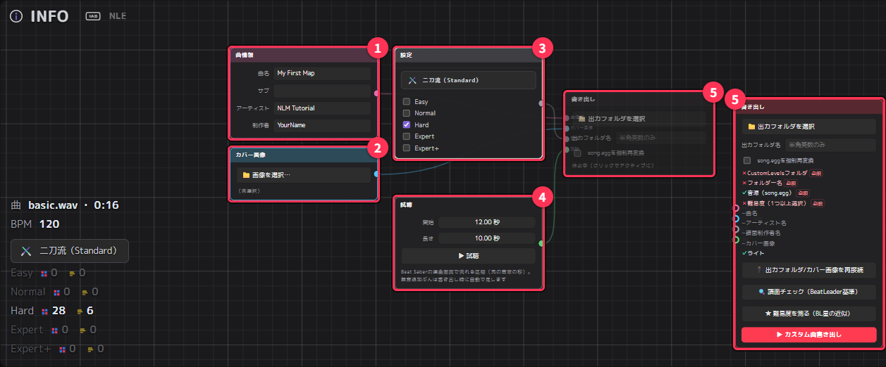

| ノード | 色 | 決めること |
|---|---|---|
| **曲情報** | ピンク | 曲名・サブタイトル・アーティスト・制作者 |
| **カバー画像** | 青 | 選曲画面のジャケット画像（形や大きさが合わない時は [書き出す時に補正](#カバー画像を補正する) できる） |
| **設定** | 灰 | ノーツの色・ライトの色・ブースト色・ステージ・書き出しに必要な難易度のチェック |
| **試聴** | 緑 | 選曲画面で流れる区間（開始の秒数と長さ） |
| **書き出し** | — | 出力フォルダ・出力フォルダ名・書き出しのボタン |

左の 4 つのノードを、線で **書き出し** ノードにつなぐと、その値が書き出しに使われます。

### つなぐ・外す

- ノードの接続口（丸い点）から書き出しノードへ **ドラッグ** するとつながります。同じ種類の線は 1 本だけで、つなぎ直すと入れ替わります
- 線を何もない所へドラッグして離すと、外れます
- 何もない所を **右クリック** すると、新しいノードを追加できます
- ノードを選んで **Ctrl + C → Ctrl + V** で複製、**X** で削除します
- **ホイール** で拡大縮小、**.**（ピリオド）で全部のノードが見える位置へ戻ります

### 書き出しノードを複数使う

書き出しノードは複数作れます。たとえば次のような使い方ができます。

- **テスト用と公開用で、出力フォルダ名を分ける**：テスト中は別の名前で書き出しておき、公開用のフォルダを上書きしない
- **カバー画像や色違いの版を作る**：別の設定ノード・カバー画像ノードをつないだ書き出しノードを用意する

新しく追加した書き出しノードには、まだ何もつながっていません（上の画像の右の⑤）。曲情報などのノードから線をつないでください。

使う書き出しノードは、**クリックして選びます**（選んだものが「アクティブ」になります。アクティブでないノードには「休止中」と出ます）。
エディタの画面のノーツの色・ステージ、譜面チェック、難易度を測るは、アクティブな書き出しノードにつながった値で動きます。
どの書き出しノードでも、書き出す譜面（ノーツ・ライト）は同じです。

最後の 1 つの書き出しノードは削除できません。

> NLE の上部（BPM 欄の左）にあるステージとノーツの色の欄は、アクティブな書き出しノードにつながった **設定** ノードの値を直接変えます。
> INFO 画面へ切り替えずに、色やステージを変えられます。

### 試聴ノード

選曲画面で曲を選んだ時に流れる区間を決めます。秒数は **元の曲の秒数** です（無音追加の分は書き出し時に自動で足します）。

- **▶ 試聴** で、その区間をフェード付きでくり返し再生して確かめられます
- NLE のマーカーを右クリック →「**▶ 試聴の開始に転送**」で、サビの頭などマーカーの位置を開始にできます
- 試聴ノードがつながっていない時は、12 秒目から 10 秒間で書き出します（譜面チェックで「試聴区間が初期値のまま」と出ます）

### song.egg を作り直す

書き出しを速くするため、曲が前回と同じなら song.egg の変換を省きます。
曲がおかしい時や、作り直したい時は、書き出しノードの「**song.eggを強制再変換**」にチェックを入れて書き出します。

<!-- 章ナビ -->
> **ほかの章へ：** [1. 作業を速くする操作](#1-作業を速くする操作) ｜ [2. 配置を助ける表示](#2-配置を助ける表示) ｜ [3. NLE を使いこなす](#3-nle-を使いこなす) ｜ [4. 難易度をまとめて作る](#4-難易度をまとめて作る) ｜ [5. テンポが変わる曲と、拍のずれの直し方](#5-テンポが変わる曲と拍のずれの直し方) ｜ [6. 曲を解析する（テンポと構成）](#6-曲を解析するテンポと構成) ｜ [7. ライティングの応用](#7-ライティングの応用) ｜ [8. INFO ノードの応用](#8-info-ノードの応用) ｜ [9. 公開前のチェック](#9-公開前のチェック) ｜ [10. 自分に合わせた設定](#10-自分に合わせた設定) ｜ [11. 困ったとき](#11-困ったとき) ｜ [▲ 目次](#目次)
<!-- /章ナビ -->

---

## 9. 公開前のチェック

譜面を公開する前に、NLM の中で次の 3 つを確かめられます。

| 機能 | 分かること |
|---|---|
| **譜面チェック**（BS Map Check と同じ判定） | ミス配置や遊びにくい配置、BeatLeader のランク基準に合わない所 |
| **NLM版 BL評価リスト** | BeatLeader のランク基準の文章を項目ごとに並べた確認表 |
| **難易度を測る** | BeatLeader の★（星）の近似値 |

ランク申請をしない譜面でも、譜面チェックはミス配置を見つけるのに役立ちます。

どれも **書き出すのと同じ内容**（書き出される全難易度と Info.dat の値）を調べるので、書き出す前に使えます。
また、パネルを開いたまま譜面を直し、ボタン 1 つでチェックし直せます。

### おすすめの順番

1. **譜面チェック**で「🚧 ランク不可」と「❌ エラー」を無くす
2. **難易度を測る**で各難易度の★を見る
3. ランク申請を考えているなら、**NLM版 BL評価リスト**で残りの項目を確かめる（★の値もここで使います）
4. 最後に、下の「公開前チェックリスト」で漏れが無いか確かめる

### 譜面チェック（BS Map Check と同じ判定）

ファイルメニューの **譜面チェック（BeatLeader基準）…**、または INFO 画面の書き出しノードにある
**🔍 譜面チェック（BeatLeader基準）** から開きます。開くとすぐにチェックが始まります。

判定は、BeatLeader のランク審査で使われている [BS Map Check](https://github.com/KivalEvan/BeatSaber-MapCheck)
（BeatLeader の設定）と同じです。

#### 結果の見方

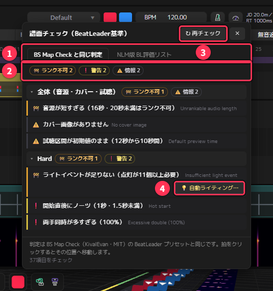

画像は説明用の短い譜面（16 秒・ライトが少ない）をチェックしたところです。

| 番号 | 名前 | 説明 |
|---|---|---|
| ① | タブ | 「BS Map Check と同じ判定」と「NLM版 BL評価リスト」を切り替える |
| ② | 集計 | 印ごとの項目の数 |
| ③ | ↻ 再チェック | 譜面を直した後に、結果を更新する |
| ④ | 💡 自動ライティング… | ライトが足りない項目にだけ出る。[自動ライティング](#自動ライティングノーツからライトを作る)（7 章）を始め、作った後にチェックし直す。カバー画像の項目には、同じ場所に [🖼 カバー画像を補正…](#カバー画像を補正する) が出る |

結果は「全体（音源・カバー・試聴）」と、難易度ごとの欄に分かれています。各項目の先頭の印は、問題の重さです。

| 印 | 意味 | どうするか |
|---|---|---|
| 🚧 ランク不可 | ランク基準を満たさない | ランク申請をするなら必ず直す |
| ❌ エラー | 大きな問題 | 理由が無ければ直す |
| ❗ 警告 | 問題の可能性がある | 確認して、必要なら直す |
| ⚠️ 情報 | 軽い問題、または問題ではない | 参考程度に見る |

ランク不可とエラーが 1 つも無ければ、一番上に「✓ ランク不可・エラーはありません」と出ます。

各項目の下に並ぶ数字は、問題のある **拍** です。

- 数字の上にマウスを置くと、曲の頭からの時間（分:秒）が出ます
- **数字をクリックすると、その難易度に切り替わり、その拍へ移動して該当のノーツなどを選んだ状態**になります。
  そのまま直せます
- 数が多い項目は「他 N 件」をクリックすると全部表示されます

直したら、パネル右上の **↻ 再チェック** で結果を更新します。
パネルは見出しをドラッグして好きな場所へ動かせます。

#### よく出る項目と直し方の例

| 項目 | 直し方 |
|---|---|
| 開始直後にノーツ（1.5 秒未満） | 最初のノーツを後ろへずらすか、ヘッダーの **無音追加** で曲の頭に無音を足す |
| 試聴区間が初期値のまま | INFO 画面の **試聴** ノードで、選曲画面で流す区間を設定する |
| カバー画像がありません | 256×256 以上の正方形の画像を、INFO 画面の **カバー画像** で選ぶ |
| カバー画像が正方形でない／小さい | 項目の横の **🖼 カバー画像を補正…** で、書き出す時に正方形・256×256 以上へ直せる（[下](#カバー画像を補正する)） |
| 飛来距離（JD）・反応時間が短すぎる／長すぎる | ヘッダーの **NJS** と **オフセット** を調整する。ヘッダーの JD / RT の表示を見ながら合わせる |
| 1/8・1/6 の拍に乗っていない | スナップが細かすぎる・ずれた位置に置いたノーツ。拍をクリックして位置を確かめる |
| ライトイベントが足りない | ライトを足す（点灯が 11 個以上必要）。項目の横の **💡 自動ライティング…** で自動で作れる |
| 照らされていないボム | ボムの手前でライトを点けておく。自動ライティングのライトは、ボムをいつも照らす |

#### カバー画像を補正する

カバー画像は **256×256 以上の正方形** で、形式が **png か jpg** である必要があります。
512×510 のように少しだけ合わない画像なら、画像を作り直さなくても NLM の中で直せます。

譜面チェックでカバー画像の項目（正方形でない／小さい）が出た時と、NLM版 BL評価リストの R1.A.4（カバー画像）が違反の時は、
その行に **🖼 カバー画像を補正…** が出ます。押すと確認の画面が開きます。

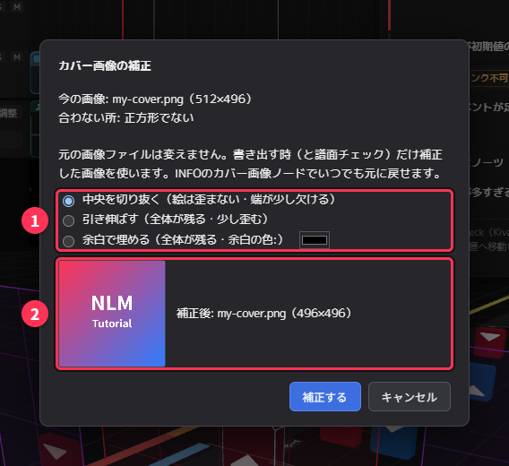

| 番号 | 名前 | 説明 |
|---|---|---|
| ① | 補正のしかた | 正方形でない時だけ選べる（下の表） |
| ② | 見本 | 補正した後の画像と、ファイル名・大きさ |

| 補正のしかた | 内容 |
|---|---|
| **中央を切り抜く**（最初はこれ） | 短い辺に合わせて、真ん中を切り抜く。絵は歪まないが、長い辺の端が少し欠ける |
| **引き伸ばす** | 長い辺に合わせて引き伸ばす。絵は全部残るが、少し歪む |
| **余白で埋める** | 長い辺に合わせ、足りない所を余白で埋める。絵は全部残る。余白の色を選べる |

- 256×256 より小さい画像は、256×256 に拡大します
- png・jpg 以外（webp など）は png にします（jpg は jpg のまま）
- 切り落とす所が多い時（長い辺の 5% 以上）は、画面に注意が出ます。絵が大きく欠ける時は「余白で埋める」を選びます

**補正する** を押すと、譜面チェックがやり直され、カバー画像の項目が消えます。

**元の画像ファイルは変わりません。** 書き出す時だけ、補正した画像を `cover.png`（jpg の時は `cover.jpg`）として出力フォルダに書き出します。
譜面チェックも、補正した後の画像で判定します。

INFO 画面のカバー画像ノードには、補正の内容（①）と **補正をやめる**（②）が出ます。

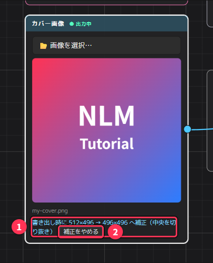

- **補正をやめる** を押すと、元の画像のまま書き出します。**Ctrl + Z** でも戻せます
- 補正の設定はプロジェクトに保存されます
- カバー画像ノードで別の画像を選び直すと、補正の設定は外れます（新しい画像も合わない時は、もう一度補正します）

> 大きく形の違う画像は、画像編集ソフトで作り直す方がきれいに仕上がります。
> この補正は「少しだけ合わない」時に、手早く直すためのものです。

### NLM版 BL評価リスト

譜面チェックのパネルの 2 つ目のタブです。**枠と背景が青緑**になります。

BeatLeader 公式サイトに書かれているランク基準の文章（Ranking Criteria）を、項目番号（R1.A.1 など）の順に並べ、
NLM が項目ごとに判定した表です。**BeatLeader や BS Map Check の公式な結果ではありません。**
見間違えないように、譜面チェックとは色を変えています。

#### 印と種類

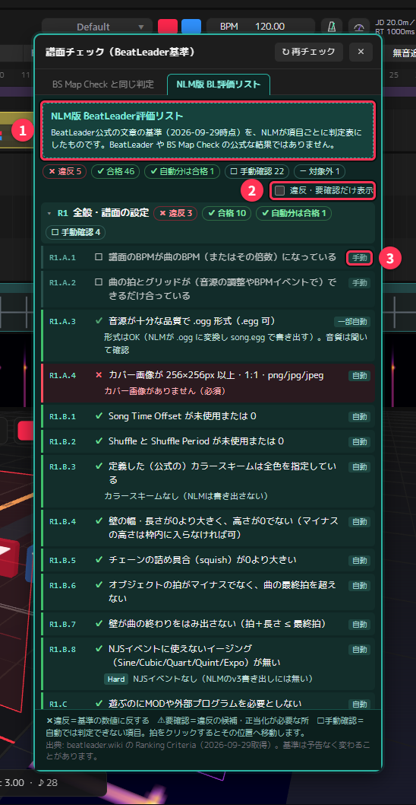

| 番号 | 名前 | 説明 |
|---|---|---|
| ① | 説明の帯 | NLM が作った表であることの表示（公式の結果ではありません） |
| ② | 違反・要確認だけ表示 | 直す必要がありそうな項目だけに絞る |
| ③ | 判定の種類 | 自動／一部自動／候補／手動／対象外 |

各項目の先頭の印は、判定の結果です。

| 印 | 意味 |
|---|---|
| ✖ 違反 | 基準の数値に反している |
| ⚠ 要確認 | 違反の候補。直すか、理由を説明できるようにしておく所 |
| ✔ 合格／自動分は合格 | 合っている（一部の項目は、自動で判定できた分だけ合格） |
| ☐ 手動確認 | 自動では判定できない。自分の目で確かめる |
| － 対象外 | この譜面には関係しない |

項目の右端には判定の種類（自動／一部自動／候補／手動／対象外）が出ます。
「候補」は、図や審査員の判断に頼る項目を NLM が解釈して、怪しい所を挙げたものです。
NLM がどう解釈したかは、項目の下の「＊」の注記に書いてあります。

上にある **違反・要確認だけ表示** にチェックを入れると、直す必要がありそうな項目だけに絞れます。

R10.A（1 拍に 1 個以上のライト）と R7.B（ボムの照明）が違反・要確認の時は、その行に **💡 自動ライティング…** が出ます。
押すと [自動ライティング](#自動ライティングノーツからライトを作る)（7 章）を始め、作った後にチェックし直します。
R1.A.4（カバー画像の大きさ・形・形式）が違反の時は **🖼 カバー画像を補正…** が出ます（[カバー画像を補正する](#カバー画像を補正する)）。

#### ★と Tech を使う項目（R5.A・R11.H.5）

R5.A（ノーツが反応に十分な時間見えているか）は、BeatLeader の★と Tech の値を使う式で判定します。
項目の中に難易度ごとの欄（②）があり、次の「難易度を測る」のプラグインを取り込んであれば、
BL評価リストを開いた時に自動で計算して入ります（①）。譜面を直した後は、再チェックの時に測り直します。

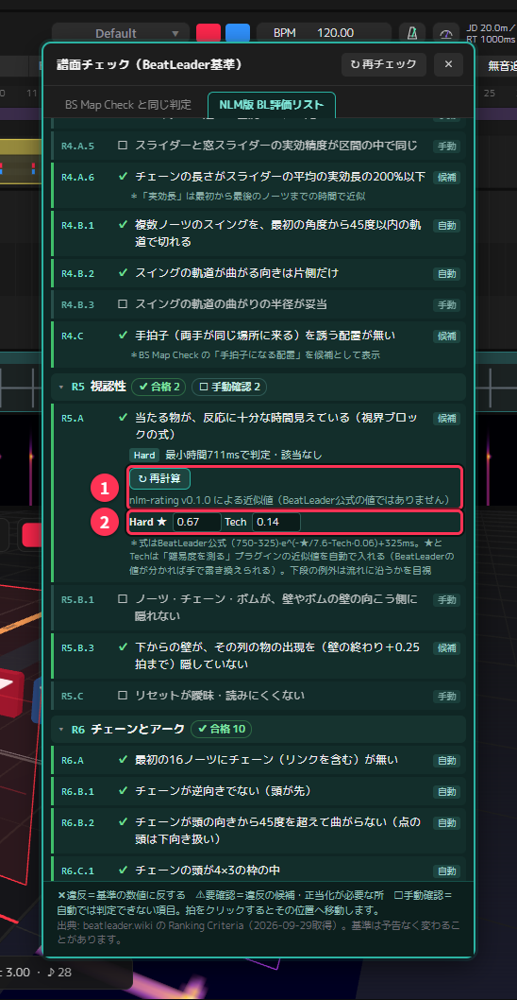

- プラグインがまだ無い時は、① に **📥 プラグインを取り込んで自動計算…** が出ます。
  押すと説明が出るので、**GitHub から取り込む** を押すと、取り込んでそのまま計算します
- 入る値は近似値です。BeatLeader の本当の値が分かっている時は、欄を手で書き換えられます。
  書き換えた欄は黄色の枠になり、測り直しても変わりません（**自動に戻す** で計算した値へ戻ります）
- 値は、アプリを開いている間だけ覚えています
- R11.H.5（難易度が★の低い順に並んでいるか）も、この欄の★で判定します。
  近似値なので、並びが逆転していても「違反」ではなく「要確認」で出ます

### 難易度を測る（BeatLeader の★の近似）

ファイルメニューの **難易度を測る（BeatLeaderの星の近似）…**、または INFO 画面の書き出しノードにある
**★ 難易度を測る（BL星の近似）** から開きます。

#### 初めて使う時：プラグインを取り込む

計算には追加プラグイン [nlm-rating](https://github.com/Oz-Co-two/nlm-rating) が必要です（約 19MB・Windows 専用）。
NLM 本体には入っていないので、パネルの **GitHub から取り込む** を押して取り込みます。

- ダウンロードしたファイルは、配布元の情報（SHA-256）と照合してから使います
- 取り込んだプラグインは、アプリのフォルダの `plugins` に保存されます。NLM 本体を更新しても残ります
- インターネットに接続するのは、ボタンを押した時だけです
- 取り込みが終わると、そのまま測定が始まります

プラグインの新しい版は **更新を確認** で確かめられます。
取り込んだ版が 2 つ以上ある時は、版を選ぶ欄が出て、前の版に戻せます。

#### 結果の見方

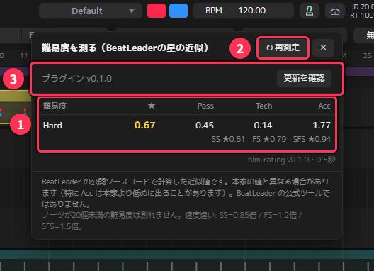

| 番号 | 名前 | 説明 |
|---|---|---|
| ① | 結果 | 難易度ごとの★と Pass / Tech / Acc。下の段は速度を変えた時の★ |
| ② | ↻ 再測定 | 譜面を直した後に、測り直す |
| ③ | プラグイン | 使っているプラグインの版と、更新の確認 |

パネルを開くたびに測定します（前に測った時から譜面が変わっていなければ、その結果をそのまま出します）。
開いたまま譜面を直した時は **↻ 再測定** を押します。NLM版 BL評価リストで測った結果も、ここに出ます。

| 列 | 意味 |
|---|---|
| ★ | 総合の難しさ（BeatLeader の星） |
| Pass | クリアするための難しさ |
| Tech | 角度や配置の技術的な難しさ |
| Acc | 高い精度を出す難しさ |

- 各難易度の下には、速度を変えた時の★も出ます（SS＝0.85 倍、FS＝1.2 倍、SFS＝1.5 倍）
- 行にマウスを置くと、予測される精度（%）が出ます
- **ノーツが 20 個未満の難易度は測れません**

> **近似値です。** BeatLeader が公開しているソースコードで計算していますが、本家サイトの値と異なる場合があります
> （特に Acc は本家より低めに出ることがあります）。BeatLeader の公式ツールではありません。

#### 使い方の例

- **難易度ごとの★の並びを確かめる**：上の難易度ほど★が高くなっているかを見ます
  （ランク基準 R11.H.5 では、★の昇順に並んでいること（0.5★までの逆転は許容）が求められます。NLM版 BL評価リストでも判定します）
- **難易度の差を調整する**：隣り合う難易度の★が近すぎる・離れすぎている時の目安にします
- NLM版 BL評価リストの R5.A・R11.H.5 には、測った★と Tech が自動で入ります（写す必要はありません）
- 同じプラグインで、MEDIA ライブラリの曲の★もまとめて計算できます（[3 章](#を計算するnlm推定)）

### 公開前チェックリスト

- [ ] **曲情報**：曲名・サブタイトル・アーティスト・制作者（マッパー名）を入れた
- [ ] **書き出す難易度**：公開しない作りかけの難易度に、ノーツやライトが残っていない
  （中身のある難易度は、設定ノードのチェックに関係なくすべて書き出されます）
- [ ] **カバー画像**：256×256 以上の正方形の画像を選んだ
- [ ] **試聴区間**：試聴ノードで、選曲画面で流す区間を決めた（▶ 試聴で確認した）
- [ ] **曲の頭**：最初のノーツまで 1.5 秒以上ある（2 秒以上がおすすめ）
- [ ] **曲の音量**：音量が小さい曲は、Music の段の **自動調整** で上げた（[5 章](#曲の音量音量補正)）
- [ ] **NJS とオフセット**：ヘッダーの JD / RT を見て、難易度ごとに遊びやすい値にした
- [ ] **ライト**：全難易度にライトが入っていて、PREVIEW で見た目を確かめた（足りなければ自動ライティングで下地を作れる）
- [ ] **譜面チェック**：ランク不可・エラーが無い（警告も一通り見た）
- [ ] **★の並び**：上の難易度ほど★が高くなっている（NLM版 BL評価リストの R11.H.5 が要確認になっていない）
- [ ] **試しプレイ**：書き出して、Beat Saber 本体で全難易度を通しで遊んだ
- [ ] **プロジェクトの保存**：`.nlmf` を保存した（あとで直す時に必要です）

<!-- 章ナビ -->
> **ほかの章へ：** [1. 作業を速くする操作](#1-作業を速くする操作) ｜ [2. 配置を助ける表示](#2-配置を助ける表示) ｜ [3. NLE を使いこなす](#3-nle-を使いこなす) ｜ [4. 難易度をまとめて作る](#4-難易度をまとめて作る) ｜ [5. テンポが変わる曲と、拍のずれの直し方](#5-テンポが変わる曲と拍のずれの直し方) ｜ [6. 曲を解析する（テンポと構成）](#6-曲を解析するテンポと構成) ｜ [7. ライティングの応用](#7-ライティングの応用) ｜ [8. INFO ノードの応用](#8-info-ノードの応用) ｜ [9. 公開前のチェック](#9-公開前のチェック) ｜ [10. 自分に合わせた設定](#10-自分に合わせた設定) ｜ [11. 困ったとき](#11-困ったとき) ｜ [▲ 目次](#目次)
<!-- /章ナビ -->

---

## 10. 自分に合わせた設定

メニューの **環境設定** で、操作の感じや見た目を自分に合わせて変えられます。
設定はタブで 6 つに分かれています。

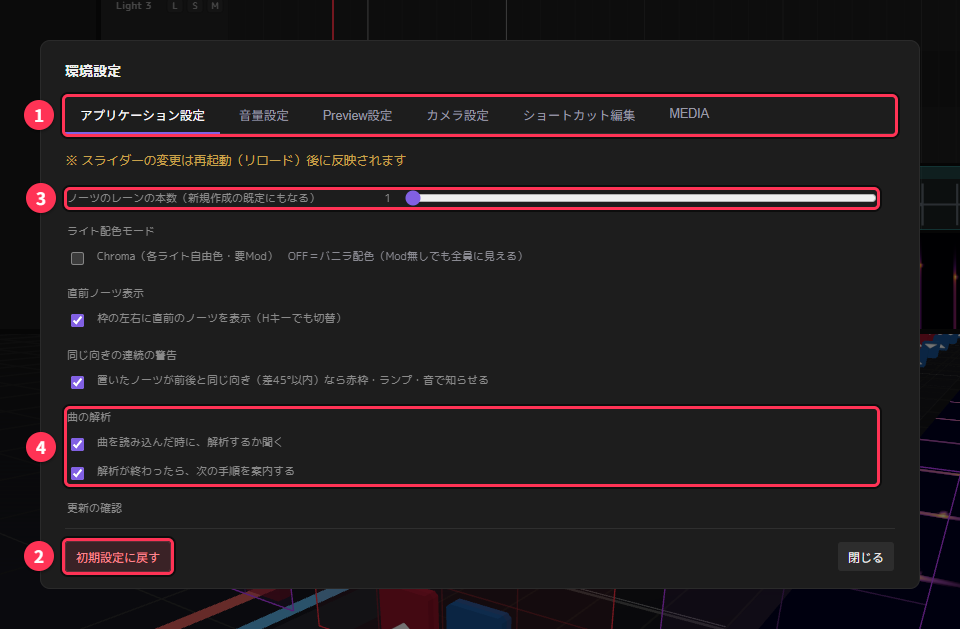

画像は、アプリケーション設定の欄を下へスクロールしたところです。

> スライダーの変更は、アプリを起動し直すと反映されます（Preview設定は、PREVIEW を開いた時に反映されます。ノーツのレーンの本数は、すぐに反映されます）。

### アプリケーション設定

| 項目 | 内容 |
|---|---|
| 言語 / Language | 日本語・英語を切り替える |
| 文字サイズ | 画面の文字の大きさ（80〜120%） |
| ショートカット表示 | 画面に浮かぶショートカット一覧の小窓を、種類（標準操作・NOTES・LIGHTING・NLE・INFO）ごとに出す・消す |
| ノーツのレーンの本数（③） | NLE のノーツのレーンの本数（1〜5 本。最初は 1 本）。いまのプロジェクトにすぐ反映され、新しいプロジェクトの本数にもなる（減らす時は、一番上のレーンにクリップがあると減らせない）。ライトのレーンはいつも 3 本から始まる（[3 章](#レーンを増やすロックソロミュート)） |
| ライト配色モード | ライトの色の付け方（[7 章](#7-ライティングの応用)） |
| 直前ノーツ表示 | [2 章](#直前ノーツの補助表示) の補助表示を出すか（H キーでも切り替え） |
| 同じ向きの連続の警告 | [2 章](#同じ向きの連続の警告) の警告を出すか |
| 曲の解析（④） | 「**曲を読み込んだ時に、解析するか聞く**」（[6 章](#曲を読み込んだ時の確認)）と「**解析が終わったら、次の手順を案内する**」（[6 章](#解析が終わった時の案内)）。どちらも最初はオン。画面の「次から聞かない」「次から出さない」でオフにした物も、ここで戻せる |
| 更新の確認 | 起動時に新しい版が出ていないか確かめるか（GitHub に接続します） |

ショートカット一覧の小窓は、操作を覚えたら消しておくと画面が広く使えます。
消さずに、小窓の **—** で題名だけの 1 行にたたんでおくこともできます。

### 音量設定

マスター・ミュージック（曲）・ノーツ音・メトロノームの音量を、別々に変えられます。
ノーツを置く時は、ノーツ音を大きめにしておくとタイミングを確かめやすくなります。

ここで変わるのは、作業中の聞こえ方だけです。書き出す曲の音量を変える時は、Music の段の音量補正（[5 章](#曲の音量音量補正)）を使います。

### Preview設定

PREVIEW の見た目を細かく調整します（100% が標準）。

| 項目 | 内容 |
|---|---|
| Bloom 強度・半径・閾値 | ライトのにじむような光り方 |
| 環境光の明るさ | ステージ全体の明るさ |
| 発光の強さ | ライトやノーツの光の強さ |
| 反射の強さ | 床などへの映り込みの強さ |

PC が重い時や、光がまぶしくてノーツが見にくい時に下げてみてください。

### カメラ設定

| 項目 | 内容 |
|---|---|
| 回転・ズーム・パン | 3D ビューで視点を動かす速さ（50〜150%） |
| 3D ビューのホイール操作を反転 | 3D ビューでホイールを回した時に進む向きを逆にする |
| 2D 画面のホイール操作を反転 | NLE・Music でホイールを回した時に進む向きを逆にする |

ホイールの向きは、3D ビューと 2D 画面（NLE・Music）で別々に決められます。

### ショートカット編集

キーの割り当てを変えます（[1 章](#ショートカットを自分用に変える)）。

### MEDIA

MEDIA ライブラリ（[3 章](#media-ライブラリ曲のフォルダを記録して一覧検索する)）の設定です。

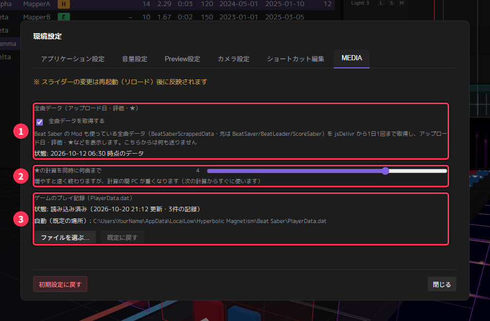

| 番号 | 項目 | 内容 |
|---|---|---|
| ① | 全曲データを取得する | アップロード日・評価・★などの全曲データを、jsDelivr から 1 日 1 回まで取得する（最初は ON）。こちらからは何も送らない。OFF にすると、取得せず一覧にも出さない。「状態」に、使っているデータの時点が出る |
| ② | ★の計算を同時に何曲まで | NLM推定の★をまとめて計算する時に、同時に計算する曲の数（最初は 4。上限は PC の CPU の数と 5 の小さい方）。増やすと早く終わるが、計算の間 PC が重くなる。起動し直さなくても、次の計算から使われる |
| ③ | ゲームのプレイ記録（PlayerData.dat） | プレイ記録の状態と場所。最初は自動（PC 版 Beat Saber の既定の場所 `AppData\LocalLow\Hyperbolic Magnetism\Beat Saber`）。見つからない時は **ファイルを選ぶ…** で選ぶ（デスクトップ版だけ）。**既定に戻す** で自動に戻す |

### 初期設定に戻す

環境設定の左下の **初期設定に戻す** で、ここにある設定をすべて最初の状態に戻せます。
プロジェクト・アセット・プラグインと、MEDIA に記録したフォルダ・プレイ記録の場所は消えません
（カタログの表示名や、詳細表示の列・並べ順・フィルターは最初の状態に戻ります）。

<!-- 章ナビ -->
> **ほかの章へ：** [1. 作業を速くする操作](#1-作業を速くする操作) ｜ [2. 配置を助ける表示](#2-配置を助ける表示) ｜ [3. NLE を使いこなす](#3-nle-を使いこなす) ｜ [4. 難易度をまとめて作る](#4-難易度をまとめて作る) ｜ [5. テンポが変わる曲と、拍のずれの直し方](#5-テンポが変わる曲と拍のずれの直し方) ｜ [6. 曲を解析する（テンポと構成）](#6-曲を解析するテンポと構成) ｜ [7. ライティングの応用](#7-ライティングの応用) ｜ [8. INFO ノードの応用](#8-info-ノードの応用) ｜ [9. 公開前のチェック](#9-公開前のチェック) ｜ [10. 自分に合わせた設定](#10-自分に合わせた設定) ｜ [11. 困ったとき](#11-困ったとき) ｜ [▲ 目次](#目次)
<!-- /章ナビ -->

---

## 11. 困ったとき

### プロジェクトを開いたのに、曲・出力フォルダ・カバー画像がつながらない

プロジェクト（`.nlmf`）には、曲・出力フォルダ・カバー画像の **場所** を保存していて、開いた時に自動でつなぎます。
次の場合は自動ではつながりません。

- ファイルやフォルダを移動した・名前を変えた
- 別の PC でプロジェクトを開いた
- v1.2.0-oz より前の版から更新した（最初の 1 回だけ）
- 他の人から受け取ったプロジェクトを開いた

出力フォルダは、安全のため **この PC のフォルダ選択画面で一度選んだことのあるフォルダ** にしか自動でつなぎません。
受け取ったプロジェクトに、知らない書き出し先が仕込まれていても書き込まないためです。

**直し方**

- 出力フォルダ・カバー画像：INFO 画面の書き出しノードにある「**🔌 出力フォルダ/カバー画像を再接続**」で選び直します
- 曲：**ファイル → 音楽ファイルを読み込む…** で選び直します

一度選び直せば、次からはまた自動でつながります。

### 書き出しボタンを押すと「書き出せません」と出る

書き出しノードのチェック一覧で、「必須」の項目に ✕ が付いています。

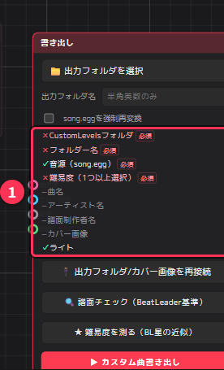

| 項目 | 直し方 |
|---|---|
| CustomLevels フォルダ | 「出力フォルダを選択」で Beat Saber の CustomLevels を選ぶ |
| フォルダー名 | 出力フォルダ名を入れる（半角英数字） |
| 音源（song.egg） | 曲を読み込む |
| 難易度（1 つ以上選択） | 設定ノードで、難易度に 1 つ以上チェックを入れる |

### 「ffmpeg が見つかりません」と出る

ogg 以外の曲（mp3・wav など）を書き出す時や、無音追加・音量補正を使う時は、曲の変換に **ffmpeg** が必要です。
ffmpeg は NLM と一緒には入りません。

1. Windows の「ターミナル」（または PowerShell）を開き、次を実行してインストールします

   ```
   winget install Gyan.FFmpeg
   ```

2. **NLM を一度閉じて、起動し直します**（起動し直さないと、インストールした ffmpeg が見つかりません）
3. もう一度書き出します

m4a などの曲を「曲を解析」する時にも ffmpeg が必要です（次の「「曲を解析」でエラーが出る」）。インストールの手順は同じです。

### 「曲を解析」でエラーが出る

| 表示 | 直し方 |
|---|---|
| この形式の音源の解析には ffmpeg が要ります… | m4a・aac・wma・mp4 などの曲は、ffmpeg で読み込んでから解析します。上の手順で ffmpeg をインストールし、**NLM を起動し直して** から、もう一度［曲を解析］を押す（mp3・ogg・wav・flac に変換した曲なら ffmpeg 無しで解析できます） |
| 曲が短すぎて解析できません | 5 秒より短い曲は解析できません。構成は、音のある所が 6 拍ぶんより少ない時も解析できません |
| 音源のファイルが大きすぎて解析できません | 300MB を超えるファイルは解析できません。mp3・ogg などの圧縮した形式に変換して読み込み直す |
| 音源を読み込めませんでした（壊れているか、対応していない形式です） | ファイルが壊れていないか確かめる。mp3・ogg・wav に変換して読み込み直す |
| 先に曲を読み込んでください | 曲を読み込んでから押す |
| 音源のファイルが見つかりません（曲を読み込み直してください） | 曲のファイルを移動・削除した。曲を読み込み直す |
| 別の解析が実行中です。終わってからもう一度押してください | 解析が終わるまで待つ（やめる時は帯の［やめる］） |
| 解析の作業が見つかりません／解析用に預けた音源が見つかりません | アプリを起動し直した時などに出ます。もう一度［曲を解析］を押す |

解析の結果がおかしい時（BPM が合わない、区切りの位置がずれている）は、[6 章](#6-曲を解析するテンポと構成) の確認の画面の知らせ（拍のずれ・テンポの揺れ・裏拍の疑い）を見て、メトロノームで確かめます。
BPM や無音追加を直した後は、帯のメニューの **解析し直す** で構成を解析し直します。

### 曲を変えていないのに、書き出した曲がおかしい

書き出しを速くするため、曲が前回と同じなら song.egg の変換を省いています。
それでもおかしい時は、書き出しノードの「**song.eggを強制再変換**」にチェックを入れて書き出し直してください。

### キーを押しても効かない

- ショートカットは、**マウスが乗っている枠**（3D ビュー・NLE・PREVIEW など）に対して効きます。操作したい枠の上にマウスを置いてから押してください
- ショートカットの割り当てを変えた場合は、**環境設定 → ショートカット編集** で確かめます。「全て既定に戻す」で元に戻せます
- 3D ビューのノーツの操作は、そのレーンが **ロック** されていると効きません（[3 章](#レーンを増やすロックソロミュート)）
- **単独編集** の間は、単独編集のレーン以外のノーツは直せません（[3 章](#単独編集)）。3D ビューの左下に「✎ 単独編集: Notes 2」のように出ます
- **リンクの子** のクリップの中のノーツ・ライトは直せません。親を直します（[3 章](#子は直せない)）

### 操作を元に戻せない

ほとんどの操作は Ctrl + Z で戻せます。難易度の転送・受信も、「親の難易度に繋ぐ」のオン・オフに関係なく、**Ctrl + Z の 1 回** で全部の難易度が戻ります（[4 章](#写す前の確認親の難易度に繋ぐ)）。

次のものは Ctrl + Z の対象ではありません。

- 単独編集の切り替え（[3 章](#単独編集)）
- 環境設定の変更
- 「次の親を選んでください」の **キャンセル** で取り消した操作（やり直しでも戻りません。[3 章](#リンクを外すクリップを消す)）

大きな変更の前には Ctrl + S で保存しておくと安心です。

### 新しいプロジェクトのノーツのレーンが 1 本しかない

v2.0.0-oz から、新しいプロジェクトはノーツのレーン 1 本・ライトのレーン 3 本から始まります。
前の版で保存したプロジェクトは、保存した時の本数のまま開きます。

- 足す時は、レーンの左端の何もない所を右クリック →「**＋ ノーツレーンを追加（一番上に）**」（[3 章](#レーンを増やすロックソロミュート)）
- 空きが無い所へクリップを置いた時は、一番上に自動でレーンが足されます
- 新しいプロジェクトの本数は、**環境設定 → アプリケーション設定 → ノーツのレーンの本数** で変えられます（[10 章](#アプリケーション設定)）

### 「曲を解析しますか？」や、解析が終わった時の案内が出ない（出したくない）

**環境設定 → アプリケーション設定 → 曲の解析** の 2 つのチェックで、出す・出さないを切り替えます（[10 章](#アプリケーション設定)）。
画面の「次から聞かない」「次から出さない」にチェックを入れて閉じた時も、ここでオンに戻せます。

- 「曲を解析しますか？」は、新しく曲を取り込んだ時だけ出ます。その曲の解析の結果がもうある時は出ません（[6 章](#曲を読み込んだ時の確認)）
- 案内が出なくても、帯の左の **🧩 クリップを作る** からクリップを作れます（[6 章](#解析からクリップを作る)）

### プロジェクトを開いたら「○ 個のリンクを外しました」と出る

リンクの子のクリップが、親と違う中身になっていたので、その子のリンクを外しました。
v2.0.0-oz より前の版でプロジェクトを開いて、子のクリップを直して保存した時などに起きます。
外れたクリップの中身はそのまま残り、普通のクリップとして直せます。もう一度リンクする時は、[3 章](#リンクする) の方法でつなぎ直します。

### 環境設定を最初の状態に戻したい

**環境設定 → 初期設定に戻す** で、画面の比率・音量・カメラの速度・ショートカットなど、全部の環境設定が最初の状態に戻ります。
プロジェクトやアセットは消えません。

### 「難易度を測る」でエラーが出る

| 表示 | 直し方 |
|---|---|
| GitHub に接続できませんでした | インターネットの接続を確かめる |
| 配布元の情報と一致しません | ダウンロードが壊れた可能性があります。時間をおいてもう一度取り込む |
| このプラグインの版は、今の NLM では使えません | NLM を新しい版に更新する |
| ノーツが 20 個未満のため測れません | その難易度は測れません（ノーツを増やせば測れます） |

### 起動時に "Failed to resolve Python.Runtime.Loader.Initialize ..." と出て起動しない

ダウンロードした zip に付く「インターネットから来たファイル」の印が原因です。
普通は起動時に自動で外しますが、それでも起動しない時は次の手順で外します。

1. ダウンロードした zip を右クリック →「プロパティ」
2. 「全般」タブの一番下の「許可する」にチェックを入れて OK
3. zip を展開し直して起動する

### 更新したら調子が悪い

アプリ内から更新した場合、前の版がアプリのフォルダの `_previous_<版>` に残っています。
NLM を閉じてから、その中の `NonLinearMapper.exe` と `_internal` を元の場所へ戻すと、前の版に戻せます。

Program Files など、書き込めない場所に NLM を置いている場合は、アプリ内から更新できません。
README の手順で手動で更新してください。

### それでも解決しない時

[GitHub の Issues](https://github.com/Oz-Co-two/nlm-oz-co2/issues) で知らせてください。
画面右上に出ている **版番号**（例：v2.0.0-oz）と、どの操作で何が起きたかを書いてもらえると助かります。

<!-- 章ナビ -->
> **ほかの章へ：** [1. 作業を速くする操作](#1-作業を速くする操作) ｜ [2. 配置を助ける表示](#2-配置を助ける表示) ｜ [3. NLE を使いこなす](#3-nle-を使いこなす) ｜ [4. 難易度をまとめて作る](#4-難易度をまとめて作る) ｜ [5. テンポが変わる曲と、拍のずれの直し方](#5-テンポが変わる曲と拍のずれの直し方) ｜ [6. 曲を解析する（テンポと構成）](#6-曲を解析するテンポと構成) ｜ [7. ライティングの応用](#7-ライティングの応用) ｜ [8. INFO ノードの応用](#8-info-ノードの応用) ｜ [9. 公開前のチェック](#9-公開前のチェック) ｜ [10. 自分に合わせた設定](#10-自分に合わせた設定) ｜ [11. 困ったとき](#11-困ったとき) ｜ [▲ 目次](#目次)
<!-- /章ナビ -->
