[日本語](tutorial.md) | **English**

# Tutorial: making your first map and playing it in Beat Saber

This tutorial walks you step by step through loading a song, placing notes, exporting the map so it can be played in Beat Saber, and saving your project.

> **Switching the UI to English**
> NLM starts in Japanese. Click **環境設定** (Preferences — the second menu at the top left, next to ファイル)
> and set **言語 / Language** to **English** on the first tab. The screenshots in this tutorial show the English UI (v2.0.0-oz).

This tutorial covers only the basic flow. For the details of each panel, see the original
[reference manual](https://helba.flashhub.net/nlm/manual/) (Japanese).
Faster workflows and the checks before publishing are covered in the [advanced tutorial](tutorial-advanced.en.md).

## Contents

1. [The screen layout](#1-the-screen-layout)
2. [Load a song and set the BPM](#2-load-a-song-and-set-the-bpm)
3. [Place notes](#3-place-notes)
4. [Select and edit, arcs and chains](#4-select-and-edit-arcs-and-chains)
5. [Bombs and walls](#5-bombs-and-walls)
6. [Lighting](#6-lighting)
7. [Check it in the preview](#7-check-it-in-the-preview)
8. [Enter the song info and export](#8-enter-the-song-info-and-export)
9. [Save the project](#9-save-the-project)
10. [Where to go next](#10-where-to-go-next)

> **About the images**
> The images were taken in a browser. In the exe version the window has a frame (title bar),
> and selecting files or folders opens the standard Windows dialogs.
> The volume meter at the right edge of the screen is cropped out of the images.

---

## 1. The screen layout

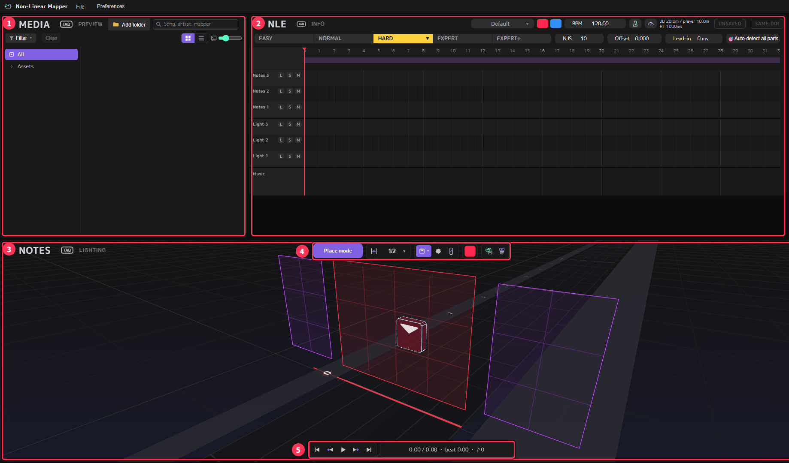

| No. | Name | What it is for |
|---|---|---|
| ① | **MEDIA / PREVIEW** | MEDIA lists songs and assets. Switch to PREVIEW for a preview that looks close to Beat Saber |
| ② | **NLE / INFO** | NLE is a timeline where you arrange the map and the song along time. Switch to INFO to set the song name, the export folder and so on |
| ③ | **NOTES / LIGHTING** | The 3D view. This is where you place notes and lights |
| ④ | Toolbar | Choose what to place (note, bomb, wall), its color and direction |
| ⑤ | Transport bar | Play / stop, and the current time and beat |

The "TAB" next to the headings of ① to ③ means: **put the mouse over that area and press Tab to switch the view**
(for example, Tab over ③ switches NOTES ⇄ LIGHTING). You can also click the "TAB" and the name next to it to switch.

The small floating windows listing shortcuts can be closed with the ✕ at their top right (you can show them again from Preferences).
Press — to fold one into a single line showing only its title (Standard, NOTES, and so on); press it again to unfold it.
They are closed in the rest of the images to keep them easy to read.

---

## 2. Load a song and set the BPM

### Load the song

Choose **File → Load music file…** from the menu and open your song file.

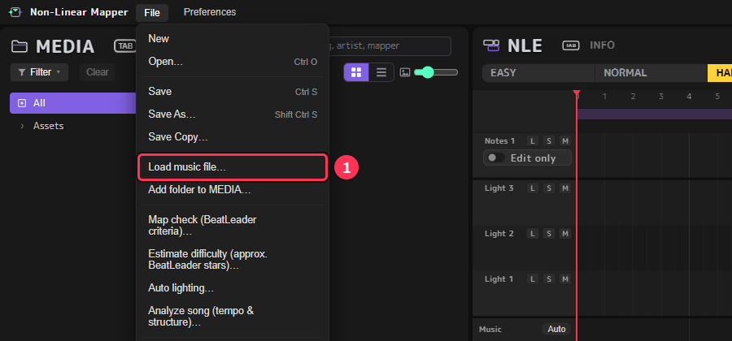

Supported formats include ogg / egg / mp3 / wav / flac / m4a.
Songs in formats other than ogg are converted to the Beat Saber format (song.egg) with ffmpeg when you export.
If you have not installed ffmpeg, install it first as described in the "ffmpeg" section of the [README](../README.en.md).

When you load a song, you are asked "Analyze this song?".

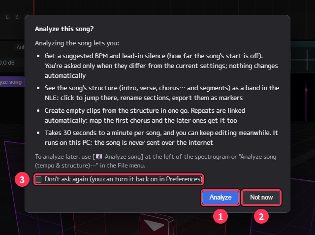

| No. | Name | Description |
|---|---|---|
| ① | Analyze | Starts analyzing the tempo (BPM and lead-in) and the structure of the song ([Analyze the song](#analyze-the-song) below) |
| ② | Not now | Closes without analyzing (Esc does the same). You can analyze the song at any time later |
| ③ | Don't ask again | Check this before closing, and this question is not shown from then on |

- The analysis runs on your PC; the song is never sent over the internet. You can keep editing while it runs
- To analyze later, use **🎼 Analyze song** at the left of the spectrogram (⑧ in the image below) or **File → Analyze song (tempo & structure)…** in the menu
- If you turned the question off with ③, turn it back on in **Preferences** → "Application" → "Song analysis" → "Ask whether to analyze when a song is loaded"
- It is not shown when you open a project, or when the song already has analysis results

Here we press **Not now** and look at the screen and the BPM first (the analysis is covered in [Analyze the song](#analyze-the-song) below).

The waveform of the song appears in the **Music** row at the bottom of the NLE.

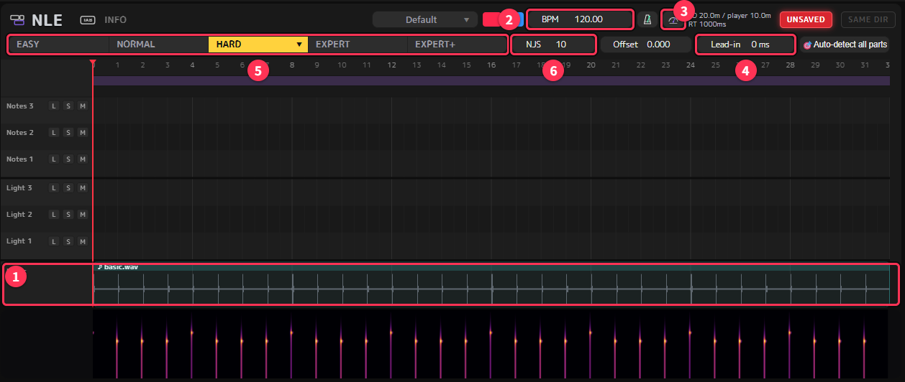

| No. | Name | Description |
|---|---|---|
| ① | Music | The waveform of the song. The colored band below it shows the strength of each frequency (spectrogram), so you can see where the song builds up |
| ② | BPM | The tempo of the song. Click the value to type a number |
| ③ | Detect BPM | Analyzes the song and suggests BPM candidates |
| ④ | Lead-in | Silence (ms) added to the start of the song. Use it when the beat lines and the start of the song do not line up |
| ⑤ | Difficulty | Which difficulty you are editing. Click it or press 1–5 to switch |
| ⑥ | NJS | Note jump speed — how fast the notes fly in. Each difficulty has its own value |
| ⑦ | Volume adjustment | The volume of the song (dB). Press **Auto** to raise a quiet song to a good level. You can also change it yourself with ‹ › |
| ⑧ | Analyze song | Analyzes the tempo (BPM and lead-in) and the structure of the song ([Analyze the song](#analyze-the-song) below). This purple button appears when a song is loaded and has not been analyzed yet |

### Set the BPM

Music files do not contain the BPM, so you set it yourself.
Press the **Detect BPM** button (③) to get candidates, and pick the one that fits.

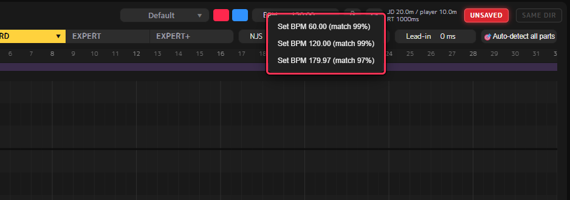

The candidates also include half and double the real BPM. Listen to the song and choose the one that feels natural.
If you know the BPM, you can also type it directly into ②.

To check by ear, turn on the metronome button to the right of the BPM and play with Space.
If the clicks and the beat of the song drift apart little by little, the BPM is wrong.
If they are off by the same amount from the very start, shift the start of the song with **Lead-in** (④).

### Analyze the song

Press **🎼 Analyze song** (⑧), or choose **File → Analyze song (tempo & structure)…** from the menu, to examine the tempo and the structure of the song.
Pressing **Analyze** in the question shown when you load a song starts it in the same way.
It takes longer than Detect BPM, but it suggests **the lead-in as well as the BPM**.
It takes about 30 seconds to a minute per song. **You can keep editing while it runs.**

Once the tempo is found, the following confirmation appears, but only if the analyzed BPM and lead-in differ from the current settings.

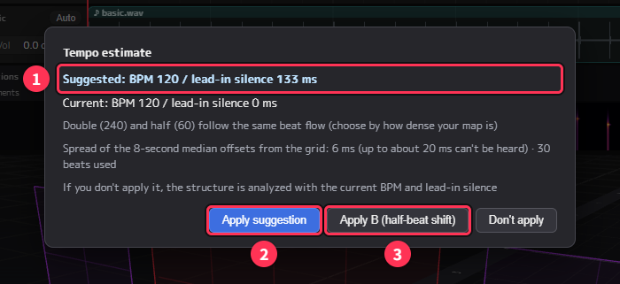

| No. | Name | Description |
|---|---|---|
| ① | Suggested | The BPM and lead-in found by the analysis. Below it you see the current settings and how reliable the suggestion is |
| ② | Apply suggestion | Sets the BPM and lead-in to the values in ① |
| ③ | Apply B (half-beat shift) | Sets the lead-in to the value in ① shifted by half a beat. This can fit better in songs whose strong sounds fall on the off-beat (half a beat off) |

- **Nothing changes automatically.** The BPM and lead-in change only when you press ② or ③. Press **Don't apply** (or Esc) to keep the current settings
- You can undo the change with **Ctrl + Z**. The notes and lights you have placed stay on their beats (their timing against the song changes)
- As above, turn on the metronome and play to check by ear. If you can't decide between the suggestion and B, try both and pick the one that fits
- If the analyzed values are the same as the current settings, this confirmation does not appear

Next, the structure of the song (larger parts such as the intro and the chorus, and finer segments) is analyzed.
While the analysis runs, the current stage (estimating the tempo, analyzing the structure) and a progress bar are shown above the spectrogram. Press **Stop** to cancel it.

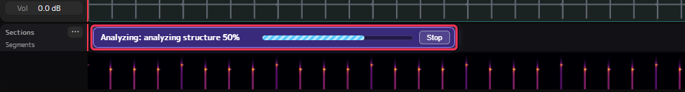

When the structure analysis finishes, the structure bands appear above the spectrogram, and a guide to what to do next is shown.

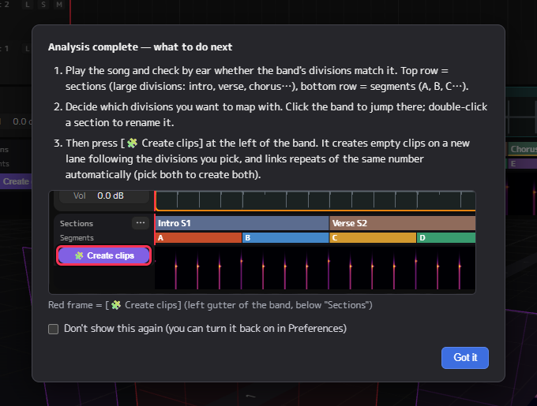

The guide describes these next steps:

1. Play the song and check by ear whether the divisions of the bands match it (top row = sections: large divisions such as the intro, verse and chorus; bottom row = segments)
2. Decide which divisions you want to map with
3. Press **🧩 Create clips** at the left of the band and choose the divisions in the window that opens; empty clips following those divisions are created on a new lane (repeats of the same number are linked automatically)

- When you close the guide with **Got it** (or Esc), **🧩 Create clips** at the left of the band glows for a moment to show where it is. This button is always there while there are analysis results (after you create clips, it turns dark purple)
- Check "Don't show this again" before closing, and the guide is not shown from then on. Turn it back on in **Preferences** → "Application" → "Song analysis" → "Show the next steps when an analysis finishes"

For how to read and use the bands (click to jump there, rename them, export them as markers, and so on),
see chapter 6 of the advanced tutorial, [Analyzing the song (tempo and structure)](tutorial-advanced.en.md#6-analyzing-the-song-tempo-and-structure);
for creating clips, see [Creating clips from the analysis](tutorial-advanced.en.md#creating-clips-from-the-analysis) in the advanced tutorial.
The rest of the images in this tutorial were taken without analysis bands.

### Adjust the song volume

A quiet song sounds quieter than the songs before and after it in Beat Saber.
Press the **Auto** button (⑦) to measure the loudness of the song and raise it to a good level (a song that is already loud enough is left as it is).
The adjustment applies both to playback and to the exported song (song.egg). You can also change it yourself with ‹ ›.

When you use the volume adjustment, the song is converted with ffmpeg on export even if it is an ogg.
For details, see [Song volume (volume adjustment)](tutorial-advanced.en.md#song-volume-volume-adjustment) in the advanced tutorial.

---

## 3. Place notes

### The place mode screen

Right after startup, the 3D view is in **Place mode**.
The red frame in the middle is **the current beat (playhead)**, and you place notes on its 4×3 grid.

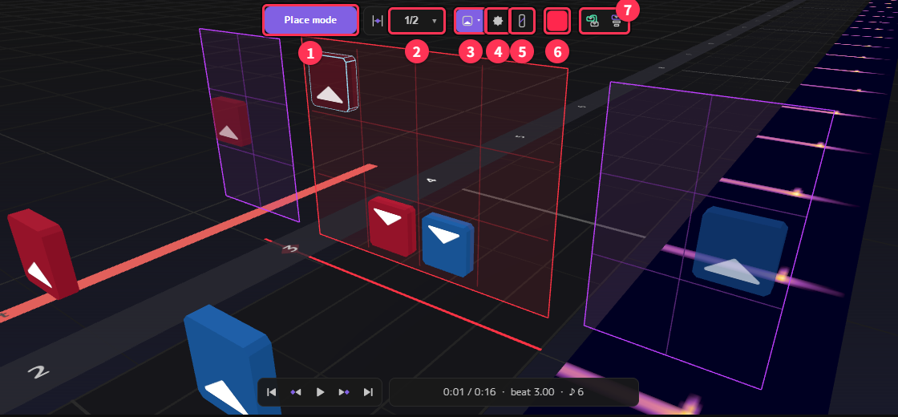

| No. | Name | Description |
|---|---|---|
| ① | Mode | The current mode. Press Q to switch between Place mode ⇄ Camera-lock mode |
| ② | Snap | How far ←/→ and the wheel move (1/2 beat at first). You can also change it with the "," key |
| ③ | Note | Places notes. Use ▾ to choose the cut direction |
| ④ | Bomb | Places bombs |
| ⑤ | Wall | Places walls |
| ⑥ | Color | The color of the notes you place. Press F to switch red ⇄ blue |
| ⑦ | Arc / Chain | Makes an arc or a chain from the selected notes ([chapter 4](#4-select-and-edit-arcs-and-chains)) |

The purple frames to the left and right of the red frame show the last red and blue notes you placed, semi-transparently.
Use them to check that the next swing flows naturally from the previous note (toggle with the H key).

### How to place

1. Move to the beat where you want to place a note with **→ / ←** (or the wheel)
2. Choose the color with **F** (as in Beat Saber, red = left hand, blue = right hand)
3. Choose the cut direction with **▾** on the note button in the toolbar (you can also rotate it with **Alt + wheel**)
4. When you point at a cell, a semi-transparent note with a white frame (where it will be placed) appears. **Left-click** to place it

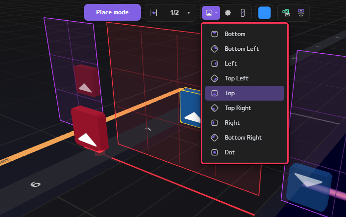

- **Right-click** to delete a note you placed by mistake. **Ctrl + Z** undoes (**Shift + Ctrl + Z** redoes)
- Placing on the same cell at the same beat overwrites the color and direction
- You can also place notes while playing (Space)

As you place notes, colored bands (clips) called "Sheet" are created automatically, one bar at a time, in the **Notes 1** row of the NLE.
The notes you place go into these clips. Clips can be moved, copied and split later,
but you don't need to worry about them at first.

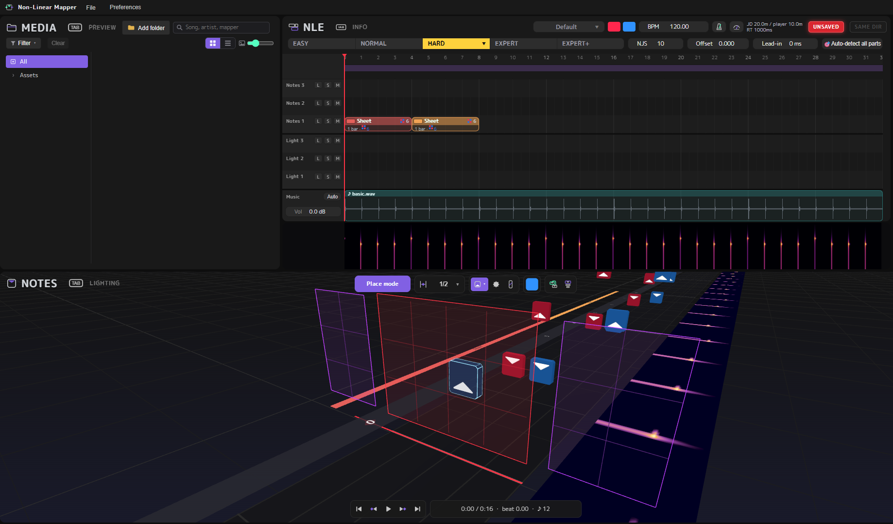

In a new map, the NLE starts with one note lane (row), **Notes 1**, and three light lanes, **Light 1–3**.
When you drop a clip from MEDIA or paste a clip and no lane is free at that time, a lane is added at the top automatically.
To start with more note lanes, change "Note lanes" in **Preferences**
(for adding and removing lanes, see [Adding lanes, lock, solo and mute](tutorial-advanced.en.md#adding-lanes-lock-solo-and-mute) in chapter 3 of the advanced tutorial).

---

## 4. Select and edit, arcs and chains

### Select in Camera-lock mode

To select and edit notes you have placed, press **Q** to switch to **Camera-lock mode**.
The view looks down at the map from the side, and you can click notes to select them.

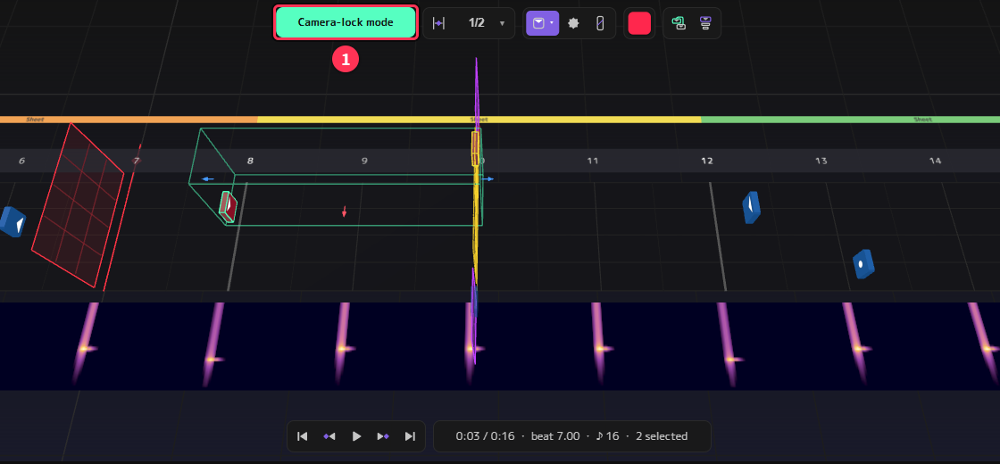

- **Left-click**: select. **Shift + left-click**: add to the selection
- **Left-drag** from an empty spot: select everything inside the box
- Drag the arrows that appear to move the selection
- **X / Delete**: delete. **A**: clear the selection
- Point at the selected notes and press **F** or use **Alt + wheel**: change the color / direction of all selected notes at once
- Rotate the view with **middle-drag**, pan with **Shift + middle-drag**, and zoom with **Ctrl + wheel**

### Arcs and chains

Select **two or more notes of the same color**, then press

- **Ctrl + R** → an **arc** (a line connecting the notes). The original notes stay
- **C** (or Ctrl + T) → a **chain** (a row of small slices). The two original notes become its head and tail

The two buttons at the right end of the toolbar do the same.

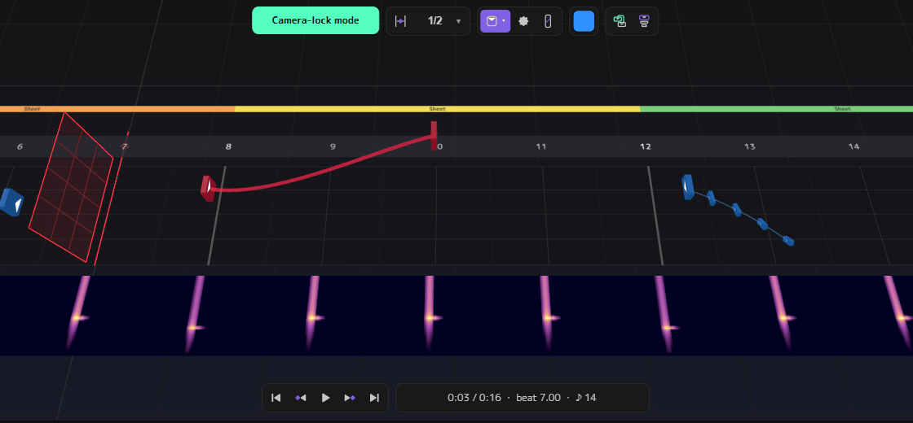

You can change how much an arc curves and how many slices a chain has with the wheel while it is selected
(for the key combinations, see the shortcut list on the screen or the NOTES section of the original manual).

An arc stays connected to the notes at its ends.

- Clicking a note at the end of an arc selects the note. When you move that note, the end of the arc follows it. When you change the note's direction, the arc's end direction changes too
- To select the arc itself, click around the middle of its line. When you move the arc, the notes at both ends move with it
- To move only one end of the arc, select the arc and use the small arrows that appear at its head and tail (the large arrows move the whole arc)

---

## 5. Bombs and walls

In Place mode, choose **Bomb** (①) or **Wall** (②) in the toolbar, then place them.
Pressing **W** also opens a circular menu (pie menu) to choose select / note / bomb / wall.

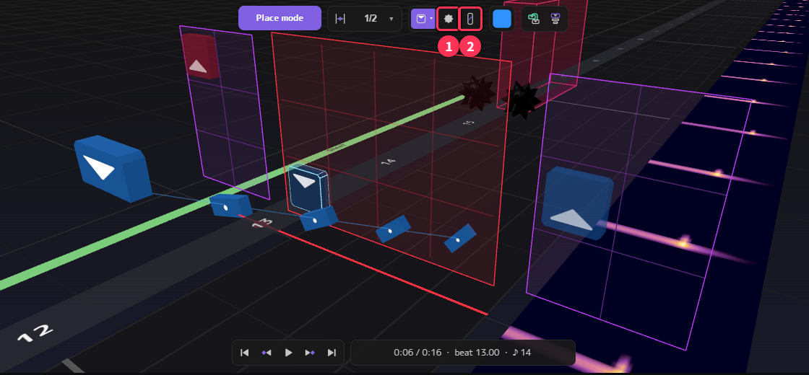

- **Bomb**: click a cell to place it, just like a note
- **Wall**: click four times to set its shape
  1. Click the starting cell
  2. Move the mouse to set the width and click
  3. Set the height and click
  4. Set the depth (length) and click
  To cancel halfway, right-click or press Esc

To resize a wall after placing it, select it in Camera-lock mode and press **S**.

---

## 6. Lighting

Put the mouse over the 3D view and press **Tab** to switch to **LIGHTING** (light editing) (①).
There are 10 lanes, one for each kind of light (RING ZOOM, CENTER, L LASER, etc.).

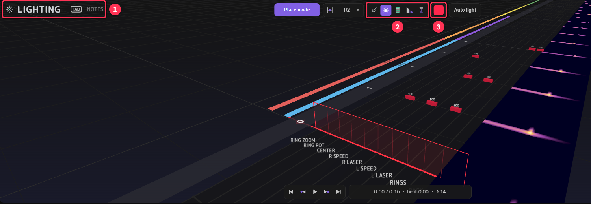

1. Choose the behavior (off / on / flash / fade / transition) with ②
2. Choose the color with the color box ③ (over the 3D view you can also press **1, 2 or 3**: ①, ② or white. Here the number keys do not switch the difficulty)
3. As with notes, move to the beat and **left-click** a lane (right-click to delete)

The lights you place are gathered into a clip in the **Light 1** row of the NLE.
Press Tab again to go back to NOTES.

A map can be played without lights. You can make the notes first and add lights later.

---

## 7. Check it in the preview

Put the mouse over the top-left area and press **Tab** to switch to **PREVIEW** (①).
You can check notes and lights in a view close to Beat Saber.

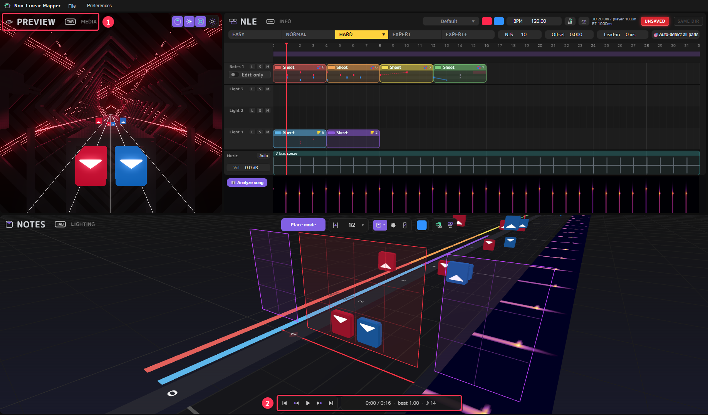

Press **Space** (or the play button ②) to play / stop.
The buttons at the top right of PREVIEW toggle the notes, lights and stage (the rightmost one brightens the stage so you can see its motion more easily).
Choose the stage (environment) in the "Default" field at the top right of the NLE.

---

## 8. Enter the song info and export

Put the mouse over the NLE and press **Tab** to switch to the **INFO** screen.
This is where you set the song name and the export folder.

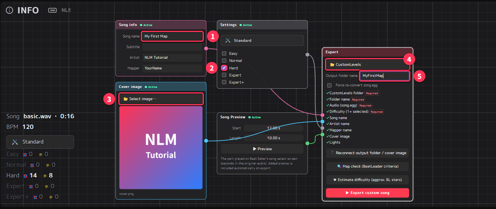

| No. | Place | What to set |
|---|---|---|
| ① | Song info | Enter the song name, subtitle, artist and mapper (your name) |
| ② | Settings | **Check at least one** difficulty (Hard in this example). You cannot export with no checks. What is actually exported is **every difficulty that has notes, lights, etc.**, regardless of the checks |
| ③ | Cover image | The cover shown on the song select screen (you can export without one) |
| ④ | Export | Use **Select output folder** to choose Beat Saber's **CustomLevels folder** |
| ⑤ | Output folder name | The name of the folder created inside CustomLevels (letters and numbers only) |

The CustomLevels folder is `Beat Saber_Data\CustomLevels` inside the folder where Beat Saber is installed.

The **Song Preview** node sets the part played on the song select screen (start and length, in seconds). You can check it with ▶ **Preview**.

The lines between the nodes show which settings are used for the export. Everything is connected from the start, so you can leave them as they are.

### Export

When every "Required" item in the export node's checklist has a ✓, you are ready.
Press **▶ Export custom song**.

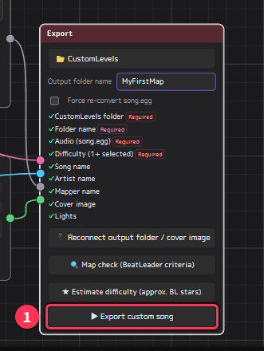

The following files are created in the folder named ⑤ inside CustomLevels:

- `Info.dat` (song info)
- `HardStandard.dat` etc. (one map file for each difficulty with content)
- `song.egg` (the song)
- the cover image

Start Beat Saber and the map appears in the custom songs list.

After editing the map, press **▶ Export custom song** again to overwrite it.
If you have not changed the song, the conversion is skipped from the second time on, so it finishes quickly.

---

## 9. Save the project

The exported files are for Beat Saber, so to continue editing later, save a **project file (`.nlmf`)**.

Save with **Ctrl + S** (or File → Save). The first time, you are asked for the location and file name.

When there are unsaved changes, **UNSAVED** at the top right of the NLE lights up in red (just moving the playhead or zooming the NLE does not light it).

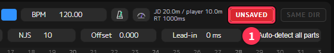

It goes off when you save.

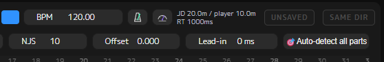

If you close the app, or choose New or Open, with unsaved changes, you are asked to choose "Save and quit (continue) / Quit without saving (continue) / Cancel".

To continue editing, open the `.nlmf` with **File → Open…** (Ctrl + O). You can also double-click the `.nlmf`.
The song, the output folder and the cover image are loaded automatically from their previous locations.
The playhead position and the zoom and scroll position of the NLE also return to where they were when you saved.
If you moved the files, select them again with "Reconnect output folder / cover image" on the export node of INFO.

---

## 10. Where to go next

Once you are used to the basics, try these features too. They are explained in the [advanced tutorial](tutorial-advanced.en.md)
(faster workflows, making the most of the NLE, the MEDIA library, building several difficulties, analyzing the song, checks before publishing, measuring ★, and more).

- **Clip editing in the NLE**: move, copy, split (C key) and join (Ctrl + G) clips to build repeated choruses and so on efficiently
- **Linked clips**: link clips that should have the same content, such as repeated choruses, and editing the parent clip gives the other linked clips (children) the same content (children cannot be edited directly).
  You can also link clips in other difficulties. Select two or more clips in the NLE and press **K** (or right-click → "Link")
  (see [Linked clips](tutorial-advanced.en.md#linked-clips) in chapter 3 of the advanced tutorial)
- **Edit only**: lets you edit just one note lane. Turn it on with the "Edit only" switch at the left of the lane (or point at the lane in the NLE and press **E**);
  notes you place in the 3D view then go only into that lane, and notes in other lanes cannot be selected or deleted (see [Edit only](tutorial-advanced.en.md#edit-only) in chapter 3 of the advanced tutorial)
- **Assets**: right-click a clip with a pattern you use often → "Save to assets", then drag it from MEDIA to another place or another song
- **Copying between difficulties**: click the selected difficulty again to open a menu that sends notes or lights to another difficulty.
  "Send notes" copies only the notes and "Send lighting" only the lights ("Send everything" copies both). Every transfer can be undone with a single **Ctrl + Z**.
  By default, the copied clips are linked to the clips they were copied from ("Link to the parent difficulty"; see chapter 4 of the advanced tutorial, [Making several difficulties efficiently](tutorial-advanced.en.md#4-making-several-difficulties-efficiently))
- **MEDIA library**: register CustomLevels or other folders with **Add folder to MEDIA…** in the File menu to sort, search and filter the list of songs (one row per difficulty in the detail view; ★, NPS, play records and more), and to drag songs into the NLE as material.
  In the exe version the folders stay registered the next time you start NLM (see [MEDIA library](tutorial-advanced.en.md#media-library-record-song-folders-then-list-and-search-them) in chapter 3 of the advanced tutorial)
- **Tempo parts**: support for songs whose BPM changes partway through ("Auto-detect all parts" in the NLE)
- **Analyze song (structure bands)**: **Analyze song** in chapter 2 also analyzes the structure of the song (larger parts such as the intro and the chorus) and shows it as bands above the spectrogram.
  Click a band to jump there, or place markers at the start of each part (see chapter 6 of the advanced tutorial, [Analyzing the song (tempo and structure)](tutorial-advanced.en.md#6-analyzing-the-song-tempo-and-structure)).
  Press **🧩 Create clips** at the left of the band to create empty NLE clips that follow the bands (repeats of the same part are linked automatically; see [Creating clips from the analysis](tutorial-advanced.en.md#creating-clips-from-the-analysis) in the advanced tutorial)
- **Markers**: place a marker with Ctrl + E and jump between markers with Ctrl + [ / ]
