**日本語** | [English](tutorial.en.md)

# チュートリアル：はじめての譜面を作って Beat Saber で遊ぶまで

曲を読み込んでノーツを置き、Beat Saber で遊べる形に書き出して保存するまでを、順番に説明します。
画面は Oz-Co2 版 v2.0.0-oz のものです。

ここで説明するのは基本の流れだけです。各パネルの細かい操作は、原作の
[リファレンスマニュアル](https://helba.flashhub.net/nlm/manual/) を参照してください。
作業を速くする操作や公開前のチェックなどは、[上級編チュートリアル](tutorial-advanced.md) で説明しています。

## 目次

1. [画面の見方](#1-画面の見方)
2. [曲を読み込んで BPM を合わせる](#2-曲を読み込んで-bpm-を合わせる)
3. [ノーツを置く](#3-ノーツを置く)
4. [選んで直す・アークとチェーン](#4-選んで直すアークとチェーン)
5. [ボムと壁](#5-ボムと壁)
6. [ライティング](#6-ライティング)
7. [プレビューで確認する](#7-プレビューで確認する)
8. [曲の情報を入れて書き出す](#8-曲の情報を入れて書き出す)
9. [プロジェクトを保存する](#9-プロジェクトを保存する)
10. [この先の機能](#10-この先の機能)

> **画像について**
> 画像はブラウザで撮影したものです。exe 版ではウィンドウの枠（タイトルバー）が付くほか、
> ファイルやフォルダを選ぶ画面は Windows 標準のダイアログになります。
> また、画面の右端にある音量メーターは画像から省いています。

---

## 1. 画面の見方

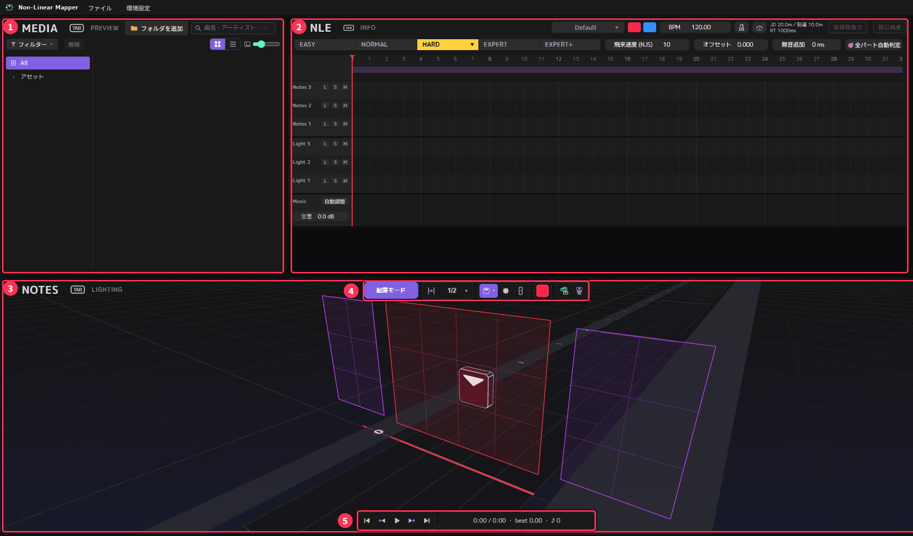

| 番号 | 名前 | 役割 |
|---|---|---|
| ① | **MEDIA / PREVIEW** | MEDIA は曲や素材の一覧です。PREVIEW に切り替えると、Beat Saber に近い見た目のプレビューになります |
| ② | **NLE / INFO** | NLE は時間の流れに沿って譜面や曲を並べるタイムラインです。INFO に切り替えると、曲名や書き出し先を設定する画面になります |
| ③ | **NOTES / LIGHTING** | 3D ビューです。ここでノーツやライトを置きます |
| ④ | ツールバー | 置くもの（ノーツ・ボム・壁）や色・向きを選びます |
| ⑤ | 再生バー | 再生・停止と、現在の時間・拍を表示します |

①〜③の見出しの横にある「TAB」は、**その枠の上にマウスを置いて Tab キーを押すと表示が切り替わる**、という意味です
（例：③の上で Tab を押すと NOTES ⇄ LIGHTING）。「TAB」と切り替え先の名前の所をクリックしても切り替わります。

画面の中に浮かんでいるショートカット一覧の小窓は、右上の ✕ で閉じられます（環境設定からまた表示できます）。
— を押すと、題名（標準操作・NOTES など）だけの1行にたためます（もう一度押すと元に戻ります）。
この先の画像では、見やすさのために閉じています。

---

## 2. 曲を読み込んで BPM を合わせる

### 曲を読み込む

メニューの **ファイル → 音楽ファイルを読み込む…** を選び、曲のファイルを開きます。

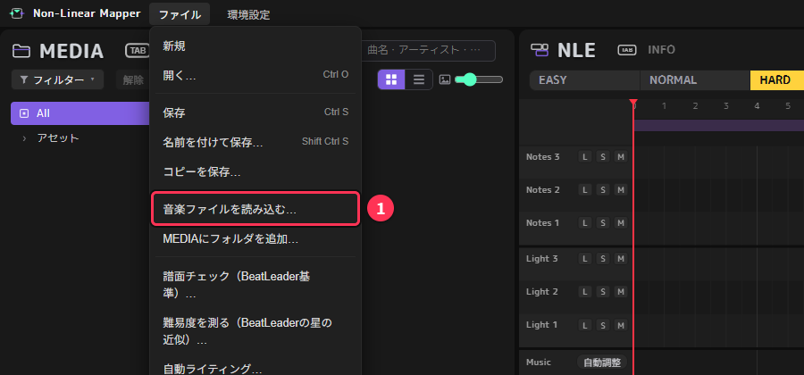

使える形式は ogg / egg / mp3 / wav / flac / m4a などです。
ogg 以外の形式の曲は、書き出すときに ffmpeg で Beat Saber 用の形式（song.egg）に変換します。
ffmpeg を入れていない場合は、README の「ffmpeg」の項を見て先に導入してください。

曲を読み込むと、「曲を解析しますか？」という確認が出ます。

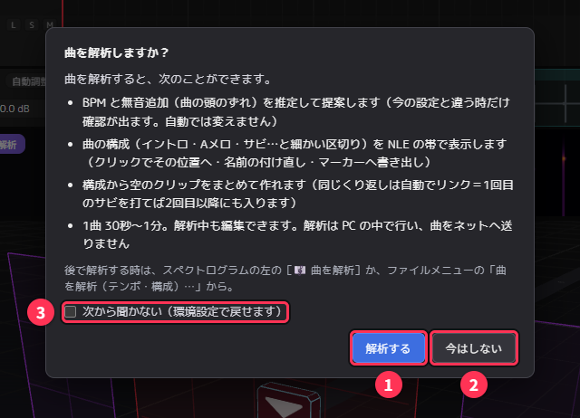

| 番号 | 名前 | 説明 |
|---|---|---|
| ① | 解析する | 曲のテンポ（BPM と無音追加）と構成の解析を始めます（[下の「曲を解析する」](#曲を解析する)） |
| ② | 今はしない | 解析せずに閉じます（Esc でも同じ）。後からいつでも解析できます |
| ③ | 次から聞かない | チェックしてから閉じると、次からこの確認は出ません |

- 解析は PC の中で行い、曲をネットへ送りません。解析している間も編集を続けられます
- 後で解析する時は、スペクトログラムの左の **🎼 曲を解析**（下の画像の⑧）か、メニューの **ファイル → 曲を解析（テンポ・構成）…** を使います
- ③で出さないようにした確認は、**環境設定** の「アプリケーション設定」→「曲の解析」の「曲を読み込んだ時に、解析するか聞く」で戻せます
- プロジェクトを開いた時や、その曲の解析の結果がもうある時は出ません

ここでは **今はしない** を押して、先に画面の見方と BPM の合わせ方を説明します（解析は下の「[曲を解析する](#曲を解析する)」で行います）。

NLE の一番下の **Music** の段には、曲の波形が表示されます。

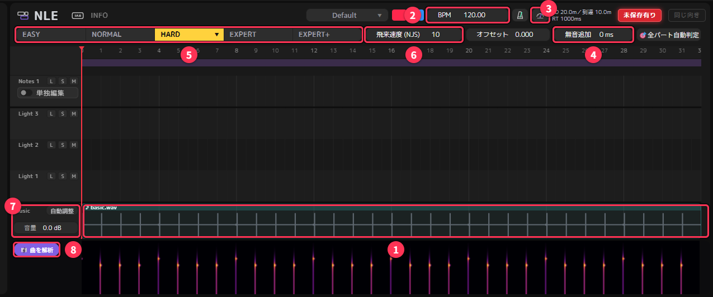

| 番号 | 名前 | 説明 |
|---|---|---|
| ① | Music | 読み込んだ曲の波形。その下の色の帯は周波数の強さ（スペクトログラム）で、曲の盛り上がりが見て分かります |
| ② | BPM | 曲のテンポ。値をクリックすると数字を入力できます |
| ③ | BPM 測定 | 曲を解析して BPM の候補を出します |
| ④ | 無音追加 | 曲の先頭に入れる無音の長さ（ms）。拍の線と曲の頭がずれているときに使います |
| ⑤ | 難易度 | 今どの難易度を編集しているか。クリック、または 1〜5 キーで切り替えます |
| ⑥ | 飛来速度 (NJS) | ノーツが飛んでくる速さ。難易度ごとに別の値を持ちます |
| ⑦ | 音量補正 | 曲の音量（dB）。**自動調整** を押すと、小さい曲をちょうど良い大きさまで上げます。‹ › で自分で変えることもできます |
| ⑧ | 曲を解析 | 曲のテンポ（BPM と無音追加）と構成を解析します（[下の「曲を解析する」](#曲を解析する)）。曲を読み込んで、まだ解析していない時に紫のボタンで出ます |

### BPM を合わせる

音楽ファイルには BPM の情報が入っていないので、自分で設定します。
③の **BPM 測定** ボタンを押すと候補が出るので、合うものを選びます。

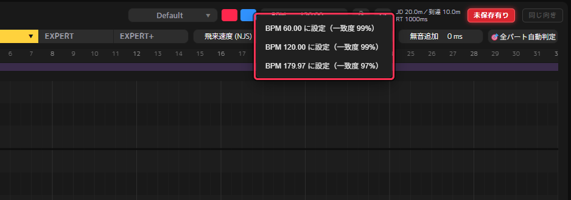

候補には、本当の BPM の半分や 2 倍の値も並びます。曲を聴いて自然なものを選んでください。
BPM が分かっている場合は、②に直接入力しても構いません。

合っているかは、BPM の右にあるメトロノームのボタンを ON にして Space で再生すると、耳で確かめられます。
クリック音と曲の拍が少しずつずれていく場合は BPM が違っています。
最初から一定の量だけずれている場合は、④の **無音追加** で曲の頭をずらして合わせます。

### 曲を解析する

⑧の **🎼 曲を解析**（またはメニューの **ファイル → 曲を解析（テンポ・構成）…**）を押すと、曲のテンポと構成を調べます。
曲を読み込んだ時の確認で **解析する** を押した時も、同じように始まります。
BPM 測定より時間はかかりますが、BPM だけでなく **無音追加の値も提案**します。
1 曲に 30 秒〜1 分ほどかかります。**解析している間も編集を続けられます**。

テンポが分かると、解析した BPM と無音追加が今の設定と違う時だけ、次の確認が出ます。

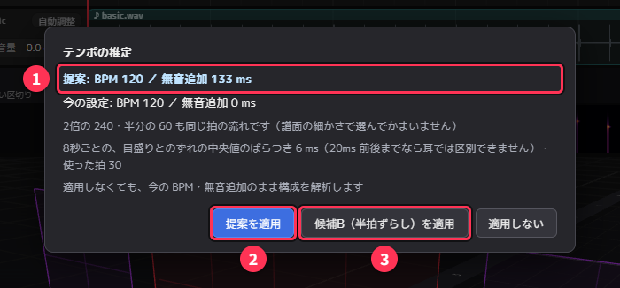

| 番号 | 名前 | 説明 |
|---|---|---|
| ① | 提案 | 解析で見つけた BPM と無音追加。その下に、今の設定と、提案の確かさの目安が出ます |
| ② | 提案を適用 | ①の値を BPM と無音追加に入れます |
| ③ | 候補B（半拍ずらし）を適用 | ①の無音追加を半拍ずらした値を入れます。強い音が拍の裏（半拍ずれた位置）に来る曲では、こちらが合うことがあります |

- **自動では変わりません**。②か③を押した時だけ BPM と無音追加が変わります。**適用しない**（または Esc）を押すと、今の設定のままです
- 適用しても **Ctrl + Z** で戻せます。置いてあるノーツやライトは拍の位置のまま動きません（曲との合い方が変わります）
- 合っているかは、上と同じくメトロノームを ON にして再生し、耳で確かめてください。提案と候補B で迷う時は、両方を試して合う方を選びます
- 解析した値が今の設定と同じ時は、この確認は出ません

続けて、曲の構成（イントロ・サビなどのまとまりと、もっと細かい区切り）を解析します。
解析している間は、スペクトログラムの上に、今の段階（テンポの推定・構成の解析）と進み具合のバーが出ます。途中でやめる時は **やめる** を押します。

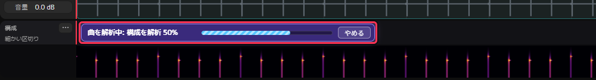

構成の解析が終わると、スペクトログラムの上に構成の帯が出て、「次にやること」の案内が出ます。

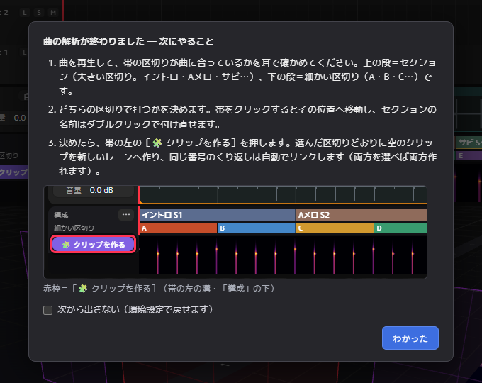

案内に書いてある次の手順は、次のとおりです。

1. 曲を再生して、帯の区切りが曲に合っているかを耳で確かめます（上の段＝セクション：イントロ・Aメロ・サビなどの大きい区切り、下の段＝細かい区切り）
2. どちらの区切りでノーツを打つかを決めます
3. 帯の左の **🧩 クリップを作る** を押し、出てくる画面で区切りを選ぶと、その区切りどおりに空のクリップを新しいレーンへ作ります（同じ番号のくり返しは自動でリンクされます）

- **わかった**（または Esc）で閉じると、帯の左の **🧩 クリップを作る** が少しの間光って、場所を示します。このボタンは、解析の結果がある間はいつも出ています（クリップを作った後は暗い紫になります）
- 「次から出さない」にチェックして閉じると、次から案内は出ません。**環境設定** の「アプリケーション設定」→「曲の解析」の「解析が終わったら、次の手順を案内する」で戻せます

帯の見方と使い方（クリックでその位置へ移動・名前の付け直し・マーカーへの書き出しなど）は
上級編 6 章の [曲を解析する（テンポと構成）](tutorial-advanced.md#6-曲を解析するテンポと構成) を、
クリップの作り方は上級編の [解析からクリップを作る](tutorial-advanced.md#解析からクリップを作る) を見てください。
この先の画像は、解析の帯が無い状態で撮っています。

### 曲の音量を整える

音量が小さい曲は、Beat Saber の中で前後の曲より小さく聞こえます。
⑦の **自動調整** ボタンを押すと、曲の音量を測って、ちょうど良い大きさまで上げます（もう十分に大きい曲はそのままです）。
上げた分は、再生と、書き出す曲（song.egg）の両方に入ります。‹ › で自分で変えることもできます。

音量補正を使うと、ogg の曲でも、書き出すときに ffmpeg で変換します。
詳しくは上級編の [曲の音量（音量補正）](tutorial-advanced.md#曲の音量音量補正) を見てください。

---

## 3. ノーツを置く

### 配置モードの画面

起動した直後の 3D ビューは **配置モード** になっています。
中央の赤い枠が **いまの拍（再生ヘッド）** で、ノーツはこの枠の 4×3 のマスに置きます。

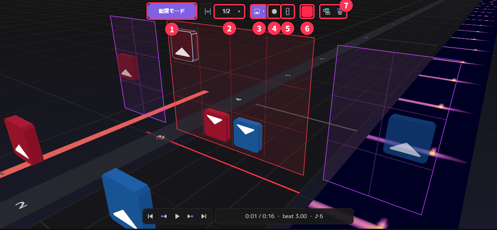

| 番号 | 名前 | 説明 |
|---|---|---|
| ① | モード | 今のモード。Q キーで 配置モード ⇄ カメラ固定モード を切り替えます |
| ② | スナップ | ←/→ キーやホイールで進む拍の細かさ（最初は 1/2 拍）。「,」キーでも変えられます |
| ③ | ノーツ | ノーツを置きます。▾ で切る向きを選べます |
| ④ | ボム | ボムを置きます |
| ⑤ | 壁 | 壁を置きます |
| ⑥ | 色 | 置くノーツの色。F キーで赤 ⇄ 青を切り替えます |
| ⑦ | アーク / チェーン | 選んだノーツからアーク・チェーンを作ります（[4 章](#4-選んで直すアークとチェーン)） |

赤枠の左右にある紫の枠は、赤・青それぞれ直前に置いたノーツを半透明で表示しています。
前のノーツからの振りが無理のない向きになっているかを確かめるのに使います（H キーで表示を切り替え）。

### 置く手順

1. **→ / ← キー**（またはホイール）で、置きたい拍まで進めます
2. **F キー**で色を選びます（Beat Saber と同じく、赤＝左手、青＝右手）
3. ツールバーのノーツボタンの **▾** で切る向きを選びます（**Alt + ホイール** でも回せます）
4. マスにマウスを合わせると、白い枠の半透明のノーツ（置く予定の位置）が表示されます。**左クリック**で置きます

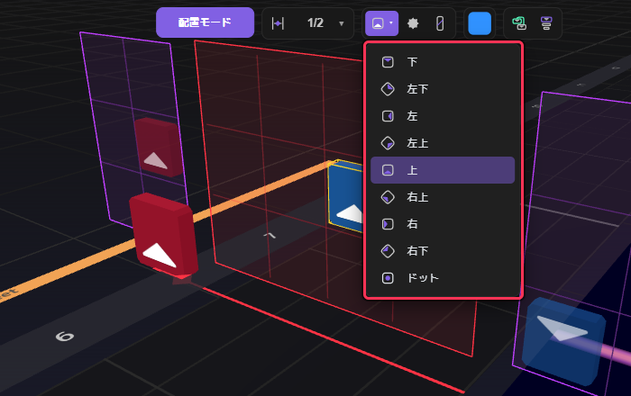

- 間違えたら **右クリック**で消せます。**Ctrl + Z** で元に戻せます（**Shift + Ctrl + Z** でやり直し）
- 同じ拍の同じマスに置くと、色と向きが上書きされます
- 再生しながら（Space）置くこともできます

置いていくと、NLE の **Notes 1** の段に「Sheet」という色付きの帯（クリップ）が 1 小節ごとに自動でできます。
置いたノーツはこのクリップに入ります。クリップはあとから移動・コピー・分割ができますが、
最初のうちは気にしなくて大丈夫です。

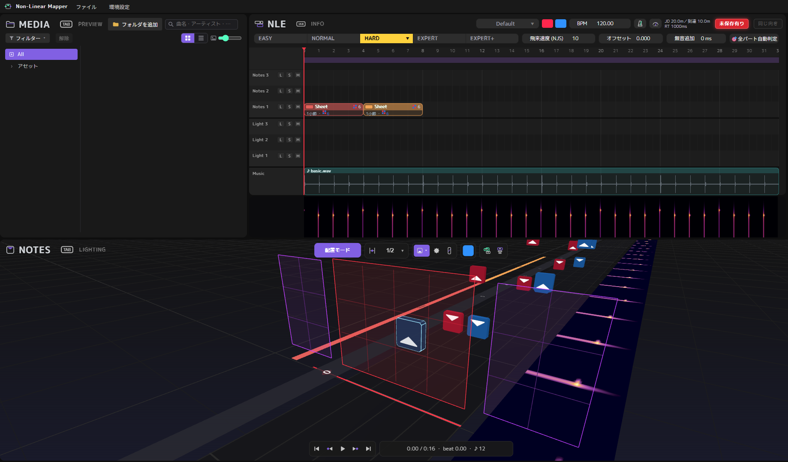

新しい譜面の NLE は、ノーツのレーン（段）が **Notes 1** の 1 本、ライトのレーンが **Light 1〜3** の 3 本から始まります。
MEDIA からクリップを落とした時や、クリップを貼り付けた時に、その時間に空いているレーンが無ければ、一番上にレーンが自動で足されます。
最初からノーツのレーンを増やしておきたい時は、**環境設定** の「ノーツのレーンの本数」で変えられます
（レーンの足し方・消し方は、上級編 3 章の [レーンを増やす・ロック・ソロ・ミュート](tutorial-advanced.md#レーンを増やすロックソロミュート) を参照）。

---

## 4. 選んで直す・アークとチェーン

### カメラ固定モードで選ぶ

置いたノーツを選んで直すときは、**Q キー**で **カメラ固定モード** に切り替えます。
譜面を横から見下ろす表示になり、ノーツをクリックして選べるようになります。

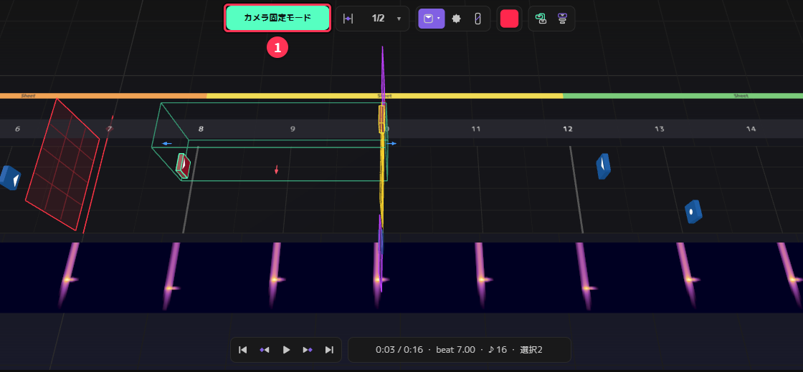

- **左クリック**：選ぶ。**Shift + 左クリック**：選んだものに追加する
- 何もないところから **左ドラッグ**：四角で囲んだものをまとめて選ぶ
- 選んだものは、表示される矢印をドラッグすると動かせます
- **X / Delete**：消す。**A**：選択を解除する
- 選んだノーツにマウスを合わせて **F**・**Alt + ホイール**：選んだノーツ全部の色・向きをまとめて変える
- 視点は **中ドラッグ**で回転、**Shift + 中ドラッグ**で平行移動、**Ctrl + ホイール**で拡大縮小します

### アークとチェーン

**同じ色のノーツを 2 つ以上**選んでから、

- **Ctrl + R** → **アーク**（ノーツとノーツをつなぐ線）。元のノーツは残ります
- **C**（または Ctrl + T）→ **チェーン**（細かく刻むノーツの列）。元の 2 つのノーツが頭と尾になります

ツールバー右端の 2 つのボタンでも同じことができます。

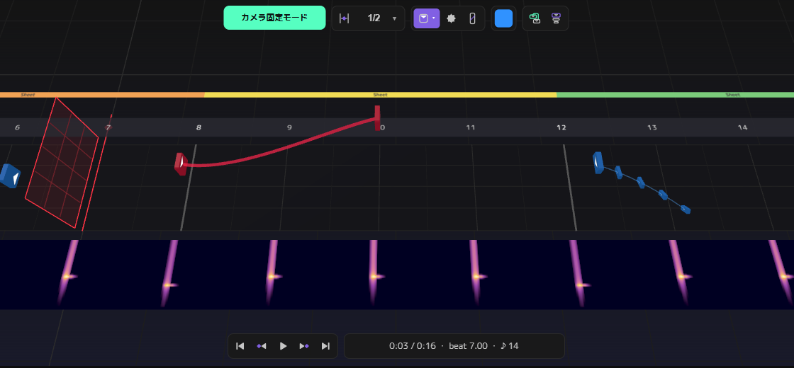

アークの曲がり具合やチェーンの分割数は、選んだ状態でホイールを使って変えられます
（組み合わせるキーは画面のショートカット一覧、または原作マニュアルの NOTES の項を参照）。

アークは、両端のノーツとつながったまま動きます。

- アークの端のノーツをクリックすると、ノーツが選ばれます。そのノーツを動かすと、アークの端もついてきます。ノーツの向きを変えると、アークの端の向きもそろいます
- アークを選ぶ時は、線の真ん中あたりをクリックします。アークを動かすと、両端のノーツも一緒に動きます
- アークの端だけを動かしたい時は、アークを選んだ時に頭と尾に出る小さい矢印を使います（大きい矢印はアーク全体の移動）

---

## 5. ボムと壁

配置モードでツールバーの **ボム**（①）または **壁**（②）を選んでから置きます。
**W キー**を押すと、選択 / ノーツ / ボム / 壁 を選ぶ円形のメニュー（パイメニュー）も出ます。

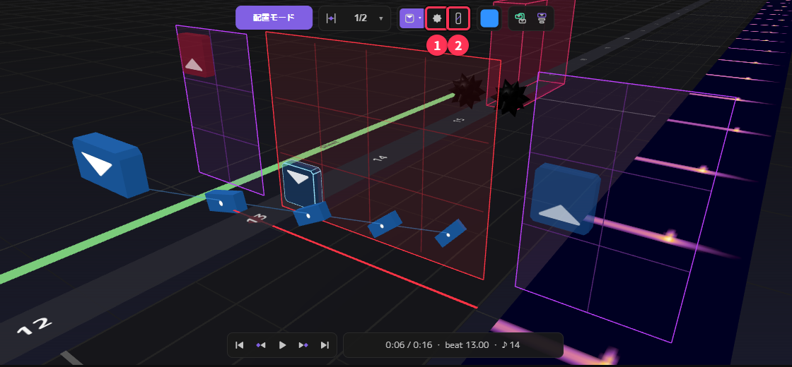

- **ボム**：ノーツと同じく、マスをクリックして置きます
- **壁**：クリックを 4 回して形を決めます
  1. 始まりのマスをクリック
  2. マウスを動かして横幅を決めてクリック
  3. 高さを決めてクリック
  4. 奥行き（長さ）を決めてクリック
  途中でやめるときは右クリックか Esc を押します

置いた後の壁の大きさは、カメラ固定モードで壁を選んで **S キー**を押すと変えられます。

---

## 6. ライティング

3D ビューの上にマウスを置いて **Tab キー**を押すと、**LIGHTING**（ライト編集）に切り替わります（①）。
ライトの種類ごとに 10 本のレーン（RING ZOOM、CENTER、L LASER など）が並んでいます。

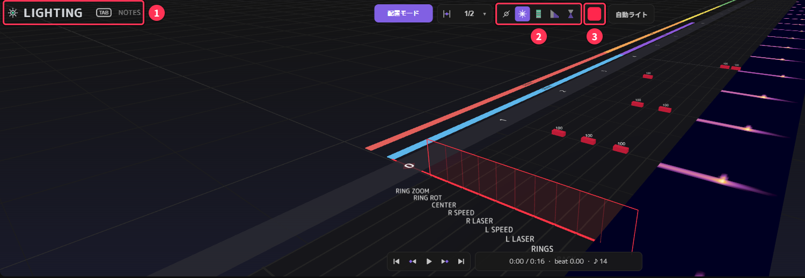

1. ②で動き（消灯 / 点灯 / フラッシュ / フェード / トランジション）を選びます
2. ③の色ボックスで色を選びます（3D ビューの上で **1・2・3 キー**でも選べます：①・②・白。このとき数字キーで難易度は切り替わりません）
3. ノーツと同じように、置きたい拍まで進めて、レーンを**左クリック**します（右クリックで消去）

置いたライトは、NLE の **Light 1** の段にクリップとしてまとまります。
もう一度 Tab キーを押すと NOTES に戻ります。

ライトは無くても譜面として遊べます。まずはノーツだけ作り、あとから足しても構いません。

---

## 7. プレビューで確認する

左上の枠の上にマウスを置いて **Tab キー**を押すと、**PREVIEW** に切り替わります（①）。
Beat Saber に近い見た目で、ノーツやライトを確認できます。

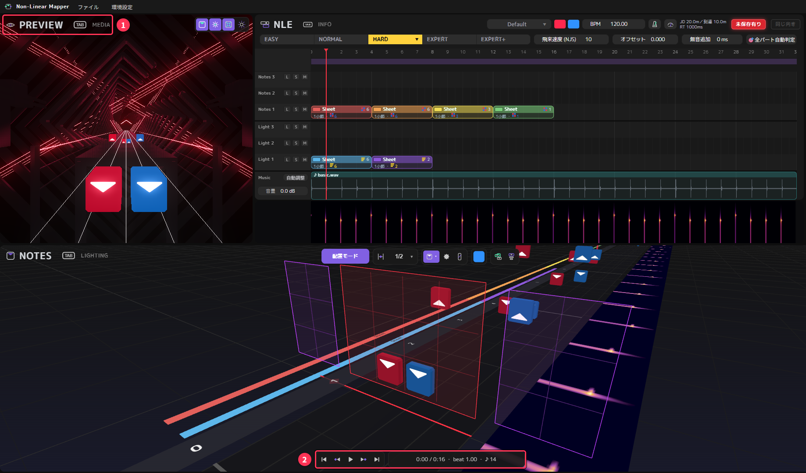

**Space**（または②の再生ボタン）で再生・停止します。
PREVIEW 右上のボタンで、ノーツ・ライト・ステージの表示を切り替えられます（右端のボタンは、ステージを明るくして動きを見やすくします）。
ステージ（背景）は NLE の右上にある「Default」の欄で選びます。

---

## 8. 曲の情報を入れて書き出す

NLE の上にマウスを置いて **Tab キー**を押すと、**INFO** 画面に切り替わります。
曲名や書き出し先はここで設定します。

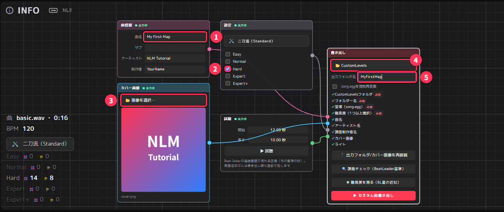

| 番号 | 場所 | 設定すること |
|---|---|---|
| ① | 曲情報 | 曲名・サブタイトル・アーティスト・制作者（あなたの名前）を入力します |
| ② | 設定 | 難易度に **1 つ以上チェック**を入れます（この例では Hard）。チェックが 1 つも無いと書き出せません。 実際に書き出されるのは、チェックに関係なく **ノーツやライトなどが入っている難易度すべて**です |
| ③ | カバー画像 | 選曲画面に出るジャケット画像を選びます（無くても書き出せます） |
| ④ | 書き出し | **出力フォルダを選択** で、Beat Saber の **CustomLevels フォルダ**を選びます |
| ⑤ | 出力フォルダ名 | CustomLevels の中に作るフォルダの名前です（半角英数字） |

CustomLevels フォルダは、Beat Saber をインストールしたフォルダの中の `Beat Saber_Data\CustomLevels` です。

「試聴」のノードは、選曲画面で流れる部分（開始位置と長さ、秒）の設定です。▶ 試聴 で確認できます。

各ノードの間の線は、どの設定を書き出しに使うかを表しています。最初から全部つながっているので、そのままで大丈夫です。

### 書き出す

書き出しノードのチェック一覧で、「必須」の項目すべてに ✓ が付いていれば準備完了です。
**▶ カスタム曲書き出し** を押します。

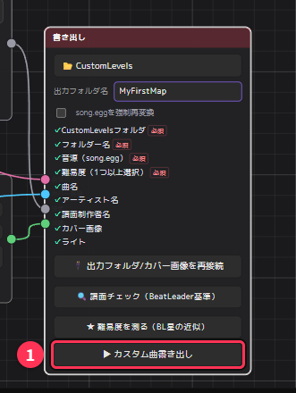

CustomLevels の中の⑤の名前のフォルダに、次のファイルが作られます。

- `Info.dat`（曲の情報）
- `HardStandard.dat` など（中身のある難易度ごとの譜面）
- `song.egg`（曲）
- カバー画像

Beat Saber を起動すると、カスタム曲の一覧に表示されます。

譜面を直したら、もう一度 **▶ カスタム曲書き出し** を押せば上書きされます。
曲を差し替えていなければ、2 回目からは曲の変換を省くので早く終わります。

---

## 9. プロジェクトを保存する

書き出したファイルは Beat Saber 用なので、後から編集を続けるには **プロジェクトファイル（`.nlmf`）** を保存しておきます。

**Ctrl + S**（または ファイル → 保存）で保存します。初めて保存するときは、保存先とファイル名を聞かれます。

保存していない変更があると、NLE 右上の **「未保存有り」** が赤く点灯します（再生位置を動かしたり NLE をズームしたりしただけでは点灯しません）。

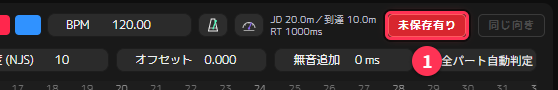

保存すると消灯します。

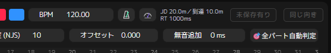

未保存のまま閉じたり、新規・開くを選んだりすると、「保存して終了（続行）／保存せずに終了（続行）／キャンセル」を選ぶ確認が出ます。

続きを編集するときは、**ファイル → 開く…**（Ctrl + O）で `.nlmf` を開きます。`.nlmf` をダブルクリックしても開けます。
曲・出力フォルダ・カバー画像は前回の場所から自動で読み込まれます。
再生位置と NLE のズーム・表示位置も、保存した時の状態に戻ります。
ファイルを移動した場合は、INFO の書き出しノードにある「出力フォルダ/カバー画像を再接続」で選び直してください。

---

## 10. この先の機能

慣れてきたら、次の機能も使ってみてください。詳しくは [上級編チュートリアル](tutorial-advanced.md) で説明しています
（作業を速くする操作、NLE の使いこなし、MEDIA ライブラリ、難易度の作り分け、曲の解析、公開前のチェック、★の測定など）。

- **NLE でのクリップ編集**：クリップを移動・コピー・分割（C キー）・結合（Ctrl + G）して、サビのくり返しなどを効率よく作れます
- **リンクしたクリップ**：サビのくり返しなど、同じ中身にしたいクリップをリンクしておくと、親のクリップを直すだけで、リンクした他のクリップ（子）も同じ中身になります（子は直接は編集できません）。
  別の難易度のクリップともリンクできます。NLE でクリップを 2 つ以上選んで **K** キー（または右クリック →「リンクする」）でリンクします
  （上級編 3 章の [リンクしたクリップ](tutorial-advanced.md#リンクしたクリップ) を参照）
- **単独編集**：ノーツのレーンを 1 つだけ編集できるようにします。レーンの左の「単独編集」のスイッチ（または、NLE でレーンの上にマウスを置いて **E** キー）でオンにすると、
  3D ビューで置いたノーツはそのレーンにだけ入り、他のレーンのノーツは選んだり消したりできなくなります（上級編 3 章の [単独編集](tutorial-advanced.md#単独編集) を参照）
- **アセット**：よく使う配置パターンのクリップを右クリック →「アセットへ保存」しておき、MEDIA から別の場所・別の曲へドラッグして使えます
- **難易度間のコピー**：選択中の難易度をもう一度クリックすると、ノーツやライトを別の難易度へ転送するメニューが出ます。
  「ノーツを転送」はノーツだけ、「ライティングを転送」はライトだけを写します（両方なら「丸ごと転送」）。どの転送も **Ctrl + Z** の 1 回で元に戻せます。
  コピーした先のクリップは、既定ではコピー元のクリップにリンクされます（「親の難易度に繋ぐ」。上級編 4 章の [難易度をまとめて作る](tutorial-advanced.md#4-難易度をまとめて作る) を参照）
- **MEDIA ライブラリ**：ファイルメニューの **MEDIAにフォルダを追加…** で CustomLevels などを登録すると、曲の一覧（詳細表示では 1 行＝1 難易度）を並べ替え・検索・絞り込み（★・NPS・プレイ記録など）でき、素材として NLE へドラッグすることもできます。
  exe 版では、登録したフォルダが次回も残ります（上級編 3 章の [MEDIA ライブラリ](tutorial-advanced.md#media-ライブラリ曲のフォルダを記録して一覧検索する) を参照）
- **テンポパート**：曲の途中で BPM が変わる曲に対応します（NLE の「全パート自動判定」）
- **曲を解析（構成の帯）**：2 章の **曲を解析** では、テンポのほかに曲の構成（イントロ・サビなどのまとまり）も解析し、スペクトログラムの上に帯で表示します。
  帯をクリックしてその位置へ移動したり、まとまりの頭にマーカーを置いたりできます（上級編 6 章の [曲を解析する（テンポと構成）](tutorial-advanced.md#6-曲を解析するテンポと構成) を参照）。
  帯の左の **🧩 クリップを作る** を押すと、帯の区切りどおりに NLE の空のクリップを作ることもできます（同じまとまりのくり返しは自動でリンク。上級編の [解析からクリップを作る](tutorial-advanced.md#解析からクリップを作る) を参照）
- **マーカー**：Ctrl + E で目印を置き、Ctrl + [ / ] で行き来できます
